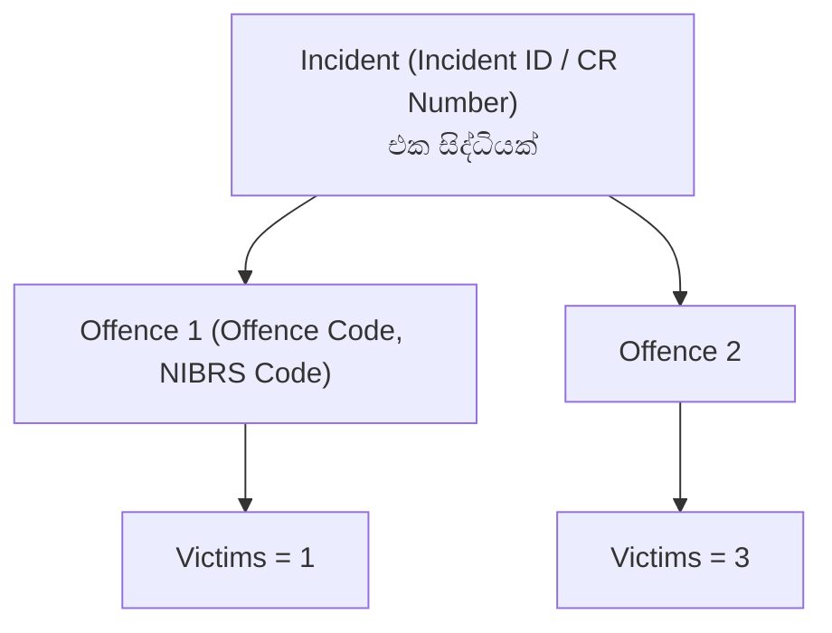
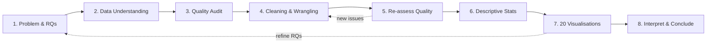

# CI7340 – Applied Data Programming
# Research Report and Visualisation (Coursework 1)
## සම්පූර්ණ සිංහල මාර්ගෝපදේශය + නිවැරදිව කරන හැටි

> [!WARNING]
> **Deadline: 17/11/2026, 23:59 (UK වෙලාවෙන්)**
> - Deadline එකෙන් පස්සේ **පැය 24ක් ඇතුළත** submit කළොත් penalty නැතුව mark කරනවා.
> - පැය 24කට පස්සේ, වැඩ දවස් 5ක් ඇතුළත submit කළොත් උපරිම mark එක **50%** යි.
> - වැඩ දවස් 5කට පස්සේ **0%** යි.
> - UK වෙලාව ලංකාවේ වෙලාවට වඩා **පැය 5½ක්** පිටිපස්සෙන් තියෙන්නේ (නොවැම්බර් මාසයේ GMT). ඒ කියන්නේ UK 23:59 = ලංකාවේ **පසුදා උදේ 05:29**. Canvas එකේ පෙන්වන deadline එකත් බලලා confirm කරගන්න.

---

## පටුන
1. [Assignment එක එක පිටුවකින්](#1-assignment-එක-එක-පිටුවකින්)
2. [Domain එක තේරුම් ගැනීම (Crime data, NIBRS, UCR)](#2-domain-එක-තේරුම්-ගැනීම)
3. [Marks බෙදීම සහ Distinction එකක් ගන්න ඕන දේ](#3-marks-බෙදීම-සහ-distinction-එකක්-ගන්න-ඕන-දේ)
4. [නිවැරදි Workflow එක (පියවරෙන් පියවර)](#4-නිවැරදි-workflow-එක)
5. [Group එකේ වැඩ බෙදාගැනීම](#5-group-එකේ-වැඩ-බෙදාගැනීම)
6. [Environment Setup](#6-environment-setup)
7. [කොටස් එකින් එක: ලියන හැටි](#7-කොටස්-එකින්-එක-ලියන-හැටි)
8. [හොඳ Research Questions හදන හැටි](#8-හොඳ-research-questions-හදන-හැටි)
9. [Visualisation නීති සහ Chart තෝරගැනීම](#9-visualisation-නීති-සහ-chart-තෝරගැනීම)
10. [Graph එකක් Interpret කරන හැටි](#10-graph-එකක්-interpret-කරන-හැටි)
11. [Word Budget එක](#11-word-budget-එක)
12. [නිතර කරන වැරදි](#12-නිතර-කරන-වැරදි)
13. [References (IEEE)](#13-references-ieee)
14. [Generative AI නීති සහ Declaration එක](#14-generative-ai-නීති-සහ-declaration-එක)
15. [අවසාන Checklist එක](#15-අවසාන-checklist-එක)

---

## 1. Assignment එක එක පිටුවකින්

| විස්තරය | |
|---|---|
| Module | CI7340 – Applied Data Programming (Kingston University) |
| Assessment එක | Research Report and Visualisation, group coursework (summative) |
| Module grade එකට බර | **40%** |
| Group size | සාමාජිකයෝ 3–4. **ඉස්සෙල්ලාම module leader ලවා approve කරගන්න ඕන** |
| Marks | Group එකේ හැමෝටම මුලින් **එකම mark එක** |
| Word limit | වචන 4000–5000 (±10%, ඒ කියන්නේ ආසන්න වශයෙන් 3600–5500) |
| Referencing | **IEEE** |
| Submission | Canvas හරහා **එක PDF එකක්** (හොඳම) හෝ Word. වෙන format accept කරන්නේ නැහැ |
| Template | Coursework template එකක් දීලා තියෙනවා. Canvas එකේ හොයාගන්න |
| Lecturer | Dr Farzana Rahman (SB3004, farzana@kingston.ac.uk) |

### Dataset එක
- File එක: `dataset_coursework1.csv` (~185 MB)
- Rows: **~508,000**, Columns: **30**
- කාල සීමාව: **2016 July 1 – 2026 Sept 10**
- අන්තර්ගතය: Montgomery County (Maryland, USA) පොලිසියට (MCPD) වාර්තා වුණු සහ තහවුරු කරපු ("founded") අපරාධ

### කරන්න ඕන දේ සරලව
> [!IMPORTANT]
> 1. Dataset එක **technically පැහැදිලි කරලා**, **problem statement** එකකුයි **scope** එකකුයි ලියන්න.
> 2. Data quality එක (missing values, inconsistencies, noise) **පරීක්ෂා කරලා**, missing data handle කරන ක්‍රම **සංසන්දනය කරලා**, **Python** වලින් ඒවා කරලා පෙන්වන්න.
> 3. Cleaning/transformation කළේ ඇයි කියලා **justify කරලා**, records **කීයකට / කීයෙන් % කට බලපෑවද** කියලා අංක වලින්ම කියන්න.
> 4. **Research questions 10ක්** හදලා, එක ප්‍රශ්නයකට **graphs 2** ගානේ **graphs 20ක්** දාලා, ඒවා **interpret** කරන්න.
> 5. Workflow එක figures/tables වලින් පෙන්වලා, **conclusions** සහ **references** දාන්න.

---

## 2. Domain එක තේරුම් ගැනීම

මේ dataset එක හරියට තේරුම් ගන්නේ නැතුව analysis කළොත් **වැරදි නිගමන** එනවා. Distinction marking criteria එකේ විශේෂයෙන්ම ඉල්ලන්නේ *"critically explains incident, offence and victim distinctions"* කියලා.

### 2.1 Source එක
- **dataMontgomery** (Montgomery County open data portal) එකේ "Crime" dataset එක. MCPD එකේ records management system එකෙන් තමයි මේ data එන්නේ.
- අපරාධ වර්ගීකරණය කරලා තියෙන්නේ FBI එකේ **CJIS Division** එකට අයිති **UCR (Uniform Crime Reporting) Program** එකේ **NIBRS (National Incident-Based Reporting System)** ප්‍රමිතියට අනුව.
- Portal එකේ dataset එක දිනපතා update වෙනවා. Investigation එකක් ඉස්සරහට යද්දී record එකක් **reclassify** වෙන්න හරි **අයින්** වෙන්න හරි පුළුවන්. Brief එකත් කියනවා මේ reports *"preliminary information"* මත පදනම් වෙලා තියෙන්නේ කියලා. මේක **limitation** එකක් විදියට ලියන්න.

### 2.2 Incident vs Offence vs Victim (ඉතාම වැදගත්)



- **Incident** එකක් කියන්නේ පොලිසියට වාර්තා වුණු **එක සිද්ධියක්**. උදා: එක ගෙයක් කඩලා බඩු හොරකම් කරලා, ගෙදර අයටත් පහර දුන්නා.
- ඒ incident එක ඇතුළේ **offences කීපයක්** තියෙන්න පුළුවන්. උදා: Burglary + Assault.
- එක offence එකකට **victims කීප දෙනෙක්** ඉන්න පුළුවන්.
- ඒ නිසා **CSV එකේ row එකක් = incident එකක් නෙවෙයි.** Row එකක් ආසන්න වශයෙන් **incident–offence** එකකට සමානයි.

> [!CAUTION]
> "අපරාධ කීයක් වුණාද?" කියලා ගණන් කරද්දී **rows ගණන් කරනවද** (offences), **unique `Incident ID` ගණන් කරනවද** (incidents), නැත්නම් **`Victims` එකතුව ගන්නවද** (victims) කියලා report එකේ **පැහැදිලිවම කියන්න**. මේ තුනෙන් එන උත්තර තුන වෙනස්. Report එක පුරාම එකම ක්‍රමය පාවිච්චි කරන්න.

### 2.3 Columns 30 සහ ඒවායේ තේරුම

| Group | Column | තේරුම | Data type (අපේක්ෂිත) |
|---|---|---|---|
| ID | `Incident ID` | Incident එකේ unique අංකය | Identifier (string ලෙස තියාගන්න) |
| ID | `Offence Code` | Offence එකේ code එක | Categorical |
| ID | `CR Number` | Central Report (case file) අංකය | Identifier |
| කාලය | `Dispatch Date / Time` | පොලිසිය dispatch කරපු වෙලාව | Datetime (string එකක් විදියට load වෙනවා) |
| කාලය | `Start_Date_Time` | අපරාධය පටන් ගත්ත වෙලාව | Datetime |
| කාලය | `End_Date_Time` | අපරාධය ඉවර වුණු වෙලාව (බොහෝ විට හිස්) | Datetime |
| වර්ගය | `NIBRS Code` | FBI NIBRS code එක (උදා: 90Z, 290) | Categorical |
| Victims | `Victims` | ඒ offence එකේ victims ගණන | Integer (discrete) |
| වර්ගය | `Crime Name1` | ප්‍රධාන වර්ගය: Crime Against Person / Property / Society | Categorical (nominal) |
| වර්ගය | `Crime Name2` | NIBRS offence category එක (උදා: Destruction/Damage/Vandalism) | Categorical |
| වර්ගය | `Crime Name3` | විස්තරාත්මක local description එක | Categorical (high-cardinality) |
| ස්ථානය | `Police District Name` | Police district එක (උදා: Silver Spring, Germantown) | Categorical |
| ස්ථානය | `Block Address` | Block මට්ටමේ ලිපිනය (privacy නිසා generalise කරලා තියෙන්නේ) | Text |
| ස්ථානය | `City`, `State`, `Zip Code` | නගරය, ප්‍රාන්තය (MD), zip code එක | Categorical (Zip එක **string** ලෙස තියාගන්න) |
| ස්ථානය | `Agency` | වාර්තා කරපු agency එක (MCPD, වෙනත්) | Categorical |
| ස්ථානය | `Place` | ස්ථාන වර්ගය (Residence, Retail, Street…) | Categorical |
| ස්ථානය | `Sector`, `Beat`, `PRA` | පොලිසියේ අභ්‍යන්තර භූගෝලීය කොටස් | Categorical |
| ලිපිනය | `Address Number`, `Street Prefix/Name/Suffix/Type` | ලිපිනයේ කොටස් | Text / Categorical |
| Geo | `Latitude`, `Longitude` | ඛණ්ඩාංක | Float |
| Geo | `Police District Number` | District code එක (උදා: 3D) | Categorical |
| Geo | `Location` | "(lat, long)" string එක, Lat/Long එකේම **redundant** copy එකක් | Text |

> [!TIP]
> **Redundancy** ගැනත් සඳහන් කරන්න: `Location` ↔ `Latitude`/`Longitude`, `Police District Number` ↔ `Police District Name`, `Block Address` ↔ Street කොටස්. Analysis එකට අවශ්‍ය නැති columns අයින් කරන එක **dimensionality reduction** එකක්. ඒක learning outcome එකකටත් ගැලපෙනවා.

---

## 3. Marks බෙදීම සහ Distinction එකක් ගන්න ඕන දේ

| # | කොටස | Marks | Distinction (70+) එකක් ගන්න ඕන දේ (marking criteria එකෙන්) |
|---|---|---|---|
| 1 | **Introduction** | 10* | නිශ්චිත problem සහ scope; **incisive, feasible** ප්‍රශ්න 10ක්; ඒත්තු ගන්වන rationale එකක්; හොඳට support කරපු workflow එකක් |
| 2 | **Dataset description** | 10* | Provenance, format, columns, types නිවැරදිව විස්තරාත්මකව; **incident/offence/victim වෙනස critically** පැහැදිලි කරන එක |
| 3 | **Initial data quality** | 15 | Thorough audit එකක්; **Python වලින් ක්‍රම සංසන්දනය** කරන එක; justified cleaning; **බලපෑම සහ limitations පැහැදිලිව evidence** කරන එක |
| 4 | **Introduction to EDA** | 15 | Critical, coherent EDA strategy එකක්; quality සහ transformation අවශ්‍යතා **නැවත assess** කරන එක; approaches සහ alternatives **rigorously justify** කරන එක |
| 5 | **Descriptive statistics** | 5 | නිවැරදි summaries; ඒවා **ඇයි ගැලපෙන්නේ** කියලා ප්‍රශ්න වලට සම්බන්ධ කරලා critically පැහැදිලි කරන එක |
| 6 | **Data visualisation** ⭐ | **40** | **Graphs 20ම** නිවැරදියි සහ effective; chart තේරීම් **critically justify** කරලා; interpretations **insightful** |
| 7 | **Conclusion & References** | 5 | කෙටි, critical synthesis එකක්; limitations පැහැදිලියි; sources **consistently** cite කරලා |
| | **එකතුව** | **100** | |

> [!NOTE]
> \*Brief එකේ marks වල පටලැවිල්ලක් තියෙනවා. එක table එකක Introduction එකට **10** යි, Dataset description එකට **10** යි. Marking criteria table එකේ ඒවා **20** සහ **5** විදියට තියෙන්නේ. Lecturer ගෙන් confirm කරගන්න. කොහොම වුණත් කොටස් දෙකම හොඳට කරන්න.

> [!TIP]
> **Marks 100න් 60ක්ම EDA වලට** (15 + 5 + 40). Graphs 20 සහ ඒවා interpret කරන එක තමයි assignment එකේ හදවත. කාලය බෙදාගද්දී මේක මතක තියාගන්න.

---

## 4. නිවැරදි Workflow එක

Data science project වල පාවිච්චි කරන **CRISP-DM** වගේ ක්‍රමවේදයක් අනුගමනය කරන එක හොඳ පුරුද්දක්. Report එකේ Introduction එකට මේ වගේ diagram එකක් දාන්න පුළුවන්. ඒත් **ඔයාලගේම** pipeline එකට ගැලපෙන්න හදාගන්න.



### පියවර විස්තර

| පියවර | කරන දේ | Output එක |
|---|---|---|
| **1. Business/Problem understanding** | Stakeholder කවුද (local government, police)? ඔවුන්ට දැනගන්න ඕන මොනවද? | Problem statement, scope, RQ draft |
| **2. Data understanding** | `df.shape`, `df.info()`, `df.head()`, `df.nunique()` | Column table, data types |
| **3. Quality audit** | Missing, duplicates, invalid values, inconsistencies, outliers | Quality issue table එකක් (% සමඟ) |
| **4. Cleaning & wrangling** | Type conversion, standardise කරන එක, missing handle කරන එක, අලුත් features හදන එක | Clean analytical dataset එක |
| **5. Re-assessment** | Clean කළාට පස්සේ **ආයේ check කරන්න**. Before/after table එකක් දාන්න | EDA introduction එකට evidence |
| **6. Descriptive stats** | Counts, %, mean/median, IQR, crosstabs | Summary tables |
| **7. Visualisation** | RQ එකකට graphs 2 බැගින් | Figures 20 |
| **8. Interpretation** | Findings, recommendations, limitations | Conclusion එක |

> [!IMPORTANT]
> Workflow එක **iterative** (නැවත නැවත කරන එකක්). EDA කරද්දී අලුත් quality issues හම්බවුණොත් ආපහු cleaning එකට යන්න. මේක report එකේ ලිව්වොත් EDA කොටසේ *"reassesses quality"* කියන criterion එකට marks ලැබෙනවා.

---

## 5. Group එකේ වැඩ බෙදාගැනීම

**සාමාජිකයෝ 4ක් ඉන්නවා නම් යෝජනාවක්:**

| සාමාජිකයා | ප්‍රධාන වගකීම | Graphs |
|---|---|---|
| A | Introduction, Dataset description, workflow diagram, report එක එකතු කරලා format කරන එක | RQ 1–2 |
| B | Data quality audit, cleaning code, missing-data comparison | RQ 3–4 |
| C | EDA introduction, transformations, descriptive statistics | RQ 5–7 |
| D | Visualisation style guide එක, conclusion, references, GAI declaration | RQ 8–10 |

**වැඩ කරන හැටි:**
- **එකම cleaned dataset එකක්** පාවිච්චි කරන්න. B cleaning notebook එක ඉවර කරලා `cleaned.parquet` (හෝ CSV) එකක් save කරනවා. අනිත් හැමෝම ඒක load කරනවා. නැත්නම් එක එක්කෙනාගේ අංක එකිනෙකට ගැලපෙන්නේ නැති වෙනවා.
- **එකම chart style එකක්** පාවිච්චි කරන්න (එකම colour palette, font size, figure size). එතකොට report එක එක කෙනෙක් ලිව්වා වගේ ඒකාකාරී විදියට පේනවා.
- Shared Google Doc/Word එකක ලියලා අන්තිමට template එකට දාන්න.
- Counting unit එක (rows / incidents / victims) **group එකක් විදියට එක පාරක් තීරණය කරන්න**.

---

## 6. Environment Setup

මේ machine එකේ `pandas` install කරලා නැහැ. Install කරගන්න:

```bash
pip install pandas numpy matplotlib seaborn missingno jupyter pyarrow
# optional: map වලට
pip install folium geopandas
```

**Load කරද්දී tips (file එක ~185 MB, rows ~508k):**
- `pd.read_csv(path, low_memory=False)`: mixed types warning එක නවත්තන්න
- ID සහ Zip Code columns `dtype=str` විදියට load කරන්න. නැත්නම් මුලින් තියෙන 0 නැති වෙන්න පුළුවන්
- Date parse කරද්දී format එක දෙන්න (`format="%m/%d/%Y %I:%M:%S %p"`). එතකොට ගොඩක් වේගවත්, warnings එන්නෙත් නැහැ
- Low-cardinality text columns `category` dtype එකට හරවලා memory ඉතුරු කරගන්න
- Clean කරපු data එක **Parquet** විදියට save කරන්න. ඊළඟ පාර load කරන්න තත්පර කීපයයි යන්නේ

> [!NOTE]
> Brief එක Jupyter Notebook පාවිච්චි කරන්න ඉඩ දෙනවා. හැබැයි ඒක **report එක වෙනුවට submit කරන්න බෑ**. වැදගත් code snippets සහ outputs report එකට screenshot එකක් හරි code block එකක් හරි විදියට දාන්න (විශේෂයෙන්ම data quality කොටසට, එතන *"demonstrate Python implementations"* කියලා ඉල්ලනවා).

---

## 7. කොටස් එකින් එක: ලියන හැටි

### 7.0 Title page
- Report title එක
- **හැම සාමාජිකයෙක්ගෙම නම + KU ID**
- Module code/name, date
- (Template එකේ ඉල්ලනවා නම්) Contents page එක

---

### 7.1 Introduction

**ලියන්න ඕන දේවල්:**
1. **Context:** Crime data analysis වැදගත් ඇයි? (Resource allocation, prevention, public safety). Reference 1–2ක් දාන්න.
2. **Dataset intro (කෙටියෙන්):** Montgomery County, NIBRS, 2016–2026, records ~508k.
3. **Problem statement:** නිශ්චිත, මනින්න පුළුවන් එකක්.
4. **Scope:** මොනවද ඇතුළත්, මොනවද එළියේ, ඇයි? (උදා: 2016 සහ 2026 අසම්පූර්ණ අවුරුදු නිසා annual trends වලින් අයින් කරනවද? Non-MCPD agencies තියාගන්නවද?)
5. **Proposed approach:** Python stack එක (pandas, matplotlib, seaborn), workflow එක.
6. **Research questions 10** (numbered list එකක්. RQ1, RQ2… විදියට).
7. **Methods → outputs → problem** කියන සම්බන්ධය: "RQ1–3 temporal patterns ගැන, ඒවායින් patrol scheduling වලට උදව් වෙනවා…" වගේ.
8. **Workflow figure** එක.

**Problem statement එකක ව්‍යුහය (template):**
> *"[Stakeholder] needs to understand [what aspect of crime] in order to [decision/action]. This report uses [method] on [data scope] to identify [patterns], answering ten research questions grouped into [themes]."*

> [!TIP]
> Research questions **themes වලට group කරන්න** (උදා: Temporal / Spatial / Crime-type / Operational). එතකොට flow එක පැහැදිලියි, Distinction criterion එකේ තියෙන *"compelling rationale"* එකටත් ගැලපෙනවා.

---

### 7.2 Preliminary Data Analysis: Dataset Description

**ලියන්න ඕන දේවල්:**
- **Source සහ provenance:** කවුද හැදුවේ (MCPD), මොන standard එකටද (NIBRS/UCR), කොහොමද update වෙන්නේ, "founded" crime කියන්නේ මොකක්ද
- **File format:** CSV, delimiter එක comma, header row එකක් තියෙනවා, quoted fields, encoding
- **Structured ද unstructured ද?** Structured (tabular). හැබැයි `Block Address`, `Location` වගේ semi-structured text fields තියෙනවා
- **Columns සහ types table එක:** Column, description, pandas dtype එක (load වුණු විදියට), **නියම semantic type එක** (nominal / ordinal / discrete / continuous / datetime / identifier), example value එකක්
- **Incident / Offence / Victim වෙනස** (Section 2.2 බලන්න)
- **Recording limitations:** preliminary data, reclassification, under-reporting, privacy නිසා ලිපින block මට්ටමට generalise කරලා තියෙන එක

> [!TIP]
> **"Loaded dtype" vs "correct type"** කියලා columns දෙකක් තියන table එකක් දැම්මොත් ගොඩක් වටිනවා. උදා: `Start_Date_Time` load වෙන්නේ `object` විදියට, නියම type එක `datetime64`. මේකෙන් ඊළඟ කොටසට (transformation needs) ස්වාභාවිකව යන්න පුළුවන්.

---

### 7.3 Preliminary Data Analysis: Initial Data Quality Assessment (15 marks)

මේක තමයි **technical** වැඩිම කොටස. **Data quality dimensions** වලට අනුව සංවිධානය කරන්න:

| Dimension | ප්‍රශ්නය | Check කරන හැටි |
|---|---|---|
| **Completeness** | Values අඩුද? | `df.isna().sum()`, `df.isna().mean()*100`, `missingno.matrix(df)` |
| **Uniqueness** | Duplicates තියෙනවද? | `df.duplicated().sum()`, `df.duplicated(subset=[...])` |
| **Validity** | Values අවසර තියෙන range/format එක ඇතුළේද? | Lat/Long county bounding box එක ඇතුළේද? Dates 2016–2026 අතරද? `Victims` ≥ 0 ද? |
| **Consistency** | එකම දේ විවිධ විදියට ලියලා තියෙනවද? | `df['City'].str.upper().str.strip().value_counts()`. Spelling variants, extra spaces |
| **Accuracy / Plausibility** | Logic එකට ගැලපෙනවද? | `End < Start` ද? `Dispatch` එක `Start` එකට ගොඩක් කලින්ද? |
| **Timeliness** | අසම්පූර්ණ කාල සීමා තියෙනවද? | 2016 (July සිට විතරයි), 2026 (Sept දක්වා විතරයි). Partial years |

**ලියන හැටි, issue එකකට මේ format එක:**

| Issue | Columns | Records ගණන | % | Type (MCAR/MAR/MNAR) | ගත්ත තීරණය | ඇයි |
|---|---|---|---|---|---|---|
| *(ඔයාලගේ findings)* | | | | | | |

#### Missing data theory (Rubin, 1976). මේක report එකට දාන්න
| වර්ගය | තේරුම | Crime data වලින් උදාහරණයක් | ගැලපෙන handling එක |
|---|---|---|---|
| **MCAR** (Missing Completely At Random) | Missing වීම කිසිම දෙයකට සම්බන්ධ නැහැ | System glitch එකකින් random rows වල දත්ත නැති වුණා | Deletion හෝ simple imputation |
| **MAR** (Missing At Random) | Missing වීම **වෙනත් observed column** එකකට සම්බන්ධයි | සමහර crime types වලට `End_Date_Time` record කරන්නේ නැහැ | Group-wise imputation, model-based (KNN/MICE), නැත්නම් indicator එකක් |
| **MNAR** (Missing Not At Random) | Missing වීම **නැති value එකටම** සම්බන්ධයි | Privacy නිසා sensitive crimes වල location හංගලා තියෙනවා | **Impute කරන්න එපා**. "Unknown" flag එකක් දාලා limitation එකක් විදියට ලියන්න |

> [!TIP]
> MCAR ද MAR ද කියලා **evidence එකෙන්** පෙන්වන්න: column එකක් missing ද නැද්ද කියන එක crime type, year, agency අනුව **crosstab** කරලා බලන්න (`pd.crosstab(df['Crime Name1'], df['X'].isna(), normalize='index')`). Missing rate එක groups අතර ගොඩක් වෙනස් නම් ඒක MCAR නෙවෙයි. මේ වගේ deep analysis එකකට තමයි Distinction marks ලැබෙන්නේ.

#### Missing-data ක්‍රම සංසන්දනය (brief එකේ ඉල්ලන දේ: *"Compare missing-data methods and demonstrate"*)

| ක්‍රමය | pandas | හොඳ පැත්ත | නරක පැත්ත | ගැලපෙන්නේ |
|---|---|---|---|---|
| Listwise deletion | `dropna()` | සරලයි, bias එකක් එකතු කරන්නේ නැහැ (MCAR නම්) | Sample size එක අඩු වෙනවා, MAR/MNAR නම් bias එනවා | Missing % අඩු, MCAR |
| **Analysis-specific deletion** | Graph එකට අවශ්‍ය column එකේ missing rows විතරක් අයින් කරන එක | Data උපරිම ප්‍රමාණයක් ඉතුරු වෙනවා | Graphs අතර n වෙනස් වෙනවා (n එක සඳහන් කරන්න ඕන) | **මේ වගේ EDA වලට ගොඩක් ගැලපෙනවා** |
| Column deletion | `drop(columns=...)` | Noise අඩු වෙනවා | Info නැති වෙනවා | ගොඩක් හිස් columns (උදා: >70%) හෝ redundant ඒවා |
| Constant / "Unknown" | `fillna('Unknown')` | Bias එකක් හංගන්නේ නැහැ, missingness එක පේනවා | අලුත් category එකක් එනවා | Categorical, MNAR |
| Mode / Median | `fillna(df[c].mode()[0])` | සරලයි | Distribution එක විකෘති වෙනවා, variance අඩු වෙනවා | Missing ඉතාම අඩු නම් විතරයි |
| Group-wise imputation | `groupby().transform()` | Context එක පාවිච්චි කරනවා | සංකීර්ණයි | MAR (උදා: Zip එකෙන් City fill කරන එක) |
| Derivation / lookup | වෙනත් column එකකින් ගණනය කරන එක | ගොඩක් නිවැරදියි | ඒ හැම column එකකටම කරන්න බෑ | `Location` string එකෙන් Lat/Long ගන්න එක, District Number ↔ Name |
| Model-based (KNN, MICE) | `sklearn.impute` | Sophisticated | මෙතන overkill. Rows 500k වලට මන්දගාමී | Numeric, MAR |

> [!IMPORTANT]
> **එක ක්‍රමයක් විතරක් පාවිච්චි කරන්න එපා.** එක column එකකට ක්‍රම **2–3ක්** try කරලා, ප්‍රතිඵල **කලින් සහ පස්සේ** සංසන්දනය කරන්න (rows කීයක් ඉතුරු වුණාද, distribution එක වෙනස් වුණාද). ඊට පස්සේ තෝරගත්ත එක justify කරන්න. *"Practical Python comparisons"* කියන Distinction criterion එක ඉල්ලන්නේ මේක.

#### Wrangling (brief එකේ නම් කරලා තියෙන දේවල්)
- **Extraction:** Datetime එකෙන් year/month/hour/weekday ගන්න එක, `Location` string එකෙන් coordinates ගන්න එක
- **Merging:** (Optional, බොහොම වටිනවා) District එකකට ජනගහනය වගේ external data එකක් join කරලා **per-capita rate** එකක් හදන එක. Raw counts විතරක් බැලුවොත් ජනගහනය වැඩි ප්‍රදේශ "භයානකයි" වගේ පේනවා. Merge කළොත් source එක cite කරන්න
- **Analytical datasets හදන එක:** Offence-level table (rows), incident-level table (`Incident ID` එකෙන් deduplicate කරපු), daily/monthly aggregated time series

---

### 7.4 Exploratory Data Analysis: Introduction to EDA (15 marks)

**ලියන්න ඕන දේවල්:**
1. **EDA මොකක්ද?** Tukey (1977) හඳුන්වා දුන්න, hypothesis හදන්න කලින් data එක බලලා patterns, anomalies, relationships හොයන ක්‍රමය. *Confirmatory analysis* එකට වඩා වෙනස් වෙන්නේ කොහොමද කියලා කියන්න.
2. **EDA strategy එක:** Univariate → Bivariate → Multivariate; Temporal → Spatial → Categorical.
3. **Quality එක ආයේ assess කරන්න:** Cleaning වලින් පස්සේ වුණු වෙනස පෙන්වන **before/after table** එකක්. ආයේ හම්බවුණු issues (උදා: hour = 00:00 වල අමුතු spike එකක්. ඒක වෙලාව නොදන්න අවස්ථාවල default value එක වෙන්න පුළුවන්).
4. **අමතර transformations සහ ඒවාට විකල්ප:**

| Transformation | ඇයි | විකල්පය | තෝරගත්තේ ඇයි |
|---|---|---|---|
| Datetime parsing + features (year, month, hour, weekday) | Temporal RQs වලට | String slicing | Parse කරන එක නිවැරදියි, vectorised |
| Response delay = Dispatch − Start | Operational RQs වලට | End − Start (duration) | ... |
| Category grouping (`Place` → දළ groups) | Categories 100+ නිසා කියවන්න අමාරුයි | Top-N + "Other" | ... |
| Partial years අයින් කරන එක / normalise කරන එක | 2016, 2026 annual trends විකෘති කරනවා | Monthly averages පාවිච්චි කරන එක | ... |
| Counts → rates / % | Groups අතර සාධාරණ සංසන්දනයක් | Raw counts | ... |
| Outlier handling (delays වල) | Skewed distributions | Log scale, IQR capping, median පාවිච්චි කරන එක | ... |

> [!TIP]
> *"Compare approaches and justify their suitability"* කියන එක EDA introduction එකේ marks වල ප්‍රධාන කොටසක්. හැම තීරණයකටම **අඩුම තරමින් එක විකල්පයක්වත්** සඳහන් කරලා ඒක reject කළේ ඇයි කියලා කියන්න.

---

### 7.5 Descriptive Statistics (5 marks)

**Data type එකට ගැලපෙන statistics තෝරගන්න:**

| Data type | ගැලපෙන statistics | Crime data උදාහරණ |
|---|---|---|
| Nominal categorical | Frequency, %, mode, unique count | `Crime Name1`, `Place`, `District` |
| Discrete count | Mean, median, mode, max, distribution | `Victims` |
| Continuous / skewed | **Median, IQR**, percentiles, skewness (mean එක outliers නිසා විකෘති වෙනවා) | Response delay |
| Time series | Counts per period, % change, rolling mean | Monthly crimes |
| Two categoricals | Crosstab, row %, (optional) chi-square / Cramér's V | Place × Crime type |

**Tools:** `describe()`, `describe(include='object')`, `value_counts(normalize=True)`, `groupby().agg(['count','mean','median'])`, `pd.crosstab(..., normalize='index')`, `skew()`.

> [!IMPORTANT]
> Table එකක් දාලා නවතින්න එපා. **"මේ statistic එක ඇයි ගැලපෙන්නේ"** (උදා: *"delay distribution එක right-skewed නිසා mean එක වෙනුවට median පාවිච්චි කළා"*) සහ **"මේකෙන් RQ X එකට උදව් වෙන්නේ කොහොමද"** කියලා ලියන්න. මේ කොටසට Distinction ලැබෙන්නේ ඒකට.

---

### 7.6 Data Visualisation (40 marks)

**මේ කොටසේ ව්‍යුහය:**
1. **Visualisation techniques සංසන්දනය** (කෙටි intro එකක්): bar vs pie, line vs area, heatmap vs small multiples, scatter vs hexbin/density. ඇයි ඔයාලා තෝරගත්තේ කියලා Tufte/Few cite කරලා කියන්න.
2. **RQ එකකට subsection එක ගානේ:**

```
4.x  RQx: <ප්‍රශ්නය>
     Figure x.a  <title>
       - Chart type එක සහ ඇයි (1–2 sentences)
       - මොනවද පේන්නේ, අංක එක්ක (2–3 sentences)
     Figure x.b  <title>   ← x.a එකට වෙනස් angle එකකින් (complement කරන)
       - Chart type එක සහ ඇයි
       - මොනවද පේන්නේ
     Answer to RQx: කෙටි උත්තරය + implication එක (2–3 sentences)
```

> [!TIP]
> **Figure 2 එක ගැන උපාය මාර්ගයක්:** RQ එකක graphs දෙකම එකම දේ පෙන්වන්න එපා (උදා: එකම data එකේ bar එකකුයි pie එකකුයි). දෙවෙනි figure එකෙන් **අලුත් දෙයක්** එකතු වෙන්න ඕන:
> - **Overview → Drill-down** (මුළු trend එක → crime type අනුව බෙදපු එක)
> - **Absolute → Relative** (counts → % / rates)
> - **What → Where/When** (වර්ගය → ස්ථානය/කාලය අනුව)
> - **Distribution → Comparison** (histogram → groups අතර box plots)

---

### 7.7 Conclusion & References (5 marks)

- **RQ 10ම** කෙටියෙන් (RQ එකකට වාක්‍ය 1–2) answer කරන්න. Table එකක් විදියටත් දාන්න පුළුවන්.
- **Problem statement එකට** ආපහු සම්බන්ධ කරන්න. Local government එකට **recommendations 2–3ක්** දෙන්න.
- **Limitations:** preliminary/reclassified data, under-reporting, counting unit ප්‍රශ්නය, missing location data, raw counts (population normalise කරලා නැත්නම්), correlation ≠ causation.
- **ඉගෙනගත්ත දේ / future work:** උදා: predictive modelling, spatial clustering, external data merge කරන එක.
- References: **IEEE**, consistent. Section 13 බලන්න.
- Report එක අගට **GAI Acknowledgement** එක. Section 14 බලන්න.

---

## 8. හොඳ Research Questions හදන හැටි

> [!CAUTION]
> Brief එකට අනුව **research questions හදන එක ඔයාලගේම වැඩක් වෙන්න ඕන** (intrinsic to the assessment). පහළ තියෙන්නේ **ප්‍රශ්නයක ගුණාංග සහ themes** විතරයි. Ready-made ප්‍රශ්න 10ක් නෙවෙයි.

### හොඳ RQ එකක ලක්ෂණ (Distinction: "incisive, feasible")
| ලක්ෂණය | තේරුම | ❌ දුර්වලයි | ✅ ශක්තිමත් වෙන්නේ |
|---|---|---|---|
| **Specific** | කුමන variable, කුමන කාල සීමාව | "Crime ගැන මොකද කියන්නේ?" | Variables සහ කාල සීමාව නම් කරපු ප්‍රශ්නයක් |
| **Answerable with this data** | Dataset එකේ columns වලින් උත්තර දෙන්න පුළුවන් | Offenders ගේ වයස ගැන (ඒ column එක නැහැ) | තියෙන columns විතරක් පාවිච්චි කරන ප්‍රශ්නයක් |
| **Analytical, not just descriptive** | "කීයද?" වලට වඩා "කොහොමද වෙනස් වෙන්නේ / සම්බන්ධද?" | "Thefts කීයද?" | Groups අතර / කාලයත් එක්ක වෙනස්කම් හොයන ප්‍රශ්නයක් |
| **Relevant to the problem** | Problem statement එකට සම්බන්ධයි | Street suffix distribution එක | Decision එකකට උදව් වෙන එකක් |
| **Visualisable 2 ways** | Complementary graphs 2ක් අඳින්න පුළුවන් | Yes/no fact එකක් | Overview + drill-down තියෙන එකක් |

### Themes (මේවායින් ඔයාලගේම ප්‍රශ්න හදාගන්න)
- ⏱ **Temporal:** දිගු කාලීන trend එක, seasonality, සතියේ දවස/පැය අනුව rhythms, විශේෂ කාල සීමා (උදා: COVID-19 කාලය)
- 🗺 **Spatial:** Districts/cities අතර වෙනස්කම්, hotspots (Lat/Long), crime concentration (*law of crime concentration*: ස්ථාන ටිකක අපරාධ වැඩි ප්‍රමාණයක් වෙනවා)
- 🏷 **Crime type:** Composition (Person/Property/Society), වර්ගවල trends, වර්ගය අනුව වෙනස් වෙන temporal/spatial රටා
- 🏠 **Place / Environment:** ස්ථාන වර්ගය සහ crime type අතර සම්බන්ධය (*routine activity theory*)
- 👥 **Victims:** Multi-victim offences, crime type අනුව victim count
- 🚓 **Operational:** Reporting/dispatch delays, agency අනුව වෙනස්කම්
- 🔀 **Multivariate:** Variables 2–3ක් එකට (උදා: hour × crime type × district)

> [!TIP]
> Criminology theory එකක් (Routine Activity Theory, Crime Pattern Theory, Hot Spots) RQ එකකට link කළොත් ප්‍රශ්නය "incisive" වෙනවා, references වලටත් ශක්තියක්. Section 13 බලන්න.

---

## 9. Visualisation නීති සහ Chart තෝරගැනීම

### 9.1 Analytical goal එක අනුව chart එක තෝරගන්න

| ඔයාට පෙන්වන්න ඕන දේ | හොඳම chart | පාවිච්චි කරන්න එපා |
|---|---|---|
| **කාලයත් එක්ක trend එක** | Line chart (+ rolling mean) | Bar ගොඩක් (points 50+ නම්) |
| **Categories සංසන්දනය** | **Horizontal bar** (sort කරලා, Top-N) | Pie (slices 5+ නම්), 3D bars |
| **Part-to-whole** | 100% stacked bar, (slices ≤ 4 නම් විතරක්) donut | Slices 10ක pie එකක් |
| **Cyclical time (day × hour)** | **Heatmap** | Lines 7ක් overlap වෙන line chart එකක් |
| **Distribution** | Histogram, KDE, **box/violin plot** | Mean bar එකක් විතරක් |
| **Groups අතර distributions** | Side-by-side box plots | Overlapping histograms ගොඩක් |
| **Categoricals දෙකක සම්බන්ධය** | Heatmap of crosstab (row %), grouped bar | Stacked bar එකක segments 15ක් |
| **Spatial** | Lat/Long scatter (alpha අඩු කරලා), **hexbin**, 2D KDE, folium map | Points 500k plain scatter එකක් (overplotting) |
| **Groups ගොඩක් එකම chart එකේ** | **Small multiples** (`sns.FacetGrid`, `relplot(col=...)`) | Lines 10ක් එක axis එකක |
| **Ranking වල වෙනස** | Slope chart, bump chart | |

### 9.2 Design නීති (Tufte & Few)
1. **Data-ink ratio එක උපරිම කරන්න:** අනවශ්‍ය borders, background, heavy gridlines අයින් කරන්න. **3D කවදාවත් එපා.**
2. **Chartjunk එපා:** Decorations, shadows වගේ දේවල් දාන්න එපා.
3. **පැහැදිලි labels:** Title (පුළුවන් නම් **finding එකම** title එක කරන්න), axis labels **units** එක්ක, legend, **n = …** සහ data source එක.
4. **Bar charts වල axis එක 0 න් පටන් ගන්න.** නැත්නම් graph එක misleading වෙනවා (Fail criterion එකේ *"misleading visuals"* කියලා තියෙනවා).
5. **Colour:** Sequential data වලට sequential palette එකක් (`viridis`, `Blues`). Diverging data වලට diverging palette එකක්. Categories වලට qualitative palette එකක්. **Colourblind-friendly** palettes. **Rainbow/jet එපා**.
6. **Sort කරන්න:** Bar charts value එක අනුව sort කරන්න (කාලය හෝ ordinal නම් ඒ පිළිවෙළට).
7. **Overplotting:** Points 500k එකට `alpha=0.05`, `s=1`, hexbin හෝ density පාවිච්චි කරන්න.
8. **Consistent style:** හැම figure එකකටම එකම theme, fonts, colours.
9. **Resolution:** `plt.savefig('fig1a.png', dpi=300, bbox_inches='tight')`. PDF එකේ blur නොවෙන්න.
10. **Numbering:** Figure 1a, 1b … 10b. Text එකේ *"As shown in Figure 3b…"* විදියට refer කරන්න.

### 9.3 Python libraries
| Library | කවදාද |
|---|---|
| `matplotlib` | Full control, customise කරන්න |
| `seaborn` | Statistical plots (box, violin, heatmap, FacetGrid) ඉක්මනින් |
| `missingno` | Missing data matrix/heatmap (quality කොටසට) |
| `folium` / `plotly` | Interactive maps. PDF එකට screenshot එකක් දාන්න ඕන |
| `geopandas` | District boundaries එක්ක choropleth maps (optional) |

---

## 10. Graph එකක් Interpret කරන හැටි

**"What → So what → Now what"** කියන framework එක පාවිච්චි කරන්න:

| පියවර | ප්‍රශ්නය | උදාහරණ වාක්‍ය ව්‍යුහය |
|---|---|---|
| **What** (observation) | Graph එකේ ඇත්තටම පේන්නේ මොකක්ද? **අංක** එක්ක | *"Figure Xa shows that … peaks at …, accounting for …% of …"* |
| **So what** (meaning) | ඒකේ තේරුම මොකක්ද? ඇයි එහෙම වෙන්න ඇත්තේ? (Theory/literature එකක් cite කරන්න) | *"This is consistent with routine activity theory [n], as …"* |
| **Now what** (implication) | Problem එකට / stakeholder ට මේකෙන් තියෙන වැදගත්කම මොකක්ද? | *"This suggests that resources could be prioritised …"* |
| **Caveat** (limitation) | මේ නිගමනයට තියෙන සීමාවන් මොනවද? | *"However, this reflects reported, not actual, crime …"* |

> [!WARNING]
> - **"The graph shows a bar chart of…"** කියලා graph එක **විස්තර කරන එක** interpretation එකක් නෙවෙයි. **Insight** එක ලියන්න.
> - **Correlation ≠ causation.** "X නිසා Y වුණා" කියන්න එපා. "X සමඟ Y සම්බන්ධ වෙනවා / ගැලපෙනවා" කියලා ලියන්න.
> - Reported crime ≠ actual crime. Police activity වැඩි ප්‍රදේශවල records ස්වාභාවිකවම වැඩියි.

---

## 11. Word Budget එක

ඉලක්කය **~4,500 words** (හොඳ මැද අගයක්). Tables, figure captions, references, appendix සාමාන්‍යයෙන් word count එකට ගණන් කරන්නේ නැහැ. ඒත් ඒක template එකෙන්/lecturer ගෙන් confirm කරගන්න.

| කොටස | Marks | යෝජිත words | Graph/Table |
|---|---|---|---|
| Introduction | 10 (20?) | ~550 | Workflow figure, RQ list |
| Dataset description | 10 (5?) | ~450 | Columns table |
| Initial data quality | 15 | ~800 | Quality issues table, missingno plot, method comparison table, code |
| Introduction to EDA | 15 | ~550 | Before/after table, transformations table |
| Descriptive statistics | 5 | ~300 | Summary tables 2–3 |
| Data visualisation | 40 | ~1,500 (figure එකකට ~60–75) | **Figures 20** |
| Conclusion | 5 | ~350 | RQ answers table (optional) |
| **එකතුව** | | **~4,500** | |

---

## 12. නිතර කරන වැරදි

| ❌ වැරැද්ද | ✅ නිවැරදි කරන විදිය |
|---|---|
| Rows = crimes කියලා හිතන එක | Counting unit එක නිර්වචනය කරලා report එක පුරාම එකම එක පාවිච්චි කරන්න |
| 2016 සහ 2026 සම්පූර්ණ අවුරුදු කියලා සංසන්දනය කරන එක | Partial years අයින් කරන්න, නැත්නම් monthly averages පාවිච්චි කරන්න |
| `dropna()` එකෙන් මුළු dataset එකම clean කරන එක | Analysis-specific handling. බලපෑම % වලින් කියන්න |
| ක්‍රම compare නොකර එක ක්‍රමයක් විතරක් පාවිච්චි කරන එක | ක්‍රම 2–3ක් try කරලා before/after පෙන්වන්න |
| Graphs විස්තර කරන එක විතරයි | What / So what / Now what |
| RQ එකක graphs දෙකම එකම දේ පෙන්වන එක | Complementary angles |
| Pie charts ගොඩක්, 3D charts | Horizontal bars, heatmaps |
| Labels/units/n නැති graphs | Title, axes, units, legend, n, source |
| Raw counts එකෙන් "district X ආරක්ෂිතයි නැහැ" කියන එක | Rates/normalisation පාවිච්චි කරන්න, නැත්නම් limitation එක සඳහන් කරන්න |
| Code ගොඩක් report එකේ body එකට දාන එක | වැදගත් snippets විතරක් body එකට, ඉතුරු ටික appendix එකට |
| References වල styles මිශ්‍ර කරන එක | IEEE විතරයි, citation order එකට අංක දාලා |
| GAI declaration එක දාන්න අමතක වෙන එක | Report එක අගට අනිවාර්යයෙන්ම |
| Member කෙනෙක්ගේ data/style එක තව කෙනෙක්ගෙන් වෙනස් වෙන එක | Shared cleaned dataset + style guide එකක් |

---

## 13. References (IEEE)

**IEEE නීති:** Text එකේ `[1]`, `[2]` විදියට **cite කරපු පිළිවෙළට** අංක දෙන්න (අකාරාදී පිළිවෙළට නෙවෙයි). Authors ලියන්නේ **initials + surname** විදියට.

**Format:**
- Book: `[n] A. Author, *Title*, xth ed. City, Country: Publisher, Year.`
- Journal: `[n] A. Author, "Article title," *Journal Abbrev.*, vol. x, no. x, pp. xx–xx, Year.`
- Dataset/Website: `[n] Organisation, "Title," Year. [Online]. Available: URL (accessed: date).`

**Topic එකට අදාළ, පාවිච්චි කරන්න පුළුවන් sources** (cite කරන්න කලින් ඔයාලම කියවලා details verify කරගන්න):

| Topic | Reference |
|---|---|
| EDA | J. W. Tukey, *Exploratory Data Analysis*. Reading, MA, USA: Addison-Wesley, 1977. |
| pandas / wrangling | W. McKinney, *Python for Data Analysis: Data Wrangling with pandas, NumPy, and Jupyter*, 3rd ed. Sebastopol, CA, USA: O'Reilly Media, 2022. |
| pandas (paper) | W. McKinney, "Data structures for statistical computing in Python," in *Proc. 9th Python in Science Conf.*, 2010, pp. 56–61. |
| Tidy data | H. Wickham, "Tidy data," *J. Stat. Softw.*, vol. 59, no. 10, pp. 1–23, 2014. |
| Missing data theory | D. B. Rubin, "Inference and missing data," *Biometrika*, vol. 63, no. 3, pp. 581–592, 1976. |
| Missing data book | R. J. A. Little and D. B. Rubin, *Statistical Analysis with Missing Data*, 3rd ed. Hoboken, NJ, USA: Wiley, 2019. |
| Visualisation design | E. R. Tufte, *The Visual Display of Quantitative Information*, 2nd ed. Cheshire, CT, USA: Graphics Press, 2001. |
| Visualisation design | S. Few, *Show Me the Numbers: Designing Tables and Graphs to Enlighten*, 2nd ed. Burlingame, CA, USA: Analytics Press, 2012. |
| Matplotlib | J. D. Hunter, "Matplotlib: A 2D graphics environment," *Comput. Sci. Eng.*, vol. 9, no. 3, pp. 90–95, 2007. |
| Seaborn | M. L. Waskom, "seaborn: Statistical data visualization," *J. Open Source Softw.*, vol. 6, no. 60, p. 3021, 2021. |
| NumPy | C. R. Harris *et al.*, "Array programming with NumPy," *Nature*, vol. 585, pp. 357–362, 2020. |
| Routine activity theory | L. E. Cohen and M. Felson, "Social change and crime rate trends: A routine activity approach," *Amer. Sociol. Rev.*, vol. 44, no. 4, pp. 588–608, 1979. |
| Hot spots | L. W. Sherman, P. R. Gartin, and M. E. Buerger, "Hot spots of predatory crime: Routine activities and the criminology of place," *Criminology*, vol. 27, no. 1, pp. 27–56, 1989. |
| Crime concentration | D. Weisburd, "The law of crime concentration and the criminology of place," *Criminology*, vol. 53, no. 2, pp. 133–157, 2015. |
| COVID & crime | M. P. J. Ashby, "Initial evidence on the relationship between the coronavirus pandemic and crime in the United States," *Crime Sci.*, vol. 9, art. no. 6, 2020. |
| CRISP-DM | R. Wirth and J. Hipp, "CRISP-DM: Towards a standard process model for data mining," in *Proc. 4th Int. Conf. Practical Applications of Knowledge Discovery and Data Mining*, 2000, pp. 29–39. |
| NIBRS | Federal Bureau of Investigation, "National Incident-Based Reporting System (NIBRS)," [Online]. Available: https://www.fbi.gov/how-we-can-help-you/more-fbi-services-and-information/ucr/nibrs |
| Dataset | Montgomery County Government, "Crime," dataMontgomery. [Online]. Available: https://data.montgomerycountymd.gov/ |

> [!TIP]
> Brief එක ඉල්ලන්නේ *"books and journals"*. Websites විතරක් දාන්න එපා. **Zotero** හෝ **Mendeley** පාවිච්චි කළොත් IEEE format එක auto හැදෙනවා.

---

## 14. Generative AI නීති සහ Declaration එක

මේ assignment එක **Category 2 (Default)** යටතේ තියෙන්නේ.

| ✅ AI පාවිච්චි කරන්න පුළුවන් | ❌ ඔයාලම කරන්න ඕන (intrinsic) |
|---|---|
| Spelling, punctuation, grammar | **Research questions 10 හදන එක** |
| Structure/outline එකක් හදන එක | **Analysis කරන එක සහ interpret කරන එක** |
| Sources හොයන එක | **Visualisations 20 හදන එක** |
| තේරුම් ගන්න (මේ document එක වගේ) | ප්‍රධාන ලිවීම, තර්ක, reasoning |
| Constructive critic කෙනෙක් විදියට feedback ගන්න එක | |

> [!WARNING]
> AI පාවිච්චි කළා නම් report එක අගට **"Acknowledgement of Generative AI (GAI) Contribution"** කියන heading එක දාලා **මොන tool එකද, මොන කොටස් වලටද, කොච්චර ප්‍රමාණයකටද, කොහොමද** පාවිච්චි කළේ කියලා ලියන්නම ඕන. Declaration එකක් නැත්නම් AI පාවිච්චි කළේ නැහැ කියලා තමයි සලකන්නේ. පස්සේ සැකයක් ආවොත් Academic Integrity procedure එකකට යන්න පුළුවන්.

**Declaration එකේ ව්‍යුහය** (ඔයාලම **සත්‍ය** විදියට පුරවන්න):

```
Acknowledgement of Generative AI (GAI) Contribution

Tool(s) used: <tool name and version>
Purpose: <e.g., understanding the assessment brief, creating an outline,
          identifying sources, grammar checking>
Extent: <which sections / approximate proportion>
How outputs were used: <e.g., all suggestions were reviewed, verified,
          and rewritten by the group; no research questions, analysis,
          or visualisations were generated by GAI>
```

---

## 15. අවසාන Checklist එක

### Setup
- [ ] Group එක module leader ලවා approve කරගත්තා
- [ ] Canvas එකෙන් **template එක** download කළා
- [ ] Marks පටලැවිල්ල (Intro 10/20, Dataset 10/5) confirm කළා
- [ ] `pip install pandas numpy matplotlib seaborn missingno jupyter pyarrow`
- [ ] Counting unit එක (rows / incidents / victims) group එක විදියට තීරණය කළා
- [ ] Shared cleaned dataset + chart style guide එකක් හැදුවා

### Content
- [ ] Problem statement එක + scope එක (justify කරලා)
- [ ] RQ 10 (themes වලට group කරලා, ඔයාලම හදපු)
- [ ] Workflow figure එක
- [ ] Source, format, structured/unstructured, columns + types table
- [ ] Incident / Offence / Victim වෙනස
- [ ] Data quality table එක (issue, count, %, decision, reason)
- [ ] MCAR/MAR/MNAR සාකච්ඡාව + evidence
- [ ] Missing-data methods **2–3ක් සංසන්දනය කරලා** Python වලින් පෙන්නුවා
- [ ] Wrangling (extraction, merging, analytical datasets)
- [ ] EDA definition + strategy + **re-assessment** (before/after)
- [ ] Transformations + alternatives + justification
- [ ] Descriptive stats + ඒවා ඇයි ගැලපෙන්නේ + RQ links
- [ ] Visualisation techniques සංසන්දනය
- [ ] **Figures 20** (1a–10b): title, labels, units, legend, n, 300 dpi
- [ ] හැම figure එකකටම: chart choice justification + What/So what/Now what
- [ ] හැම RQ එකකටම පැහැදිලි උත්තරයක්
- [ ] Conclusion: synthesis + recommendations + limitations + learning
- [ ] IEEE references (books + journals), text එකේ citations ගැලපෙනවා

### Submission
- [ ] Title page එකේ හැම සාමාජිකයෙක්ගෙම **නම + KU ID**
- [ ] Word count 4000–5000 (±10%)
- [ ] **GAI Acknowledgement** කොටස
- [ ] Spelling/grammar check කළා
- [ ] **PDF** එකක් විදියට export කළා (figures පැහැදිලිද කියලා බැලුවා)
- [ ] Canvas එකට submit කළා, Similarity report එක check කළා
- [ ] (Deadline එකට කලින් කීප පාරක් submit කරන්න පුළුවන්. අවසාන version එක upload වුණාද කියලා confirm කරගන්න)

---

*මේ document එක හැදුවේ assignment brief එකයි, dataset එකේ header එකයි, data science සහ visualisation best practices ගැන web research එකකුයි පදනම් කරගෙන, තේරුම් ගන්න උදව්වක් විදියට. Research questions, analysis, visualisations සහ report එක ලියන එක group එකේම වැඩ වෙන්න ඕන.*
