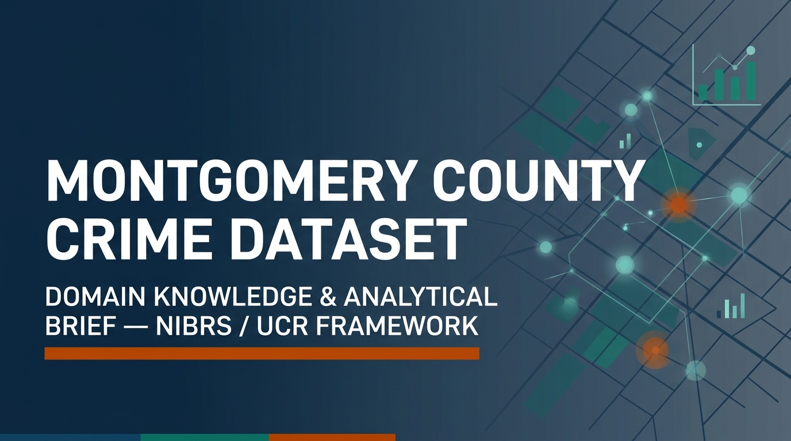
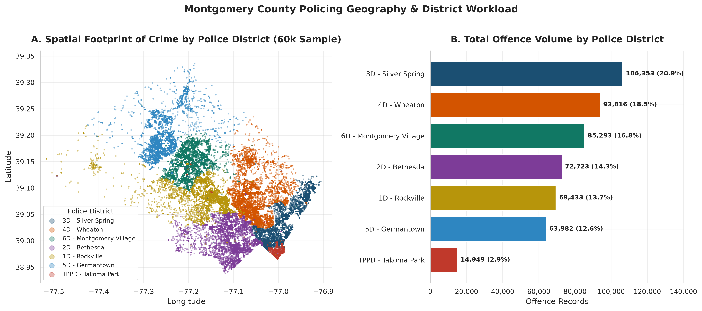
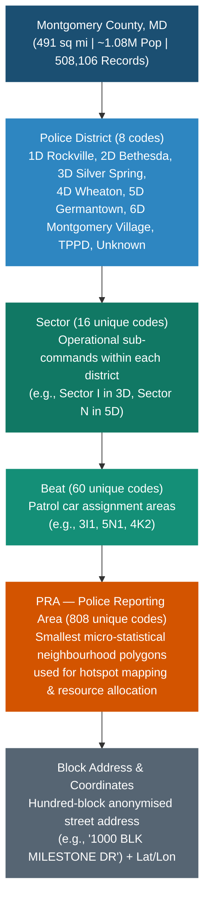
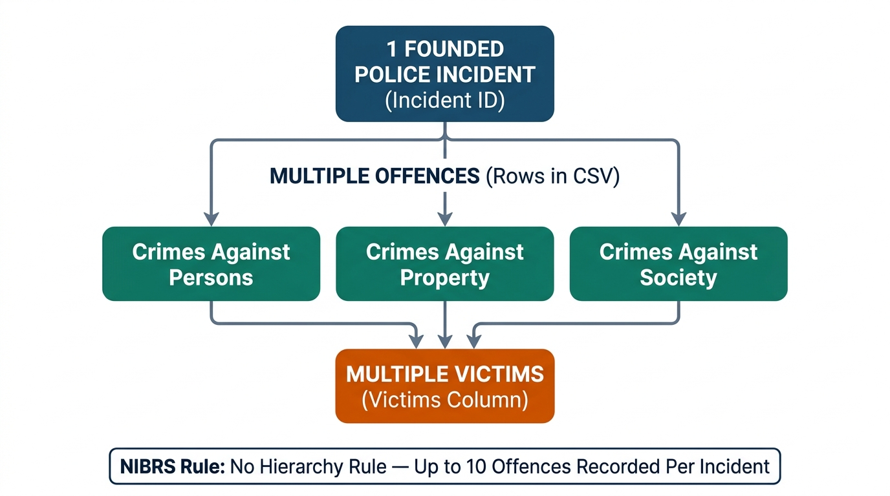
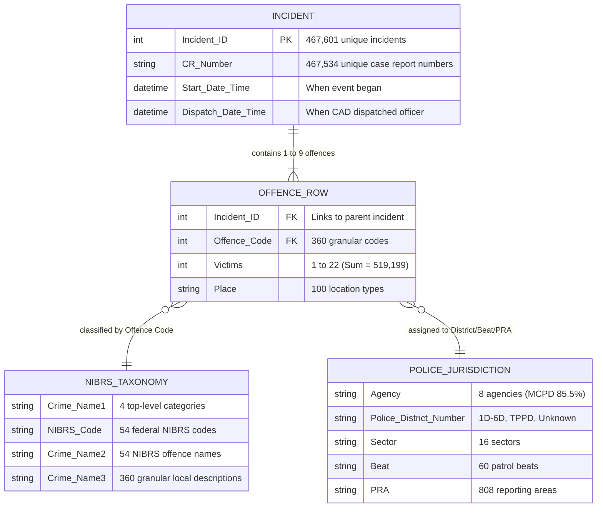
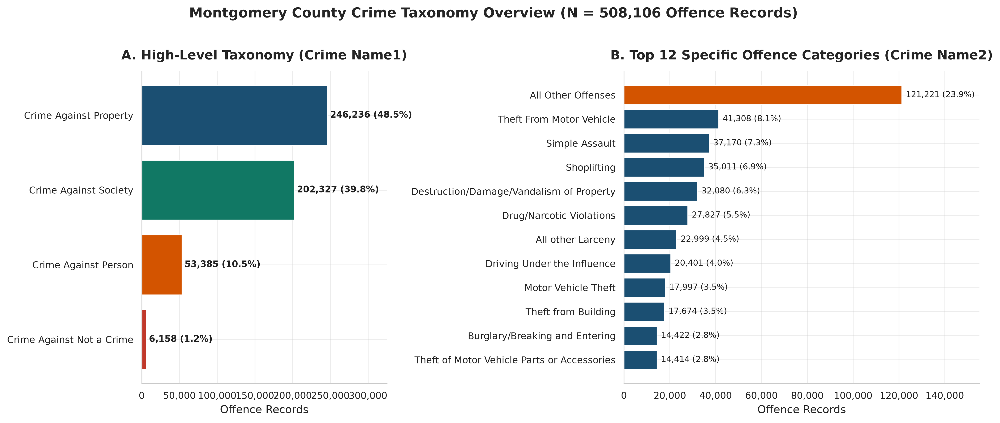
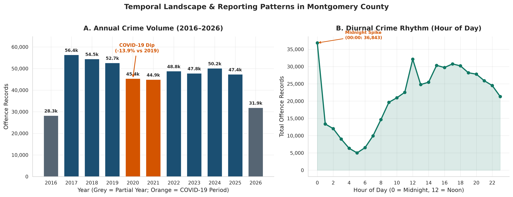
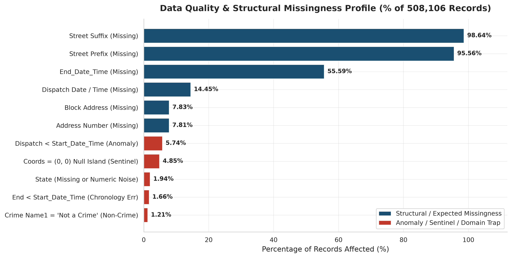

# Montgomery County Crime Dataset — Comprehensive Domain Knowledge & Analytical Brief

**Module:** CI7340 Applied Data Programming (Kingston University, 2026/2027)  
**Team:** Group 17 — **Thisara** (Data Engineering Lead), **Sachithra** (Project Coordinator), **Kavindu** (EDA & QA Lead)  
**Source Dataset:** `dataset_coursework1.csv` (`508,106` offence records | `467,601` unique incidents | `30` columns | `185 MB`)  
**Temporal Span:** 1 July 2016 – 14 September 2026 *(brief cites through 10 September 2026; 228 trailing records extend to 14 September 2026)*  
**Primary Standard:** FBI Criminal Justice Information Services (CJIS) — National Incident-Based Reporting System (NIBRS) / Uniform Crime Reporting (UCR)

> [!IMPORTANT]
> **Why Every Team Member Must Read This Brief First**  
> Crime datasets are not simple retail transaction logs. They are legal, operational, and administrative artefacts shaped by federal reporting rules (FBI NIBRS), multi-agency municipal policing boundaries, privacy redaction practices, and computer-aided dispatch (CAD) system upgrades. Analysing `dataset_coursework1.csv` without understanding **Incident vs. Offence vs. Victim counting**, **NIBRS `90Z` non-criminal service calls**, **partial-year boundaries**, and **`(0, 0)` Null Island coordinate redactions** will lead to major analytical errors. This brief equips all three Group 17 members with a shared, rigorous foundation before we finalise our 10 Research Questions and 20 visualisations.

---

## Table of Contents

1. [Geographic, Demographic & Civic Context of Montgomery County, Maryland](#1-geographic-demographic--civic-context-of-montgomery-county-maryland)
2. [Multi-Agency Policing Architecture & Spatial Command Hierarchy](#2-multi-agency-policing-architecture--spatial-command-hierarchy)
3. [The FBI UCR & NIBRS Framework: Incident, Offence & Victim Rules](#3-the-fbi-ucr--nibrs-framework-incident-offence--victim-rules)
4. [The 3-Level Crime Taxonomy & The "90Z / Not a Crime" Discovery](#4-the-3-level-crime-taxonomy--the-90z--not-a-crime-discovery)
5. [Police Reporting Lifecycle, Provenance & Legal Caveats](#5-police-reporting-lifecycle-provenance--legal-caveats)
6. [Temporal Landscape, Historical Shifts & Reporting Artifacts (2016–2026)](#6-temporal-landscape-historical-shifts--reporting-artifacts-20162026)
7. [Complete 30-Column Technical Data Dictionary](#7-complete-30-column-technical-data-dictionary)
8. [Data Quality Anomalies, Structural Missingness & Analytical Traps](#8-data-quality-anomalies-structural-missingness--analytical-traps)
9. [Domain-Informed Blueprint for Group 17's 10 Research Questions](#9-domain-informed-blueprint-for-group-17s-10-research-questions)
10. [Glossary of Domain Terms & References (IEEE Format)](#10-glossary-of-domain-terms--references-ieee-format)

---

## 1. Geographic, Demographic & Civic Context of Montgomery County, Maryland

To interpret spatial crime concentrations, seasonal patterns, and offence mixes accurately, we must first understand the physical and socioeconomic geography that generates these records.

### 1.1 Location and Regional Role
**Montgomery County, Maryland** (locally nicknamed *"MoCo"*) is the most populous county in the State of Maryland and one of the most affluent, culturally diverse suburban-urban counties in the United States [1], [2]. Spanning roughly **491 square miles (1,272 km²)** immediately north and northwest of **Washington, D.C.**, the county is bounded by the Potomac River to the southwest (bordering Northern Virginia), Frederick County to the northwest, Howard County to the northeast, and Prince George's County to the southeast.

Montgomery County functions as a major employment, transit, federal research, and residential hub within the Washington–Baltimore metropolitan corridor. Its urban geography is structured around two primary transportation spines:
- **The Interstate 270 (I-270) Technology Corridor:** Running northwest from Bethesda through Rockville, Gaithersburg, Germantown, and Clarksburg — home to major biotechnology, pharmaceutical, and federal agency campuses (e.g., NIH, NIST, FDA).
- **The Red Line / Down-County Urban Core:** High-density, transit-oriented urban centres directly bordering Washington, D.C. — including **Silver Spring**, **Bethesda**, **Wheaton**, and **Takoma Park** — connected by the Washington Metro (WMATA) and MARC commuter rail.
- **The Agricultural Reserve (Up-County / Western Wedge):** Roughly one-third of the county's land area in the north and west (Poolesville, Dickerson, Barnesville, Damascus) is legally protected low-density farmland and parkland, producing sharp urban-to-rural density gradients in crime volume.

### 1.2 Demographic & Socioeconomic Profile
According to U.S. Census / American Community Survey (ACS) estimates and Montgomery Planning data [2], [3]:
- **Total Population:** Approximately **1.08 million residents** (median age ~40.6 years).
- **High Diversity (Majority-Minority County):** Approximately **38%** Non-Hispanic White, **22%** Hispanic or Latino (of any race), **18%** Black or African American, **16%** Asian, and **6%** two or more races / other.
- **Economic Profile:** High median household income (exceeding **$130,000** [4]) and high educational attainment, yet with notable localized socioeconomic variation between wealthy residential enclaves (Potomac, Chevy Chase, Bethesda) and denser, mixed-income commercial/transit corridors (Silver Spring, Wheaton, Gaithersburg, Montgomery Village).

### 1.3 Incorporated Municipalities vs. Unincorporated Communities (CDPs)
A critical domain nuance for our `City` column is that **most of Montgomery County is unincorporated**. Only a handful of jurisdictions are legally incorporated municipalities with their own city governments (and in three cases, their own municipal police departments), whereas major urban centres like Silver Spring, Bethesda, Germantown, and Wheaton are **Unincorporated Census-Designated Places (CDPs)** governed directly by Montgomery County.

| Community / Hub | Legal Status | Approx. Population | Crime Records in Dataset | % of Dataset | Urban Character & Policing Context |
| :--- | :--- | :---: | :---: | :---: | :--- |
| **Silver Spring** | Unincorporated CDP | ~260,000+ (postal area) | `175,611` | **34.56%** | Dense multicultural urban hub bordering D.C.; spans **3D** & parts of **4D**; major nightlife, retail, and Metro transit centre. |
| **Gaithersburg** | Incorporated City | ~71,000 | `71,631` | **14.10%** | Biotech/retail hub along I-270 (Olde Towne & Kentlands); policed jointly by **GPD** and **MCPD 6D**. |
| **Rockville** | Incorporated City (County Seat) | ~68,000 | `71,429` | **14.06%** | Civic, judicial, and commercial hub; Town Center & Rockville Pike retail corridor; policed jointly by **RCPD** and **MCPD 1D**. |
| **Germantown** | Unincorporated CDP | ~93,000 | `48,583` | **9.56%** | Large master-planned suburban community along upper I-270; policed by **MCPD 5D**. |
| **Bethesda** | Unincorporated CDP | ~65,000–70,000 | `36,143` | **7.11%** | Affluent corporate, dining, and medical hub (NIH, Walter Reed); policed by **MCPD 2D**. |
| **Takoma Park** | Incorporated City | ~18,000 | `16,629` | **3.27%** | Compact, progressive city on D.C. border; policed primarily by its own independent **TPPD**. |
| **Montgomery Village** | Unincorporated CDP | ~35,000 | `14,898` | **2.93%** | Planned suburban community adjacent to Gaithersburg; HQ of **MCPD 6D**. |
| **Chevy Chase / Potomac** | Unincorporated / Towns | ~10k–47k | `10,064` / `10,048` | **1.98% each** | Low-density, high-income residential areas; lower overall volume, skewed toward property/auto/fraud offences. |

> [!TIP]
> **Why `City = SILVER SPRING` Has 175,611 Records While `Police District = 3D (SILVER SPRING)` Has 106,353**  
> Postal city names (`City`) follow USPS mailing zones, NOT police district boundaries! The Silver Spring USPS postal area stretches far north into **4D Wheaton** (Colesville, White Oak, Aspen Hill, Glenmont). Never treat `City` and `Police District Name` as interchangeable keys — use `Police District Number` for operational policing comparisons and cleaned `City` only for community-level postal geography.

---

## 2. Multi-Agency Policing Architecture & Spatial Command Hierarchy

### 2.1 Law Enforcement Agencies Operating in Montgomery County
Because Montgomery County contains both unincorporated county territory and incorporated municipalities, **eight distinct agency codes** appear in the `Agency` column. Most local agencies share a unified Records Management System (**EJustice**) and feed approved NIBRS records into the county's centralized public crime portal (`dataMontgomery`) [5], [6].

| Agency Code | Full Agency Name | Records in Dataset | Share (%) | Operational Mandate & Jurisdiction |
| :--- | :--- | :---: | :---: | :--- |
| **MCPD** | Montgomery County Police Department | `434,446` | **85.50%** | Primary county-wide police force serving all unincorporated areas and providing major-crime/investigative support across the county. |
| **RCPD** | Rockville City Police Department | `28,878` | **5.68%** | Municipal police department for the City of Rockville (county seat), operating in coordination with MCPD 1st District. |
| **GPD** | Gaithersburg Police Department | `28,541` | **5.62%** | Municipal police department for the City of Gaithersburg, coordinating patrol & calls-for-service with MCPD 6th District. |
| **TPPD** | Takoma Park Police Department | `14,841` | **2.92%** | Independent municipal police force serving the City of Takoma Park; appears as its own district code (`TPPD`). |
| **MCFM** | Montgomery County Fire Marshal (Office of the Fire Marshal / FEIS) | `1,237` | **0.24%** | Sworn fire/explosives investigators handling **arson**, explosive device threats, and fire-code criminal offences. |
| **MCSO** | Montgomery County Sheriff's Office | `156` | **0.03%** | Court security, civil process, domestic-violence protective orders, and warrant service. |
| **OTHR** | Other / External Partner Agency | `4` | **0.00%** | Rare cross-jurisdictional or assisting-agency entries (e.g., Park Police / state / federal assist). |
| **P** | *Data-Entry Anomaly / Truncated Code* | `3` | **0.00%** | Likely truncated agency code (e.g., Park Police or MCPD typo) — should be flagged during data quality assessment. |

> [!NOTE]
> Notice that the **Maryland-National Capital Park Police (Montgomery County Division)** — which patrols over 37,000 acres of county parkland — maintains a separate primary reporting feed, so park-only incidents are largely outside this MCPD/EJustice extract unless assisted by MCPD/municipal officers. This is an excellent **scope limitation** to cite in the Introduction and Conclusion!

### 2.2 The Six MCPD Operational Districts + Takoma Park
Montgomery County Police divides the county into **six numbered Police Districts (`1D` through `6D`)**, plus **Takoma Park (`TPPD`)** as a seventh operational unit in the dataset.

| District Code | Station / Command Name | Offence Records | Share (%) | Geographic Footprint & Crime Profile |
| :---: | :--- | :---: | :---: | :--- |
| **3D** | **Silver Spring** | `106,353` | **20.93%** | Highest volume district. Covers Downtown Silver Spring, White Oak, Four Corners, and the southeastern D.C. border. High density of retail shoplifting, assaults, vehicle thefts, and transit-corridor activity. |
| **4D** | **Wheaton** | `93,816` | **18.46%** | Second-highest volume. Covers Wheaton, Glenmont, Aspen Hill, Olney, and Layhill. Mix of dense commercial hubs (Westfield Wheaton) and sprawling suburban residential subdivisions. |
| **6D** | **Montgomery Village** *(Gaithersburg)* | `85,293` | **16.79%** | Third-highest volume. Covers Gaithersburg, Montgomery Village, and Washington Grove along central I-270. High commercial retail activity (Lakeforest/Rio corridors) plus dense apartment complexes. |
| **2D** | **Bethesda** | `72,723` | **14.31%** | Covers Bethesda, Chevy Chase, Potomac, Kensington, and Garrett Park. Affluent southwestern quadrant; lower violent crime share, higher proportion of larceny, theft from vehicle, and financial/identity fraud. |
| **1D** | **Rockville** | `69,433` | **13.67%** | Covers Rockville, Potomac (north), Poolesville, and Darnestown. Combines busy Rockville Pike commercial strip and county courthouse complex with vast western rural Agricultural Reserve. |
| **5D** | **Germantown** | `63,982` | **12.59%** | Covers Germantown, Clarksburg, Damascus, and Boyds (northern up-county). Rapidly growing suburban residential corridor along upper I-270. |
| **TPPD** | **Takoma Park** | `14,949` | **2.94%** | Independent municipal district covering the City of Takoma Park on the D.C./Prince George's County border. |
| **Unknown** | *(Missing / `OTHER`)* | `1,557` | **0.31%** | `1,542` rows have `Police District Name = NaN` and `15` rows have `OTHER`; typically out-of-county follow-ups, online/phone fraud reports without a physical district, or un-geocoded entries. |

### 2.3 Nested Spatial Command Hierarchy
Every geocoded offence in Montgomery County sits inside a strict **five-level nested policing geography** [7]:

**Analytical takeaway:** When conducting spatial analysis (especially **Kavindu's RQs 7–10**), you can zoom smoothly from macro-level (`Police District Number`: 7 active districts) → meso-level (`Beat`: 60 patrol zones) → micro-level (`PRA`: 808 neighbourhoods) → point-level (`Latitude`/`Longitude`, excluding `(0, 0)` sentinels).

---

## 3. The FBI UCR & NIBRS Framework: Incident, Offence & Victim Rules

The single most important conceptual distinction in this coursework — explicitly tested in the Kingston University **Distinction (70%+)** rubric for *Dataset Description* — is understanding how the **FBI's Uniform Crime Reporting (UCR) Program** and its modern **National Incident-Based Reporting System (NIBRS)** structure crime records.

### 3.1 From Legacy SRS (Hierarchy Rule) to Modern NIBRS
For nearly a century (1930–2020), the FBI collected national crime statistics using the **Summary Reporting System (SRS)**. Under SRS, law enforcement agencies followed the strict **Hierarchy Rule**: if a single criminal episode involved multiple crimes (for example, a suspect broke into a house [*Burglary*], assaulted a resident [*Aggravated Assault*], and stole a car [*Motor Vehicle Theft*]), the agency was forced to report **only the single most severe offence** and discard all secondary offences [8], [9].

On 1 January 2021, the FBI officially retired SRS and transitioned nationally to **NIBRS** (which Montgomery County had already adopted prior to July 2016). **NIBRS completely eliminates the Hierarchy Rule**:
- Up to **10 distinct offences** can be recorded under a single criminal incident (`Incident ID`) [8].
- Each offence row links to its parent incident, preserving co-occurring crimes (e.g., *Drug Violations* + *Weapon Law Violations* + *DUI* during a single traffic stop).
- Victim counts, property contexts, and precise timestamps are captured at the incident/offence level rather than aggregated into monthly summary counts.

### 3.2 Group A vs. Group B Offences and Counting Rules
Under federal NIBRS specifications [9], [10], offences are divided into two reporting tiers and three primary victim-target categories:

1. **Group A Offences** (52+ serious offence types across 24 offence categories): Full incident-based reporting is required (incident, offence, property, victim, offender, arrestee segments). Examples: Homicide, Rape, Robbery, Aggravated/Simple Assault, Burglary, Larceny/Theft, Motor Vehicle Theft, Vandalism, Fraud, Identity Theft, Drug/Narcotic Violations, Weapon Law Violations.
2. **Group B Offences** (10 lesser offence categories, NIBRS codes `90A`–`90Z`): Historically arrest-only in federal submissions, though local police departments like MCPD also log non-arrest incident reports under `90Z` (`All Other Offenses`) for local operational tracking. Examples: DUI (`90D`), Disorderly Conduct (`90C`), Trespass (`90J`), Liquor Law Violations (`90G`), and `90Z` (`All Other Offenses`).

**NIBRS Counting Rules by Crime Category:**
- **Crimes Against Persons** *(victims are always individuals)*: Count **one offence per individual victim** (e.g., assaulting 3 people = 3 victims).
- **Crimes Against Property** *(primary objective is obtaining money, property, or material benefit)*: Count **one offence per distinct criminal operation**, *except* **Motor Vehicle Theft**, which counts one offence per stolen vehicle.
- **Crimes Against Society** *(prohibited/consensual acts against public order, e.g., drugs, weapons, DUI, prostitution)*: Society itself is the "victim," so count **one offence per distinct violation**.

### 3.3 The Three Units of Analysis in `dataset_coursework1.csv`
Every Group 17 member must know the exact mathematical difference between **Rows (Offences)**, **Unique Incidents**, and **Victim Counts** in our dataset:

| Unit of Analysis | Exact Count in Dataset | How to Compute in Python | When to Use It |
| :--- | :---: | :--- | :--- |
| **Offence Records (CSV Rows)** | **`508,106`** | `len(df)` | Measuring total offence volume, offence type shares (`Crime Name2`), and NIBRS co-occurrence. |
| **Unique Incidents** | **`467,601`** | `df["Incident ID"].nunique()` | Measuring how many separate police crime events occurred (avoids double-counting multi-offence events). |
| **Multi-Offence Incidents** | **`33,749`** (`7.22%` of incidents) | `(df.groupby("Incident ID").size() > 1).sum()` | Studying crime co-occurrence (avg = `1.0866` offences/incident; max = `9` offences in 1 incident). |
| **Victim-Offence Sum** | **`519,199`** | `df["Victims"].sum()` | Measuring victim burden (note: `98.22%` of rows have `Victims == 1`; max = `22` victims in a single offence row). |

> [!WARNING]
> **Critical Pitfall — Do Not Confuse `Victims.sum()` with Unique Individuals!**  
> If a single incident (`Incident ID`) has 2 offence rows (e.g., *Burglary* with `Victims = 1` and *Vandalism* with `Victims = 1`), the same homeowner may be counted once per offence row. Furthermore, for `Crime Against Society` (e.g., DUI or Drug possession), `Victims = 1` represents **Society**, not an injured human victim! Always specify whether a chart measures **Offence Records**, **Unique Incidents**, or **Reported Victim-Offence Counts**.

---

## 4. The 3-Level Crime Taxonomy & The "90Z / Not a Crime" Discovery

Montgomery County's dataset classifies every row through a **3-tier hierarchical taxonomy** (`Crime Name1` → `Crime Name2` / `NIBRS Code` → `Crime Name3` / `Offence Code`):

### 4.1 High-Level Distribution (`Crime Name1`)
1. **Crime Against Property — `246,236` records (`48.46%`):** Nearly half of all records. Dominated by *Theft From Motor Vehicle* (`41,308`), *Shoplifting* (`35,011`), *Vandalism/Property Damage* (`32,080`), *All Other Larceny* (`22,999`), *Motor Vehicle Theft* (`17,997`), *Theft from Building* (`17,674`), *Burglary* (`14,422`), *Theft of Vehicle Parts* (`14,414`), and *Identity Theft / Fraud* (`32,890+` combined across fraud subtypes).
2. **Crime Against Society — `202,327` records (`39.82%`):** Appears huge on the surface, but **60% of this category (`121,221` records) is `NIBRS 90Z — All Other Offenses`** (explained below!). The true substantive offences here are *Drug/Narcotic Violations* (`27,827`) and *Driving Under the Influence (DUI)* (`20,401`), plus *Liquor Laws*, *Trespass*, *Weapon Violations*, and *Disorderly Conduct*.
3. **Crime Against Person — `53,385` records (`10.51%`):** Direct interpersonal harm. Heavily dominated by *Simple Assault* (`37,170`, nearly 70% of all Crimes Against Person), followed by *Aggravated Assault*, *Intimidation*, *Forcible Sex Offences*, *Kidnapping*, and *Homicide*.
4. **Crime Against Not a Crime — `6,158` records (`1.21%`):** Non-criminal police reports recorded inside the same feed!

### 4.2 Two Major Domain Discoveries (Distinction-Level Insights)

> [!CAUTION]
> **Discovery #1: What Is Inside `Crime Against Not a Crime` (6,158 rows)?**  
> Profiling `Crime Name3` reveals that **99.76%** of `Crime Against Not a Crime` consists of **`JUVENILE - RUNAWAY` (`6,143` records)**, alongside **`HOMICIDE - JUSTIFIABLE` (`12` records)** and **`HOMICIDE - BY NON-POLICE - JUSTIFIABLE` (`3` records)**. Under federal NIBRS rules, runaway juveniles were removed as a criminal offence category, and justifiable homicides (e.g., lawful self-defence or officer-involved lawful force) are legally classified as *not a crime*, yet police still generate formal incident reports for tracking and welfare.

> [!CAUTION]
> **Discovery #2: The `NIBRS 90Z` (`All Other Offenses`) Distortion (121,221 rows = 23.86%)**  
> Nearly **1 in every 4 rows** in `dataset_coursework1.csv` is coded `90Z` (`All Other Offenses`) under `Crime Against Society`. Drilling down into `Crime Name3` shows that the vast majority of `90Z` rows are **non-criminal public-safety, mental health, and administrative service reports**, NOT street crimes:
> - `POLICE INFORMATION`: **33,174** records
> - `MENTAL ILLNESS - EMERGENCY PETITION` + `MENTAL ILLNESS`: **23,391** records (`19,739` + `3,652`)
> - `LOST PROPERTY`: **17,917** records
> - `SUDDEN DEATH` *(non-homicide medical/unattended deaths)*: **10,021** records
> - `MISSING PERSON`: **7,496** records
> - `RECOVERED PROPERTY` (Mont. Co. + Other): **7,638** records (`4,293` + `3,345`)
>
> **Strategic Impact for Group 17:** If you blindly report "Crime Against Society accounts for 39.8% of crime in Montgomery County," a domain-savvy marker will notice that ~100,000 of those records are mental-health petitions, lost property, and police info memos! Instead, we should explicitly **distinguish between Total Police Incident Workload (all 508,106 rows)** and **Substantive Criminal Offences (excluding `Not a Crime` and non-criminal `90Z` service calls)** — a massive distinction-level analytical strength!

---

## 5. Police Reporting Lifecycle, Provenance & Legal Caveats

Understanding how a real-world event becomes a row in `dataset_coursework1.csv` explains almost every timestamp anomaly and missing value in the dataset.

### Key Legal & Provenance Caveats to Cite in Our Report
1. **"Founded" Crime Only:** This dataset contains only **approved, founded** police incident reports — meaning a responding officer and supervisor determined that a reportable event actually occurred. Calls determined to be *unfounded* (false alarms, baseless claims) are excluded [5].
2. **Preliminary Information (Not Court Convictions):** As stated in the coursework brief, records reflect **preliminary information supplied by reporting parties** at the time of the initial report. Subsequent investigations may reclassify an offence (e.g., from *Aggravated Assault* to *Simple Assault*, or *Theft* to *Civil Dispute*), and arrests or judicial convictions are **not** included in this dataset.
3. **The "Dark Figure of Crime" (Under-Reporting Bias):** Police incident data measures **reported** crime, not **actual** crime. High-visibility or insurance-linked crimes (e.g., *Motor Vehicle Theft*, *Residential Burglary*) have very high reporting rates, whereas *Simple Assault*, *Domestic Violence*, *Sexual Offences*, *Minor Shoplifting*, and *Cyber/Identity Fraud* are systematically under-reported.
4. **Enforcement-Driven vs. Victim-Driven Crimes:** Increases in *Drug/Narcotic Violations* (`35A`), *DUI* (`90D`), or *Weapon Violations* often reflect **proactive police enforcement patrols** rather than sudden spikes in underlying public behaviour.
5. **Privacy Redaction & Block-Level Geocoding:** To protect victim identities, exact street house numbers are rounded down to the **100-block** (e.g., `1047 Milestone Dr` becomes `1000 BLK MILESTONE DR`), and sensitive/un-geocodable locations have their `Block Address` omitted or coordinates zeroed out to `(0.0, 0.0)`.

---

## 6. Temporal Landscape, Historical Shifts & Reporting Artifacts (2016–2026)

Temporal crime analysis is one of the highest-value pillars of our coursework (especially **Sachithra's RQs 1–3**), yet raw time-series plots of `dataset_coursework1.csv` contain **four major structural artifacts** that every member must recognise before interpreting trends.

### 6.1 Eleven-Year Longitudinal Profile (2016–2026)
| Year | Total Offence Records | Coverage Status | Key Real-World & Analytical Context |
| :---: | :---: | :--- | :--- |
| **2016** | `28,270` | **Partial (6 months: Jul–Dec)** | Dataset begins 1 July 2016 (annualised pace ≈ 56.5k). **Never compare raw 2016 totals directly against full years!** |
| **2017** | `56,355` | Full Year (12 months) | Highest full-year volume in dataset; CAD `Dispatch Date / Time` integration begins **2 April 2017**. |
| **2018** | `54,468` | Full Year (12 months) | Modest year-over-year decline (-3.3%). |
| **2019** | `52,666` | Full Year (12 months) | Pre-pandemic baseline (-3.3% vs 2018). |
| **2020** | `45,369` | Full Year (12 months) | **Sharp COVID-19 Lockdown Dip (-13.9% vs 2019).** Stay-at-home orders slashed retail shoplifting, commuter car break-ins, and DUI stops, while domestic/residential incidents and online/identity fraud shifted share. |
| **2021** | `44,915` | Full Year (12 months) | Lowest full-year total; gradual reopening and hybrid work patterns across the D.C. metro area. |
| **2022** | `48,814` | Full Year (12 months) | Post-pandemic rebound (+8.7% vs 2021), driven by returning retail traffic, auto thefts (national Kia/Hyundai theft wave), and property crime. |
| **2023** | `47,832` | Full Year (12 months) | High plateau; sustained auto-related offences and shoplifting activity. |
| **2024** | `50,151` | Full Year (12 months) | Post-COVID peak (+4.8% vs 2023), approaching pre-pandemic 2019 levels. |
| **2025** | `47,359` | Full Year (12 months) | Moderation (-5.6% vs 2024). |
| **2026** | `31,907` | **Partial (~8.5 months: Jan 1–Sep 14)** | Includes **228 rows** after the brief's stated 10 Sept 2026 cutoff. Use **monthly averages** or **full-year filter (`2017–2025`)** for clean annual comparisons. |

### 6.2 Understanding the Three Timestamps
1. **`Start_Date_Time` (0% missing):** The officer's best estimate of when the criminal offence *began*. This is our **primary analytical timestamp** for all trend, seasonal, and hourly analyses.
2. **`End_Date_Time` (55.59% missing — `282,444` nulls):** Populated primarily when a crime occurred over an uncertain **time window** (e.g., a victim parked their car at 9:00 PM and discovered it broken into at 7:00 AM; or a homeowner went on vacation for a week and returned to a burglary). Point-in-time events (shoplifting caught on camera, bar assaults, DUI stops) normally leave `End_Date_Time` blank.
3. **`Dispatch Date / Time` (14.45% missing — `73,405` nulls):** Timestamp when the 911/Emergency Communications Center (ECC) Computer-Aided Dispatch (CAD) system dispatched an officer.
   - **Historical System Boundary:** `Dispatch Date / Time` only starts on **2 April 2017** — almost all records between July 2016 and March 2017 are `NaN` for this column!
   - **Channel Effect:** Walk-in station reports, online citizen reports (Coplogic), and administrative follow-up reports often lack a CAD dispatch timestamp even after 2017.

### 6.3 The Diurnal Rhythm & The "Midnight Spike" Artifact
Looking at Panel B of the Temporal Landscape figure above reveals a textbook criminological data artifact:
- **True Daily Trough:** **05:00 AM** (`5,018` records) — lowest human activity and mobility across the county.
- **Afternoon/Evening Peak:** Steadily climbs from 08:00 AM to a broad afternoon/evening plateau between **12:00 PM and 09:00 PM** (driven by retail hours, commuting, school dismissal, and evening nightlife).
- **Artificial Midnight Spike (`00:00` = `36,843` records):** Notice the dramatic vertical spike at **Hour 0 (12:00 AM)** — nearly double Hour 23 and Hour 1! In police Records Management Systems (EJustice) and online reporting portals, when a reporting victim knows the *date* of an offence (e.g., identity theft, fraud, mail theft, or an overnight break-in) but **cannot specify the exact hour**, the system defaults the time component to `00:00:00` (12:00:00 AM).

> [!TIP]
> **How to Turn the Midnight Spike into Distinction-Level Analysis**  
> In our EDA and Temporal Visualisations, we should explicitly call out the `00:00:00` spike, check what % of `00:00` rows have exact `00:00:00` timestamps vs `00:01–00:59`, and show how excluding defaulted midnight timestamps clarifies the true late-night crime curve!

---

## 7. Complete 30-Column Technical Data Dictionary

Every column in `dataset_coursework1.csv` belongs to one of **five logical attribute families**. Below is the complete, verified dictionary (computed directly on all `508,106` rows) with exact missingness, cardinality, domain meaning, and Group 17 cleaning guidance.

### Family A: Identifiers (3 Columns)
| # | Column Name | Raw Dtype | Nulls (%) | Unique Values | Domain Meaning & Cleaning Rule |
| :-: | :--- | :---: | :---: | :---: | :--- |
| 1 | `Incident ID` | `int64` | `0` (`0.00%`) | `467,601` | Primary parent identifier for a founded police incident. Repeats when 2–9 offences occur in one incident (`7.22%` of incidents). **Key for incident-level deduplication.** |
| 2 | `CR Number` | `object` | `0` (`0.00%`) | `467,534` | Official Police Case Report number (typically `YY#######`, e.g., `260040147` = 2026 case). Nearly 1:1 with `Incident ID` (67 minor discrepancies across multi-agency/supplemental links). Store as string. |
| 3 | `Offence Code` | `object` | `0` (`0.00%`) | `360` | Granular 4-digit local/state offence code mapping 1:1 to `Crime Name3` (e.g., `9108`, `2901`). Store as string to preserve leading zeros. |

### Family B: Temporal Attributes (3 Columns)
| # | Column Name | Raw Dtype | Nulls (%) | Unique Values | Domain Meaning & Cleaning Rule |
| :-: | :--- | :---: | :---: | :---: | :--- |
| 4 | `Start_Date_Time` | `object` | `0` (`0.00%`) | `372,500` | Estimated start timestamp of offence (`MM/DD/YYYY HH:MM:SS AM/PM`). Parse to `datetime64`. Primary time axis; watch for `00:00:00` defaults and partial years `2016`/`2026`. |
| 5 | `End_Date_Time` | `object` | `282,444` (`55.59%`) | `157,941` | Estimated end timestamp for time-window offences. **Do NOT drop or blindly impute nulls** — missingness is structurally informative (point-in-time vs window crime). Flag `8,418` rows where `End < Start`. |
| 6 | `Dispatch Date / Time` | `object` | `73,405` (`14.45%`) | `397,963` | CAD dispatch timestamp (available from `2017-04-02` onward). Use to compute `Dispatch_Lag_Hours` only on post-April-2017 rows where `Dispatch >= Start` (flag `29,165` rows where `Dispatch < Start`). |

### Family C: Crime Classification & Victims (5 Columns)
| # | Column Name | Raw Dtype | Nulls (%) | Unique Values | Domain Meaning & Cleaning Rule |
| :-: | :--- | :---: | :---: | :---: | :--- |
| 7 | `NIBRS Code` | `object` | `0` (`0.00%`) | `54` | Federal FBI NIBRS offence code (e.g., `23F`, `13B`, `90Z`). Exact 1:1 mapping with `Crime Name2`. Use to separate Group A vs Group B (`90*`) codes. |
| 8 | `Victims` | `int64` | `0` (`0.00%`) | `10` | Count of victims linked to this offence row (range `1`–`22`, sum = `519,199`). For Crimes Against Society, `1` denotes Society as the victim. |
| 9 | `Crime Name1` | `object` | `0` (`0.00%`) | `4` | Top-level NIBRS category: `Crime Against Property`, `Crime Against Society`, `Crime Against Person`, `Crime Against Not a Crime`. |
| 10 | `Crime Name2` | `object` | `0` (`0.00%`) | `54` | Standard federal NIBRS offence name (e.g., `Shoplifting`, `Simple Assault`, `All Other Offenses`). Best granularity for top-10 crime visualisations. |
| 11 | `Crime Name3` | `object` | `0` (`0.00%`) | `360` | Granular Montgomery County statutory/operational offence description (e.g., `MENTAL ILLNESS - EMERGENCY PETITION`, `LARCENY - FROM AUTO`). Essential for dissecting `90Z` and `Not a Crime`. |

### Family D: Policing & Operational Jurisdiction (6 Columns)
| # | Column Name | Raw Dtype | Nulls (%) | Unique Values | Domain Meaning & Cleaning Rule |
| :-: | :--- | :---: | :---: | :---: | :--- |
| 12 | `Agency` | `object` | `0` (`0.00%`) | `8` | Reporting law enforcement agency (`MCPD`, `RCPD`, `GPD`, `TPPD`, `MCFM`, `MCSO`, `OTHR`, `P`). Flag `P` (3 rows) as code anomaly. |
| 13 | `Police District Number` | `object` | `0` (`0.00%`) | `8` | Short command code (`1D`–`6D`, `TPPD`, `Unknown`). **Zero nulls** — cleanest primary spatial grouping key. |
| 14 | `Police District Name` | `object` | `1,542` (`0.30%`) | `8` | Station command name (`SILVER SPRING`, `WHEATON`, `MONTGOMERY VILLAGE`, `BETHESDA`, `ROCKVILLE`, `GERMANTOWN`, `TAKOMA PARK`, `OTHER`). Impute nulls to `UNKNOWN` to align 1:1 with `Police District Number`. |
| 15 | `Sector` | `object` | `0` (`0.00%`) | `16` | District sub-command zone (single letter/code). Clean, 0% missing. |
| 16 | `Beat` | `object` | `0` (`0.00%`) | `60` | Patrol assignment area (e.g., `3I1`, `5N1`). Clean, 0% missing — ideal for meso-level spatial heatmaps. |
| 17 | `PRA` | `object` | `9` (`0.00%`) | `808` | Police Reporting Area — micro-level neighbourhood polygon code. Standardise as string; only 9 missing rows. |

### Family E: Location, Street Address & Coordinates (13 Columns)
| # | Column Name | Raw Dtype | Nulls (%) | Unique Values | Domain Meaning & Cleaning Rule |
| :-: | :--- | :---: | :---: | :---: | :--- |
| 18 | `Place` | `object` | `0` (`0.00%`) | `100` | Premise/environment type (e.g., `Residence - Single Family` 10.3%, `Residence - Apartment/Condo` 9.8%, `Street - In vehicle` 8.8%, `Other/Unknown` 8.1%). Great for grouping into macro-premises (Residence / Street / Parking / Retail). |
| 19 | `Block Address` | `object` | `39,804` (`7.83%`) | `23,491` | Privacy-anonymised hundred-block street address. Missing when privacy-redacted or intersection/park-based. |
| 20 | `City` | `object` | `37` (`0.01%`) | `314` | USPS postal city name. **High text noise** (314 raw values due to typos, casing, abbreviations). Strip/uppercase and map major variants before city-level charts. |
| 21 | `State` | `object` | `9,509` (`1.87%`) | `12` | State code (`MD` = 98.06%). Contains numeric bleed noise (`16` = 224 rows, `7` = 1, `17` = 1) and border states (`DC` = 121, `VA` = 12). Flag & clean numeric noise. |
| 22 | `Zip Code` | `object` | `3,474` (`0.68%`) | `206` | 5-digit postal ZIP code (Montgomery County range `20812`–`20916`). Store as 5-char string; validate against MD ZIP range. |
| 23 | `Address Number` | `float64` | `39,661` (`7.81%`) | `441` | Hundred-block numeric prefix (e.g., `1000`, `13000`). Redundant with `Block Address`; low analytical value. |
| 24 | `Street Prefix` | `object` | `485,545` (`95.56%`) | `4` | Directional street prefix (`N`, `S`, `E`, `W`). Structurally empty for 95.6% of streets. **Candidate to drop from analytical tables.** |
| 25 | `Street Name` | `object` | `1,467` (`0.29%`) | `8,156` | Street name without block number. Useful for top-corridor analysis (e.g., Georgia Ave, Rockville Pike). |
| 26 | `Street Suffix` | `object` | `501,176` (`98.64%`) | `6` | Directional street suffix. Structurally empty for 98.6% of streets. **Candidate to drop from analytical tables.** |
| 27 | `Street Type` | `object` | `1,856` (`0.37%`) | `35` | Road type (`RD`, `DR`, `AVE`, `BLVD`, `PIKE`). |
| 28 | `Latitude` | `float64` | `0` (`0.00%`) | `18,956` | WGS84 latitude. `95.15%` valid (`38.9`–`39.4`); **`24,648` (`4.85%`) are exact `0.0` (Null Island sentinel)!** Replace `0.0` with `NaN` for spatial plots. |
| 29 | `Longitude` | `float64` | `0` (`0.00%`) | `4,372` | WGS84 longitude. `95.15%` valid (`-77.6`–`-76.8`); **`24,648` (`4.85%`) are exact `0.0`!** Replace `0.0` with `NaN` for spatial plots. |
| 30 | `Location` | `object` | `0` (`0.00%`) | `31,194` | Redundant string tuple `"    (39.0457, -76.992)"` with leading spaces. **Candidate to drop** after verifying consistency with `Latitude`/`Longitude`. |

---

## 8. Data Quality Anomalies, Structural Missingness & Analytical Traps

A central requirement of CI7340 (*Initial Data Quality Assessment — 15 marks*) is distinguishing **structural/benign missingness** from **genuine anomalies/sentinel values**, comparing Python cleaning methods, and quantifying exact percentages affected.

### 8.1 Structural Missingness vs. True Data Defects
| Issue | Records Affected | % of Dataset | Root Domain Cause | Recommended Group 17 Treatment |
| :--- | :---: | :---: | :--- | :--- |
| **`Street Suffix` & `Street Prefix` nulls** | `501,176` / `485,545` | `98.64%` / `95.56%` | Most U.S. suburban streets lack directional prefixes/suffixes (structural MNAR). | **Drop columns** from analytical datasets (document justification). |
| **`End_Date_Time` nulls** | `282,444` | `55.59%` | Point-in-time offences have no duration window. | **Retain nulls**; create binary flag `Has_End_Time` + compute duration only where `End >= Start`. |
| **`Dispatch Date / Time` nulls** | `73,405` | `14.45%` | Pre-April 2017 CAD cutoff + non-dispatched walk-in/online reports. | **Retain nulls**; restrict dispatch-lag analysis strictly to post-April-2017 dispatched records. |
| **`Block Address` nulls** | `39,804` | `7.83%` | Privacy redaction (sensitive offences) or non-street locations (parks/intersections). | Retain rows; fill display label with `"REDACTED/UNSPECIFIED"` if needed. |
| **`Dispatch < Start_Date_Time`** | `29,165` | `5.74%` | Officer dispatched to an ongoing call before final offence start-time estimate, or clock/manual entry mismatch. | **Flag as `Invalid_Dispatch_Lag`**; exclude negative lags from response-time descriptive stats. |
| **`(0.0, 0.0)` Null Island Coords** | `24,648` | `4.85%` | Geocoding failure or intentional privacy redaction (`Simple Assault` = 2,202; `All Other Offenses` = 5,959; `Theft From Vehicle` = 1,956). | **Replace `0.0` with `NaN`** (NEVER drop these 24,648 rows globally — doing so biases county-wide crime totals by nearly 5%!). Exclude `NaN` coords *only* inside GPS spatial maps. |
| **`State` missing or numeric noise** | `9,876` total (`9,509` null + `226` numeric) | `1.94%` | Numeric codes (`16`, `7`, `17`) bled into `State` field during ETL; `DC`/`VA` border incidents. | Convert numeric codes to `NaN` (or impute `MD` where `Latitude`/`Longitude` is inside Montgomery County bounding box). |
| **`End_Date_Time < Start_Date_Time`** | `8,418` | `1.66%` | Officer data-entry typo (e.g., AM/PM flip or wrong year typed in `End_Date_Time`). | **Flag & nullify `End_Date_Time`** on impossible negative-duration records rather than dropping the crime row. |
| **Trailing dates after 2026-09-10** | `228` | `0.04%` | Extract pulled slightly past the brief's stated end date (through 14 Sept 2026). | Document transparently in Dataset Description & Data Quality; handle consistently via full-year (`2017–2025`) filters for annual comparisons. |

### 8.2 Six Golden Analytical Rules for Group 17
1. **Never plot raw 2016 or 2026 annual totals alongside 2017–2025** without clearly labelling them as partial years (or normalising to monthly/daily rates).
2. **Always state your unit of analysis** on every chart subtitle/caption: *Offence Records (`N = 508,106`)* vs. *Unique Incidents (`N = 467,601`)* vs. *Substantive Criminal Offences (excluding `Not a Crime` & non-criminal `90Z`)*.
3. **Never drop `(0, 0)` coordinate rows globally** — replace `0.0` with `NaN` so temporal and offence-type analyses remain unbiased, and note the `4.85%` un-geocoded share on all spatial maps.
4. **Never treat `City` as a substitute for `Police District`** — `City` has 314 messy USPS postal strings, whereas `Police District Number` has 8 clean operational codes (`0%` missing).
5. **Acknowledge the `00:00:00` midnight defaulting spike** in any hourly crime chart.
6. **Remember this is preliminary, founded, reported crime data** — never claim it proves court convictions or captures 100% of unreported crime (*Dark Figure of Crime*).

---

## 9. Domain-Informed Blueprint for Group 17's 10 Research Questions

Using the domain insights uncovered above, here is how **Sachithra**, **Thisara**, and **Kavindu** can align their assigned Research Question clusters so the entire report tells one coherent, policy-relevant story for Montgomery County local government:

| Member | Assigned Theme | Suggested Domain-Grounded RQ Angles (To Finalise in Phase 1 Call) | Key Domain Nuances to Highlight |
| :--- | :--- | :--- | :--- |
| **Sachithra** *(RQs 1–3, 6 charts)* | **Temporal & Longitudinal Dynamics** | • **RQ1 (Long-term & COVID shift):** How did annual & monthly crime volume evolve across pre-COVID (2017–2019), COVID (2020–2021), and post-COVID (2022–2025) periods? • **RQ2 (Seasonality & Day-of-Week):** Do Property, Person, and Society crimes exhibit distinct monthly seasonal cycles and weekday/weekend patterns? • **RQ3 (Diurnal Crime Rhythms):** How do offence types vary by hour of day, and how does the `00:00:00` timestamp-defaulting artifact affect temporal interpretation? | Exclude partial years `2016`/`2026` in annual totals (or use monthly rates); expose the `00:00` midnight artifact. |
| **Thisara** *(RQs 4–6, 6 charts)* | **Crime Taxonomy, Severity, Co-occurrence & Victims** | • **RQ4 (Substantive Crime vs. Service Workload):** How much of Montgomery County's reported volume is substantive crime vs. non-criminal `90Z` service/mental-health calls and `Not a Crime` (runaway) reports? • **RQ5 (Multi-Offence Co-occurrence):** Under NIBRS (no Hierarchy Rule), which offence pairs most frequently co-occur within the `33,749` multi-offence incidents? • **RQ6 (Victim Burden & Premise Risk):** Which offence categories and `Place` environments (Residential vs. Commercial/Retail vs. Street/Parking) generate the highest victim counts and multi-victim incidents? | Directly demonstrates mastery of **Incident vs. Offence vs. Victim** and the **90Z discovery**! |
| **Kavindu** *(RQs 7–10, 8 charts)* | **Spatial Hotspots, Jurisdictions & Operational Response** | • **RQ7 (District Workload & Crime Mix):** How do overall crime volumes and Property/Person/Society profiles differ across the 6 MCPD districts (`1D`–`6D`) and `TPPD`? • **RQ8 (Micro-Spatial Hotspots):** Within the highest-volume districts (`3D`, `4D`, `6D`), how concentrated is crime across `Beats`, `PRAs`, and GPS density clusters (Pareto/80-20 hotspot concentration)? • **RQ9 (Multi-Agency Jurisdictions):** How does incident mix differ across county (`MCPD`), municipal (`RCPD`, `GPD`, `TPPD`), and specialised (`MCFM`, `MCSO`) agencies? • **RQ10 (Reporting & Dispatch Lag):** How long is the lag between `Start_Date_Time` and `Dispatch Date / Time` across crime categories and districts (post-April 2017), and what does this imply for patrol deployment? | Mask `(0, 0)` Null Island coords to `NaN`; filter dispatch lag strictly to post-April-2017 valid positive lags. |

---

## 10. Glossary of Domain Terms & References (IEEE Format)

### Key Domain Glossary
- **Beat:** The smallest active patrol-car assignment zone within a Police Sector (`60` beats in Montgomery County).
- **CAD (Computer-Aided Dispatch):** Emergency 911 dispatch software that logs `Dispatch Date / Time` when units are assigned.
- **CDP (Census-Designated Place):** An unincorporated population centre (e.g., Silver Spring, Bethesda, Germantown, Wheaton) without its own city government.
- **CR Number:** Official police Case Report number assigned to a founded incident in the EJustice RMS.
- **Dark Figure of Crime:** The proportion of actual crimes that go unreported to police and therefore never appear in official datasets.
- **EJustice:** The shared law enforcement Records Management System (RMS) used by MCPD and municipal partner agencies.
- **Founded Crime:** A reported incident verified by responding officers and supervisor review as having genuinely occurred (as opposed to *unfounded* calls).
- **Hierarchy Rule:** Legacy FBI SRS rule requiring agencies to record only the single most serious offence per incident — **abolished under NIBRS**.
- **NIBRS (National Incident-Based Reporting System):** Modern FBI UCR standard recording up to 10 offences per incident alongside victim, property, and location attributes.
- **Null Island `(0.0, 0.0)`:** Sentinel coordinate pair in the Gulf of Guinea used when an address cannot be geocoded or is privacy-redacted.
- **PRA (Police Reporting Area):** Micro-level statistical neighbourhood boundary (`808` PRAs in Montgomery County) used for crime mapping.
- **UCR (Uniform Crime Reporting):** The FBI's national statistical program governing U.S. law enforcement crime classification.

---

### References (IEEE Style)

[1] U.S. Census Bureau, *QuickFacts: Montgomery County, Maryland*, U.S. Department of Commerce, Washington, DC, USA, 2025. [Online]. Available: https://www.census.gov/quickfacts/montgomerycountymaryland

[2] Montgomery Planning, *Montgomery County Trends: A Look at People, Housing, and Jobs Since 1990*, Maryland-National Capital Park and Planning Commission (M-NCPPC), Wheaton, MD, USA, 2024. [Online]. Available: https://montgomeryplanning.org/

[3] Census Reporter, *ACS Demographic Profile: Montgomery County, MD*, 2025. [Online]. Available: https://censusreporter.org/

[4] Data USA, *Montgomery County, MD — Economy & Demographics Profile*, Deloitte / Datawheel, 2025. [Online]. Available: https://datausa.io/

[5] Montgomery County Department of Police, *Crime Dataset — dataMontgomery Open Data Portal*, Montgomery County Government, Rockville, MD, USA, 2026. [Online]. Available: https://data.montgomerycountymd.gov/

[6] City of Takoma Park Police Department, *Crime Data & EJustice Records Management Overview*, Takoma Park, MD, USA, 2025. [Online]. Available: https://takomaparkmd.gov/

[7] Montgomery County GIS Open Data, *Police Districts, Sectors, and Beats Spatial Boundaries*, Montgomery County Government, Rockville, MD, USA, 2025. [Online]. Available: https://data.montgomerycountymd.gov/

[8] Federal Bureau of Investigation (FBI), *National Incident-Based Reporting System (NIBRS) User Manual*, Criminal Justice Information Services (CJIS) Division, Uniform Crime Reporting (UCR) Program, Clarksburg, WV, USA, 2021. [Online]. Available: https://ucr.fbi.gov/nibrs/

[9] Federal Bureau of Investigation (FBI), *Effects of NIBRS on Crime Statistics*, CJIS Division, Washington, DC, USA, 2015. [Online]. Available: https://ucr.fbi.gov/nibrs/

[10] Federal Bureau of Investigation (FBI), *NIBRS Offense Definitions: Group A and Group B Offenses*, UCR Program, Clarksburg, WV, USA, 2023. [Online]. Available: https://cde.ucr.cjis.gov/
