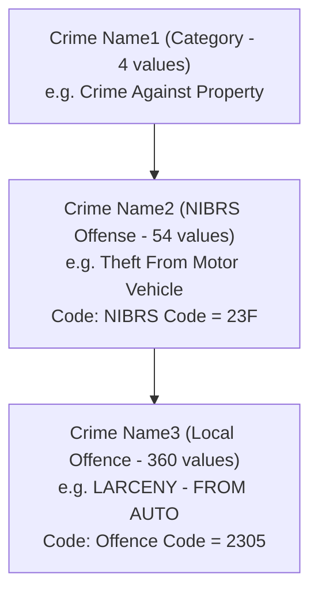
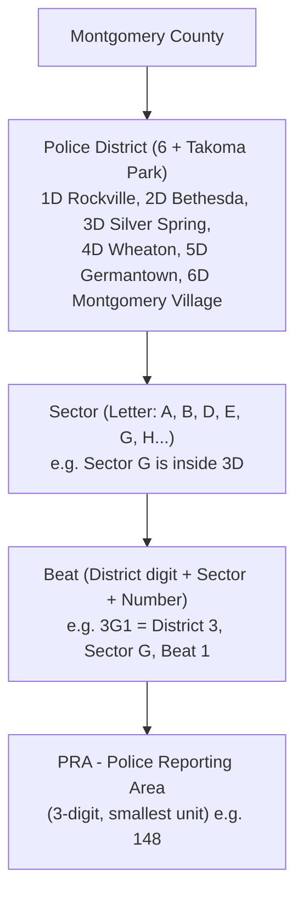
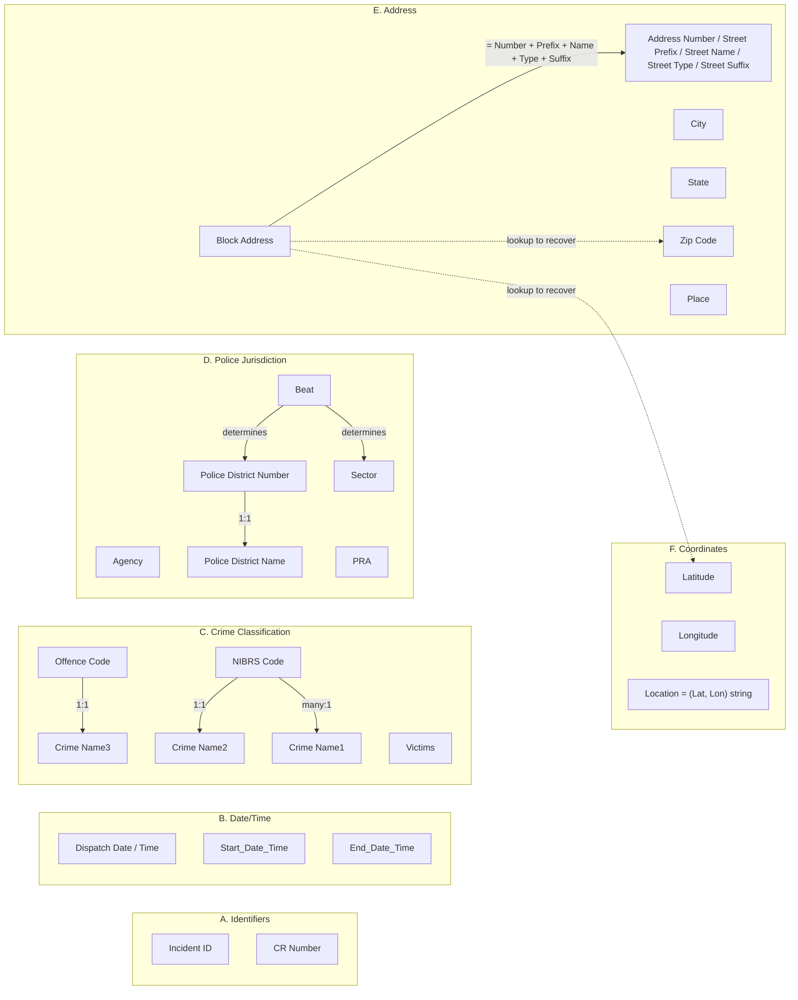

# 📘 Domain Knowledge Guide: `dataset_coursework1.csv`
## Montgomery County (Maryland, USA) Police Crime Incidents — Column-by-Column සම්පූර්ණ විස්තරය (සිංහලෙන්)

> [!NOTE]
> මේ document එකේ තියෙන හැම අංකයක්ම (row counts, missing %, unique values) **මුළු CSV file එකම (508,106 rows) Python එකෙන් scan කරලා** ගත්ත ඇත්ත අගයන්. ඔයාලගේ notebook එකේ `df.isna().sum()`, `df['col'].value_counts()` වගේ ඒවායින් ආයේ verify කරගන්න.
>
> මේ folder එකේම තියෙන [Dataset_Profile_Sinhala.md](Dataset_Profile_Sinhala.md) එක **dataset එක ගැන overview** එකක්. මේ document එක ඊට වඩා ගැඹුරට යනවා: **හැම column එකක්ම** domain එකේ මොකක්ද, ඒකෙන් ගන්න පුළුවන් insights මොනවද, ඒකේ තියෙන දෝෂ මොනවද, ඒවා clean කරන්නේ කොහොමද කියලා.

---

## 📑 පටුන

1. [Domain එක තේරුම් ගනිමු (Background Knowledge)](#1-domain-එක-තේරුම්-ගනිමු-background-knowledge)
2. [Dataset එක එක බැල්මෙන්](#2-dataset-එක-එක-බැල්මෙන්)
3. [Column Groups සහ ඒවා අතර සම්බන්ධතා](#3-column-groups-සහ-ඒවා-අතර-සම්බන්ධතා)
4. [Missing Data වර්ග (Theory) — Cleaning වලට කලින් දැනගන්න](#4-missing-data-වර්ග-theory)
5. [Column-by-Column සම්පූර්ණ විස්තරය (Columns 30)](#5-column-by-column-සම්පූර්ණ-විස්තරය)
   - [A. Identifier Columns](#a-identifier-columns)
   - [B. Date / Time Columns](#b-date--time-columns)
   - [C. Crime Classification Columns](#c-crime-classification-columns)
   - [D. Police Jurisdiction Columns](#d-police-jurisdiction-columns)
   - [E. Address / Geographic Columns](#e-address--geographic-columns)
   - [F. Coordinate Columns](#f-coordinate-columns)
6. [Summary Table: හැම Column එකකටම Cleaning Decision එක](#6-summary-table)
7. [සම්පූර්ණ Cleaning Pipeline එක (Python Code)](#7-සම්පූර්ණ-cleaning-pipeline-එක)
8. [Dataset එකෙන් අහන්න පුළුවන් Research Questions](#8-research-questions)
9. [Ethics සහ Limitations](#9-ethics-සහ-limitations)

---

## 1. Domain එක තේරුම් ගනිමු (Background Knowledge)

### 1.1 මේ data එක ආවේ කොහෙන්ද?

මේ dataset එක **Montgomery County Police Department (MCPD)** එක **Data Montgomery** (County එකේ Open Data Portal එක) හරහා publish කරන **"Crime"** dataset එක. Montgomery County කියන්නේ **USA, Maryland (MD) state** එකේ, Washington DC එකට උතුරින් තියෙන county එකක්. ජනගහනය ලක්ෂ 10ක් විතර.

හැම row එකක්ම කියන්නේ **පොලිසියට වාර්තා වුණු crime incident එකක ඇතුළත් එක offence එකක්**. (Incident එකක් කියන්නේ සිද්ධිය; offence එකක් කියන්නේ ඒ සිද්ධියේ කරපු එක වරදක්. උදා: එක burglary incident එකකම "Burglary" + "Vandalism" කියලා offences දෙකක් තියෙන්න පුළුවන්.)

### 1.2 NIBRS කියන්නේ මොකක්ද? (මේක තේරුම් ගන්න එක අත්‍යවශ්‍යයි)

**NIBRS (National Incident-Based Reporting System)** කියන්නේ USA එකේ **FBI** එක හඳුන්වා දීපු crime reporting standard එක. ඇමරිකාවේ පොලිස් හැම එකක්ම crime එක classify කරන්නේ මේ standard එකට අනුව.

NIBRS එකේ crime එකක් **levels 3කින්** classify කරනවා. මේ dataset එකේ `Crime Name1`, `Crime Name2`, `Crime Name3` කියන්නේ හරියටම මේ levels තුන:



| NIBRS Crime Category | අර්ථය | උදාහරණ |
| :--- | :--- | :--- |
| **Crime Against Person** | මිනිස් ශරීරයට / ජීවිතයට එරෙහි අපරාධ (victim කෙනෙක් ඉන්නවා) | Assault, Homicide, Sex offences, Kidnapping |
| **Crime Against Property** | දේපළ ලබාගැනීම / හානි කිරීම | Theft, Burglary, Vandalism, Fraud, Motor Vehicle Theft |
| **Crime Against Society** | සමාජයේ නීති/සදාචාරයට එරෙහි (සෘජු victim කෙනෙක් නැහැ) | Drug violations, DUI, Weapon law violations, "All Other Offenses" |
| **Crime Against Not a Crime** | පොලිසියට වාර්තා වුණත් crime එකක් නොවන සිද්ධි | Runaway (ළමයි ගෙදරින් පැනයාම), Justifiable Homicide |

> [!IMPORTANT]
> **"Crime Against Society → All Other Offenses (90Z)"** කියන එකේ rows **121,221 (23.9%)** තියෙනවා. මේ ඇතුළේ "POLICE INFORMATION", "LOST PROPERTY", "MENTAL ILLNESS - EMERGENCY PETITION", "RECOVERED PROPERTY" වගේ **ඇත්තටම අපරාධ නොවන** පොලිස් records ගොඩක් තියෙනවා. "Crime trends" analyse කරනකොට මේවා වෙනම handle කරන්න ඕනේ — නැත්නම් ඔයාලගේ "crime count" එක ලොකුවට inflate වෙනවා!

### 1.3 Police Organisation Structure (Geography Hierarchy)

Montgomery County Police එක ප්‍රදේශ **hierarchical** විදියට බෙදලා තියෙනවා:



- **Beat** code එක දැක්කම District එකයි Sector එකයි දෙකම කියන්න පුළුවන් (`3G1` → District 3, Sector G). Data එකේ check කළාම **එක Beat එකක් කවදාවත් District දෙකකට map වෙන්නේ නැහැ** — ඒ නිසා Beat එකෙන් District එක 100% විශ්වාසයෙන් recover කරන්න පුළුවන්.

### 1.4 Agencies (Police Departments)

County එක ඇතුළේ police agencies කීපයක් වැඩ කරනවා. City කීපයකට තමන්ගේම police department එකක් තියෙනවා:

| Code | සම්පූර්ණ නම | Rows | විස්තරය |
| :--- | :--- | ---: | :--- |
| `MCPD` | Montgomery County Police Department | 434,446 | ප්‍රධාන county police (85.5%) |
| `RCPD` | Rockville City Police Department | 28,878 | Rockville city එකේ police |
| `GPD` | Gaithersburg Police Department | 28,541 | Gaithersburg city එකේ police |
| `TPPD` | Takoma Park Police Department | 14,841 | Takoma Park city එකේ police |
| `MCFM` | Montgomery County Fire Marshal | 1,237 | ගිනි තැබීම් (Arson) වගේ ඒවා investigate කරන |
| `MCSO` | Montgomery County Sheriff's Office | 156 | Sheriff (court orders, warrants) |
| `OTHR` | Other | 4 | වෙනත් |
| `P` | ❌ Invalid | 3 | Data entry error (බොහෝවිට truncated value) |

### 1.5 Privacy සඳහා Data Anonymisation

Victims ලාගේ privacy එක රකින්න County එක **නිශ්චිත ලිපිනය දෙන්නේ නැහැ** — ඒ වෙනුවට **"Block" level** එකට round කරනවා (`1000 BLK MILESTONE DR` = Milestone Drive එකේ 1000–1099 අතර ගෙවල් block එක). Coordinates (Latitude/Longitude) ත් ඒ block එකේ මැද point එකට set කරලා තියෙන්නේ. ඒ නිසා **එකම block එකේ crimes සියල්ලම එකම coordinate එකේ** පෙනෙනවා (Hotspot map එකේ "stacked points" හැටියට).

---

## 2. Dataset එක එක බැල්මෙන්

| Property | අගය |
| :--- | :--- |
| File size | ~185 MB (CSV) |
| Rows (offence records) | **508,106** |
| Columns | **30** |
| Unique Incidents (`Incident ID`) | **467,601** |
| Rows-per-incident > 1 ඇති incidents | **33,749** (එක incident එකකට offences කීපයක්) |
| 100% සමාන duplicate rows | **0** |
| Time coverage (`Start_Date_Time`) | **2016-07-01 00:00** සිට **2026-09-14 20:44** දක්වා |
| 2016 / 2026 | ⚠️ **අර්ධ අවුරුදු** (2016 = July–Dec, 2026 = Jan–Sep 14) |
| Geography | Montgomery County, MD (Lat 38.9–39.35, Long −77.52 – −76.9) |

**අවුරුදු අනුව rows:**

| 2016* | 2017 | 2018 | 2019 | 2020 | 2021 | 2022 | 2023 | 2024 | 2025 | 2026* |
|---|---|---|---|---|---|---|---|---|---|---|
| 28,270 | 56,355 | 54,468 | 52,666 | 45,369 | 44,915 | 48,814 | 47,832 | 50,151 | 47,359 | 31,907 |

> [!WARNING]
> **Yearly trend chart එකක් අඳිනකොට 2016 සහ 2026 අර්ධ අවුරුදු.** ඒවා සම්පූර්ණ අවුරුදු එක්ක compare කළොත් "2016 සහ 2026 crime අඩු වුණා" කියලා වැරදි නිගමනයකට එනවා. විසඳුම: (1) 2017–2025 විතරක් yearly compare කරන්න, නැත්නම් (2) **monthly average** එකක් පාවිච්චි කරන්න.
> 2020 අඩුවීම (45,369) **COVID-19 lockdown** එකට සම්බන්ධ වෙන්න පුළුවන් — Report එකේ discuss කරන්න හොඳ point එකක්.

---

## 3. Column Groups සහ ඒවා අතර සම්බන්ධතා

Columns 30 logically groups 6කට බෙදන්න පුළුවන්. මේ groups අතර තියෙන **redundancy (එකම තොරතුර දෙපාරක් තියෙන තැන්)** තේරුම් ගත්තම missing values fill කරන්න ලේසියි:



**Data එකෙන් verify කරපු සම්බන්ධතා:**

| සම්බන්ධතාව | Verified? | Cleaning වලට වැදගත්කම |
| :--- | :---: | :--- |
| `Offence Code` ↔ `Crime Name3` | ✅ 100% 1:1 | එකක් තිබ්බොත් අනිත් එක ඕනේ නැහැ (redundant) |
| `NIBRS Code` ↔ `Crime Name2` | ✅ 100% 1:1 | Redundant |
| `NIBRS Code` → `Crime Name1` | ✅ හැම code එකකටම එක category එකයි | Redundant |
| `Police District Number` ↔ `Police District Name` | ✅ 1:1 | Name missing නම් Number එකෙන් fill කරන්න පුළුවන් |
| `Beat` → `Police District Number` | ✅ කිසිම Beat එකක් district 2කට යන්නේ නැහැ | District recover කරන්න පුළුවන් |
| `Sector` → `Police District Number` | ✅ (එක row එකක් හැර — `P`→`3D` 1 row) | Consistency check එකක් |
| `Location` = `(Latitude, Longitude)` | ✅ 4 decimal places වලට round කරපු string එක | Drop කරන්න (redundant) |
| `Block Address` → `Latitude/Longitude` | ✅ Block 23,010න් 13,461ක් හැමවිටම එකම coordinate | Lat=0 rows recover කරන්න lookup |

---

## 4. Missing Data වර්ග (Theory)

Cleaning decision එකක් ගන්න කලින් **"මේ value එක missing වුණේ ඇයි?"** කියලා අහන්න ඕනේ. Statistics වල missingness වර්ග 3ක් තියෙනවා, plus practical වර්ගයක්:

| වර්ගය | අර්ථය | මේ dataset එකේ උදාහරණය | කරන්න ඕනේ දේ |
| :--- | :--- | :--- | :--- |
| **MCAR — Missing Completely At Random** (සම්පූර්ණයෙන්ම අහඹු ලෙස අතුරුදන්) | Missing වීමට කිසිම රටාවක් නැහැ | `City` missing 37 rows, `PRA` missing 9 | Drop කළත් bias එකක් නැහැ |
| **MAR — Missing At Random** (වෙනත් column එකකට අනුව අතුරුදන්) | Missing වීම වෙනත් observed column එකකට සම්බන්ධයි | `Dispatch Date / Time` — **2016 දී 99.1% missing, 2021 දී 1.4% විතරයි** (අවුරුද්දට අනුව) | Group-wise analyse කරන්න; impute කරන්න එපා |
| **MNAR — Missing Not At Random** (අගය නිසාම අතුරුදන්) | අගය මොකක්ද කියන එක නිසාම missing වෙනවා | `End_Date_Time` — Crime එක හරියටම කවදා ඉවර වුණාද කියලා **දන්නේ නැති** නිසාම හිස් | Impute කරන්න එපා; "unknown" flag එකක් හදන්න |
| **Structural Missing** (ස්වභාවයෙන්ම හිස් විය යුතු) | Value එකක් තියෙන්න **ඕනෙම නැහැ** | `Street Prefix` (95.6%) — හැම පාරකටම "N/E/W/S" කියලා දිශාවක් නැහැ | Missing කියලා සලකන්නම එපා; `""`/"None" දාන්න |
| **Disguised Missing** (වෙස්වලාගත් missing) | NaN නෙවෙයි, ඒත් ඇත්තටම missing | `Latitude = 0.0` (24,648 rows), `Beat = "own"`, `Sector = "w"`, `PRA = "Unknown"` | **මේවා තමයි භයානකම** — `isna()` එකට අහුවෙන්නේ නැහැ! NaN බවට convert කරන්න |

> [!CAUTION]
> `df.isna().sum()` එක දුවලා "Latitude එකේ missing 0යි" කියලා නවතින්න එපා. **Latitude = 0.0** කියන්නේ Atlantic සාගරේ මැද (Gulf of Guinea, Africa ළඟ) තියෙන point එකක්! Hotspot map එකක් අඳිනකොට ඒ rows 24,648 ම Africa ළඟ dot එකක් විදියට පෙනෙනවා.

---

## 5. Column-by-Column සම්පූර්ණ විස්තරය

හැම column එකකටම මේ format එක පාවිච්චි කරලා තියෙනවා:
- 📖 **Domain Meaning** — මේ column එක ඇත්ත ලෝකයේ මොකක්ද
- 📊 **Data Facts** — dtype, missing, unique, sample values
- 🎯 **Outcome / Insights** — මේ column එකෙන් ගන්න පුළුවන් analysis
- ⚠️ **Issues** — data quality ගැටලු
- 🧹 **Cleaning Strategy** — කරන්න ඕනේ දේ + Python code

---

### A. Identifier Columns

---

#### 1. `Incident ID`

📖 **Domain Meaning:** පොලිස් records system එකේ හැම crime **incident** (සිද්ධිය) එකකටම දෙන unique අංකය. එකම සිද්ධියේ offences කීපයක් තිබුණොත් ඒ හැම row එකකම එකම `Incident ID` එක තියෙනවා.

📊 **Data Facts:**
| Property | අගය |
| :--- | :--- |
| Raw dtype | integer (9-digit) |
| Missing | **0 (0%)** |
| Unique | 467,601 (rows 508,106න්) |
| Range | 201087096 – 201590766 |
| Max rows per incident | 9 (උදා: `201458365`, `201168542`) |

🎯 **Outcome / Insights:**
- **Incident count vs Offence count:** "Crime කීයක් වුණාද?" කියන ප්‍රශ්නයට උත්තර දෙන්න **`df['Incident ID'].nunique()`** (467,601) පාවිච්චි කරන්න — `len(df)` (508,106) නෙවෙයි. Report එකේ මේ වෙනස පැහැදිලිව කියන්න.
- **Multi-offence incidents:** `df.groupby('Incident ID').size()` → සිද්ධියක offences කීයක් තියෙනවාද? (උදා: Drug + Weapon එකට සිදුවෙන රටාව).
- **Crime co-occurrence analysis:** එකම incident එකේ එකට වෙන crime types මොනවද? (උදා: Burglary + Destruction of Property).

⚠️ **Issues:** කිසිම ගැටලුවක් නැහැ. එකම incident එකේ rows වල Offence Code repeat වෙන්නේ නැහැ (verified) — ඒ කියන්නේ මේවා duplicates නෙවෙයි, **වෙනස් offences**.

🧹 **Cleaning Strategy:**
- ❌ **Duplicates විදියට drop කරන්න එපා!** `df.drop_duplicates(subset='Incident ID')` කළොත් offences 40,505ක් නැති වෙනවා.
- Dtype: `string` හෝ `int64` (calculations කරන්නේ නැති නිසා identifier එකක් හැටියට `string` හොඳයි).

```python
df['Incident ID'] = df['Incident ID'].astype('string')
# Incident-level analysis සඳහා:
offences_per_incident = df.groupby('Incident ID').size()
print(offences_per_incident.value_counts().sort_index())
```

---

#### 2. `CR Number`

📖 **Domain Meaning:** **Central Records / Case Report Number** — Officer කෙනෙක් report එක ලියනකොට දෙන case number එක. Court, insurance claims වගේ ඒවට reference කරන්නේ මේ අංකය. **මුල් ඉලක්කම් 2 = අවුරුද්ද** (`260040147` → 20**26**; `16033468` → 20**16**, 8-digit).

📊 **Data Facts:**
| Property | අගය |
| :--- | :--- |
| Missing | **0** |
| Unique | 467,534 (Incident ID 467,601ට වඩා 67ක් අඩුයි) |
| Length | 9-digit: 429,737 / **8-digit: 37,797** |

🎯 **Outcome / Insights:**
- **Data validation:** CR Number එකේ අවුරුදු prefix එක `Start_Date_Time` year එකට ගැලපෙනවද? (Report year vs Crime year — පරණ crime එකක් පස්සේ report කළොත් වෙනස් වෙනවා → **delayed reporting** analysis).
- CR 1කට Incident ID කීපයක් (67 cases) — linked incidents.

⚠️ **Issues:** 8-digit සහ 9-digit format දෙකක් (2016/2017 records 8-digit). Numeric විදියට read කළොත් leading zero ප්‍රශ්න නැති වුණත් format inconsistent.

🧹 **Cleaning Strategy:** String විදියට තියාගන්න. Analysis වලට අවශ්‍ය නැත්නම් **drop** කරන්න (Incident ID එක තියෙනවා).

```python
df['CR Number'] = df['CR Number'].astype('string')
df['cr_year'] = 2000 + df['CR Number'].str[:2].astype(int)   # Optional validation feature
```

---

### B. Date / Time Columns

> [!TIP]
> Date columns තුනම format එක `MM/DD/YYYY HH:MM:SS AM/PM`. **Format එක explicitly දෙන්න** — නැත්නම් pandas row 5 ලක්ෂයක් එකින් එක guess කරලා ගොඩක් slow වෙනවා:
> ```python
> FMT = '%m/%d/%Y %I:%M:%S %p'
> for c in ['Dispatch Date / Time', 'Start_Date_Time', 'End_Date_Time']:
>     df[c] = pd.to_datetime(df[c], format=FMT, errors='coerce')
> ```

---

#### 3. `Dispatch Date / Time`

📖 **Domain Meaning:** 911 call එකට පස්සේ **Police officer කෙනෙක්ව සිද්ධිය වෙත යැව්ව (dispatch කරපු) වෙලාව**. Officer කෙනෙක් dispatch නොකරපු cases වලට (උදා: online report, station එකට ඇවිත් report කිරීම, පස්සේ හොයාගත්ත fraud) මේ value එක **නැහැ**.

📊 **Data Facts:**
| Property | අගය |
| :--- | :--- |
| Missing | **73,405 (14.45%)** |
| Unique | 397,963 |
| Suspicious repeat | `12/02/2019 04:39:39 PM` → 48 rows (bulk/system entry) |

**Missing % අවුරුද්දට අනුව (MAR එකක් බවට සාක්ෂිය):**

| 2016 | 2017 | 2018 | 2019 | 2020 | 2021 | 2022 | 2023 | 2024 | 2025 | 2026 |
|---|---|---|---|---|---|---|---|---|---|---|
| **99.1%** | 28.6% | 5.1% | 5.4% | 1.2% | 1.4% | 1.2% | 6.5% | 15.5% | 14.0% | 13.8% |

🎯 **Outcome / Insights:**
- **Response / Reporting Lag (ප්‍රතිචාර ප්‍රමාදය):** `Dispatch − Start` = crime එක පටන් ගත්තට පස්සේ police dispatch වෙන්න ගිය කාලය.
  - Median lag = **~2.8 minutes** (0.046 hours) — ගොඩක් crimes "in progress" ලෙස වාර්තා වෙනවා.
  - 90th percentile = **~120 hours (දින 5)** — Theft වගේ ඒවා දින ගණනකට පස්සේ හොයාගන්නවා.
- **Crime type අනුව lag compare කිරීම** (Assault vs Theft vs Fraud) — හොඳ boxplot එකක්.
- **Dispatched vs Non-dispatched** — `has_dispatch` flag එකෙන් "Officer යවන්න තරම් urgent crimes මොනවද?" analyse කරන්න.

⚠️ **Issues:**
1. **14.45% missing** — **2016 data එකේ dispatch system එක record වෙලාම නැහැ** (99.1%) → MAR (year-dependent). 2023 සිට ආයේ වැඩිවෙලා (online reporting වැඩිවීම?).
2. **Negative lag 29,165 rows** — Dispatch එක Start එකට කලින්! (Victim කියපු "start time" එක estimate එකක් වීම, නැත්නම් data entry error).
3. Extreme lags — max **83,898 hours (~9.5 years)**.

🧹 **Cleaning Strategy:**
- ❌ **Impute කරන්න එපා** (mean/median dispatch time එකක් දැම්මොත් ඒක කෙලින්ම වැරදි තොරතුරක්).
- ✅ `has_dispatch` boolean flag එකක් හදන්න.
- ✅ Lag analysis කරනකොට විතරක් missing rows බැහැර කරන්න, **negative lags NaN කරන්න**, extreme values (> 99th percentile) cap/exclude කරන්න.
- ✅ Lag analysis එක 2018–2022 වගේ missing අඩු අවුරුදු වලට සීමා කිරීම ගැන සලකන්න (2016 අනිවාර්යයෙන් exclude).

```python
df['has_dispatch'] = df['Dispatch Date / Time'].notna()
df['dispatch_lag_min'] = (df['Dispatch Date / Time'] - df['Start_Date_Time']).dt.total_seconds() / 60
df.loc[df['dispatch_lag_min'] < 0, 'dispatch_lag_min'] = np.nan          # impossible values
cap = df['dispatch_lag_min'].quantile(0.99)
df['dispatch_lag_min_capped'] = df['dispatch_lag_min'].clip(upper=cap)
```

---

#### 4. `Start_Date_Time`

📖 **Domain Meaning:** **Crime එක පටන් ගත්ත (නැත්නම් පටන් ගත්තා යැයි සැලකෙන) වෙලාව**. Victim/witness කියන විදියට record කරන්නේ. උදා: "රෑ 10ට වාහනය park කළා, උදේ 7ට බලනකොට glass කඩලා" → Start = 10 PM, End = 7 AM.

📊 **Data Facts:**
| Property | අගය |
| :--- | :--- |
| Missing | **0 (0%)** ✅ |
| Range | 2016-07-01 00:00 → 2026-09-14 20:44 |
| Midnight (00:00) starts | **21,760 rows** ⚠️ |
| Top value | `01/01/2021 12:00:00 AM` (57), `01/01/2022 12:00:00 AM` (56), `01/01/2020 …` (51) |

🎯 **Outcome / Insights (මේ dataset එකේ වැදගත්ම column එක!):**
- **Temporal patterns:**
  - `hour` → **Hour-of-day crime pattern** (රෑ වෙලාවේ crime වැඩිද?)
  - `day_of_week` → Weekend vs Weekday
  - `month` → **Seasonality** (ගිම්හානයේ crime වැඩිද?)
  - `year` → Long-term trend, COVID-2020 effect
- **Heatmap: Day-of-week × Hour** — Crime analysis වල classic visualization එක.
- **Crime type × Hour** — DUI රෑට, Shoplifting දවල්ට වගේ රටා.

⚠️ **Issues:**
1. **Placeholder midnight times (21,760):** නියම වෙලාව දන්නේ නැති විට officer `12:00 AM` දානවා. `hour == 0` bar එක අසාමාන්‍ය ලෙස උස යනවා → **"මධ්‍යම රාත්‍රියේ crime වැඩියි" කියන වැරදි නිගමනය**.
2. **Placeholder dates — මාසයේ 1 වෙනිදා:** `01/01/YYYY 12:00:00 AM` (ජනවාරි 1) සහ `03/01`, `10/01` වගේ — Fraud/identity theft වගේ crime එක "කවදා ද කියලා හරියටම නොදන්නා" විට අවුරුද්දේ/මාසයේ මුල් දිනය දානවා → **ජනවාරි 1 sharp spike**.
3. 2016 සහ 2026 අර්ධ අවුරුදු.

🧹 **Cleaning Strategy:**
- Missing නැහැ — fill කරන්න දෙයක් නැහැ.
- ✅ `is_midnight_placeholder` flag එකක් හදලා **hour-of-day analysis එකේදී ඒ rows exclude කරන්න** (report එකේ assumption එක ලියන්න).
- ✅ Feature engineering:

```python
s = df['Start_Date_Time']
df['year']        = s.dt.year
df['month']       = s.dt.month
df['day_of_week'] = s.dt.day_name()
df['hour']        = s.dt.hour
df['is_weekend']  = s.dt.dayofweek >= 5
df['is_midnight_placeholder'] = (s.dt.hour == 0) & (s.dt.minute == 0)
df['is_first_of_month_midnight'] = df['is_midnight_placeholder'] & (s.dt.day == 1)

# Hour analysis — placeholders නැතුව
hourly = df.loc[~df['is_midnight_placeholder'], 'hour'].value_counts().sort_index()
# Full years only for yearly trend
full_years = df[df['year'].between(2017, 2025)]
```

---

#### 5. `End_Date_Time`

📖 **Domain Meaning:** Crime එක **අවසන් වුණු (නැත්නම් සොයාගත්) වෙලාව**. Crime එක එක මොහොතක සිදුවුණොත් (උදා: assault එකක්, DUI arrest එකක්) End time එකක් අවශ්‍ය නැහැ — ඒ නිසා ගොඩක් rows හිස්.

📊 **Data Facts:**
| Property | අගය |
| :--- | :--- |
| Missing | **282,444 (55.59%)** ❗ |
| Negative duration (End < Start) | **8,418 rows** |
| Median duration | **4 hours** |
| 90th percentile | 124 hours (~5 දින) |
| Max | 83,880 hours |

Missing % 2016 දී 45.6% සිට 2026 දී 63.3% දක්වා **කෙමෙන් වැඩිවෙනවා**.

🎯 **Outcome / Insights:**
- **Crime Duration / Discovery Window:** `End − Start` → "Crime එක සිද්ධ වෙන්න පුළුවන් කාල පරාසය". Theft from auto (රාත්‍රිය පුරා) vs Shoplifting (විනාඩි කීපයක්).
- `has_end_time` flag එක → **"instantaneous" crimes vs "window" crimes** classify කිරීම (Crime Name2 අනුව % compare කරන්න — හොඳ insight එකක්).

⚠️ **Issues:**
1. **55.6% missing** — මේක **MNAR + Structural**. End time එකක් නැත්තේ (a) crime එක instantaneous නිසා, නැත්නම් (b) නොදන්නා නිසා.
2. Negative durations 8,418 — AM/PM වැරදීම් / data entry errors.

🧹 **Cleaning Strategy:**
- ❌ **Impute කරන්න එපා** (Start + median duration දැම්මොත් බොරු data හැදෙනවා). 55% missing column එකක් impute කරන එක statistically වැරදියි.
- ❌ Column එක drop කරන්නත් අවශ්‍ය නැහැ — duration analysis වලට ප්‍රයෝජනවත්.
- ✅ `has_end_time` flag + `duration_hours` (negative → NaN).
- ⚠️ Option: End == NaN නම් `duration = 0` (instantaneous) කියලා assume කරන්නත් පුළුවන් — **එහෙම කළොත් report එකේ assumption එක පැහැදිලිව ලියන්න**.

```python
df['has_end_time'] = df['End_Date_Time'].notna()
df['duration_hours'] = (df['End_Date_Time'] - df['Start_Date_Time']).dt.total_seconds() / 3600
df.loc[df['duration_hours'] < 0, 'duration_hours'] = np.nan
```

---

### C. Crime Classification Columns

---

#### 6. `Offence Code`

📖 **Domain Meaning:** Maryland/County **local offence code** එක (4-digit). NIBRS code එකට වඩා විස්තරාත්මකයි. මුල් ඉලක්කම් 2 = offence family එක (`23xx` = Larceny/Theft, `13xx` = Assault, `35xx` = Drugs, `54xx` = DUI, `91xx` = Police information / non-crime).

📊 **Data Facts:**
| Property | අගය |
| :--- | :--- |
| Missing | **0** |
| Unique | **360** |
| Top | `2305` (41,308 — Larceny from auto), `2303` (35,011 — Shoplifting), `9199` (33,174 — Police information), `1399` (31,826 — Assault 2nd degree) |

🎯 **Outcome:** Detailed offence analysis. `Crime Name3` එකේ text label එක තියෙන නිසා plot කරනකොට ඒක පාවිච්චි කරන්න.

⚠️ **Issues:** නැහැ. `Crime Name3` එකට **100% 1:1** → redundant.

🧹 **Cleaning Strategy:** String/category විදියට තියාගන්න (numeric math කරන්න එපා — code එකක් මිසක් quantity එකක් නෙවෙයි). Dimensionality reduction වලදී `Crime Name3` එක තියාගෙන මේක drop කරන්නත් පුළුවන්.

```python
df['Offence Code'] = df['Offence Code'].astype('string').astype('category')
```

---

#### 7. `NIBRS Code`

📖 **Domain Meaning:** **FBI NIBRS Offense Code** (3-character, උදා: `23F`, `13B`, `90Z`). Section 1.2 බලන්න. මේක **ඇමරිකාව පුරා standard** නිසා වෙනත් county/state data එක්ක compare කරන්න පුළුවන් column එක මේකයි.

| Code | අර්ථය |  Code | අර්ථය |
|---|---|---|---|
| `90Z` | All Other Offenses (121,221) | `35A` | Drug/Narcotic Violations |
| `23F` | Theft From Motor Vehicle | `23H` | All Other Larceny |
| `13B` | Simple Assault | `90D` | Driving Under the Influence |
| `23C` | Shoplifting | `240` | Motor Vehicle Theft |
| `290` | Destruction/Vandalism | `220` | Burglary/Breaking & Entering |
| `13A` | Aggravated Assault | `09A` | Murder & Non-negligent Manslaughter |

> NIBRS code එකේ **letters**: `23A`–`23H` ඔක්කොම Larceny family එක; `13A/B/C` Assault family එක. `9xx` codes ("Group B" offenses) — අඩු බරපතළකම, arrest එකක් වුණොත් විතරක් report වෙන්නේ.

📊 **Data Facts:** Missing **0**, Unique **54**. `90I` (Runaway) සහ `09C` (Justifiable Homicide) → "Crime Against Not a Crime".

🎯 **Outcome:** Crime type distribution (Top-10 bar chart), crime mix by district/year, **Property vs Person vs Society** ratio.

⚠️ **Issues:** නැහැ. `Crime Name2` එකට 1:1.

🧹 **Cleaning Strategy:** Category dtype. NIBRS "family" feature එකක් හදන්න පුළුවන්:

```python
df['NIBRS Code'] = df['NIBRS Code'].astype('category')
df['nibrs_family'] = df['NIBRS Code'].astype(str).str[:2]   # '23' = Larceny, '13' = Assault ...
```

---

#### 8. `Victims`

📖 **Domain Meaning:** Offence එකේ **victims ගණන** (පුද්ගලයන්, ව්‍යාපාර, ආයතන, නැත්නම් "Society").

📊 **Data Facts:**
| Victims | 1 | 2 | 3 | 4 | 5 | 6 | 7 | 8 | 9 | 22 |
|---|---|---|---|---|---|---|---|---|---|---|
| Rows | 499,046 | 7,704 | 928 | 288 | 86 | 23 | 23 | 5 | 2 | **1** |

- Missing **0**, Min = **1** (0 කවදාවත් නැහැ), Max = **22** (Simple Assault එකක්).

🎯 **Outcome:**
- Multi-victim crimes (Victims ≥ 2) — Assault/Robbery type මොනවද?
- **Total victims per district/year** — `df.groupby('year')['Victims'].sum()`.

⚠️ **Issues:**
1. **Min = 1 හැමවිටම** — "Crime Against Society" (Drugs, DUI) වලට ඇත්ත victim කෙනෙක් නැතත් `1` දාලා (NIBRS එකේ "Society/Public" victim type එක). ඒ නිසා **"Victims" ≠ "හානි වුණු මිනිස්සු"**. Person crimes වලට විතරක් මේ column එක meaningful.
2. **Outlier: 22** — බොහෝවිට ඇත්ත (group fight එකක්) — බැහැර කරන්න එපා, ඒත් mean එකට බලපාන නිසා **median** පාවිච්චි කරන්න.

🧹 **Cleaning Strategy:** `int8` dtype (memory). Outlier එක තියාගන්න; IQR method එක මෙතන අදාළ නැහැ (99% ම 1 නිසා IQR = 0 → හැම 2+ value එකක්ම "outlier" වෙනවා — ඒක වැරදි නිගමනයක්!).

```python
df['Victims'] = df['Victims'].astype('int8')
person_victims = df.loc[df['Crime Name1'] == 'Crime Against Person', 'Victims']
```

---

#### 9. `Crime Name1`

📖 **Domain Meaning:** NIBRS **Crime Against Category** එක (ඉහළම level එක). Section 1.2 table එක බලන්න.

📊 **Data Facts:** Missing **0**, Unique **4**:
| Category | Rows | % |
| :--- | ---: | ---: |
| Crime Against Property | 246,236 | 48.5% |
| Crime Against Society | 202,327 | 39.8% |
| Crime Against Person | 53,385 | 10.5% |
| Crime Against Not a Crime | 6,158 | 1.2% |

🎯 **Outcome:** Pie/stacked bar chart, **category share over years** (100% stacked area chart), district අනුව crime profile (Bethesda = property-heavy? Silver Spring = person crimes?).

⚠️ **Issues:** "Crime Against" prefix එක repeat වෙනවා (labels දිගයි). "Not a Crime" (Runaway 6,143 + Justifiable Homicide 15) crime analysis එකෙන් exclude කළ යුතුද කියලා තීරණය කරන්න.

🧹 **Cleaning Strategy:** Labels කෙටි කරලා category dtype එකට:

```python
df['crime_category'] = (df['Crime Name1'].str.replace('Crime Against ', '', regex=False)
                                         .astype('category'))     # Property / Society / Person / Not a Crime
df_crimes = df[df['crime_category'] != 'Not a Crime']             # Crime-only analysis
```

---

#### 10. `Crime Name2`

📖 **Domain Meaning:** **NIBRS Offense name** එක (`NIBRS Code` එකේ text label එක) — උදා: "Theft From Motor Vehicle", "Simple Assault".

📊 **Data Facts:** Missing **0**, Unique **54**. Rare: Incest, Justifiable Homicide, Negligent Manslaughter, Human Trafficking, Bribery, Gambling.

🎯 **Outcome:** **ප්‍රධාන "crime type" column එක** visualization වලට — Top-10 crimes horizontal bar chart, crime type × hour heatmap, crime type trend (Motor Vehicle Theft 2023 දී වැඩි වුණාද?).

⚠️ **Issues:**
1. "All Other Offenses" (23.9%) ලොකු "අපැහැදිලි" කණ්ඩායමක් — Top-N charts වල **පළමු තැන ගන්නේ මේක**, ඒත් ඒකෙන් මොකුත් තේරෙන්නේ නැහැ. Exclude කිරීම / වෙනම note කිරීම.
2. Capitalisation inconsistency: "All other Larceny" vs "All Other Offenses".
3. Rare categories (rows < 50) charts අවුල් කරනවා.

🧹 **Cleaning Strategy:** Strip + category. Rare categories "Other (rare)" ලෙස group කරන්න (charts වලට විතරක්):

```python
df['Crime Name2'] = df['Crime Name2'].str.strip().astype('category')
counts = df['Crime Name2'].value_counts()
rare = counts[counts < 500].index
df['crime_type_grouped'] = df['Crime Name2'].astype(str).where(~df['Crime Name2'].isin(rare), 'Other (rare)')
```

---

#### 11. `Crime Name3`

📖 **Domain Meaning:** **Local detailed offence description** (`Offence Code` එකේ label එක) — උදා: "LARCENY - FROM AUTO", "ASSAULT - 2ND DEGREE", "DRUGS - MARIJUANA - POSSESS".

📊 **Data Facts:** Missing **0**, Unique **360**. ALL CAPS. Top: LARCENY - FROM AUTO (41,308), LARCENY - SHOPLIFTING (35,011), **POLICE INFORMATION (33,174)**, ASSAULT - 2ND DEGREE (31,826), **MENTAL ILLNESS - EMERGENCY PETITION (19,739)**, **LOST PROPERTY (17,917)**.

🎯 **Outcome:**
- **Non-crime records හඳුනාගැනීම:** "POLICE INFORMATION", "LOST PROPERTY", "RECOVERED PROPERTY", "MENTAL ILLNESS - EMERGENCY PETITION" → පොලිසියේ service calls, crimes නෙවෙයි.
- **Policy change analysis:** "DRUGS - MARIJUANA - POSSESS" — Maryland එකේ **2023 July 1 cannabis legalisation** එකෙන් පස්සේ මේ records අඩු වුණාද? (Excellent research question!)
- Weapon involvement: text එකේ "GUN", "KNIFE" වගේ keywords → `str.contains()` වලින් weapon flag එකක්.

⚠️ **Issues:** Text inconsistency (`-` spacing, abbreviations: "BLDG", "AUTO", "COMM SEX OFF"), 360 categories visualization එකකට වැඩියි.

🧹 **Cleaning Strategy:**

```python
df['Crime Name3'] = df['Crime Name3'].str.strip().str.replace(r'\s+', ' ', regex=True).astype('category')
non_crime_terms = ['POLICE INFORMATION', 'LOST PROPERTY', 'RECOVERED PROPERTY',
                   'MENTAL ILLNESS', 'FOUND PROPERTY', 'SUDDEN DEATH']
df['is_service_call'] = df['Crime Name3'].astype(str).str.contains('|'.join(non_crime_terms))
df['weapon_flag']     = df['Crime Name3'].astype(str).str.contains(r'GUN|FIREARM|KNIFE|WEAPON')
```

---

### D. Police Jurisdiction Columns

---

#### 12. `Police District Name`

📖 **Domain Meaning:** Crime එක වුණු **Police District එකේ නම** (Section 1.3). County එකේ district 6 + Takoma Park.

📊 **Data Facts:**
| District | Rows |
| :--- | ---: |
| SILVER SPRING (3D) | 106,353 |
| WHEATON (4D) | 93,816 |
| MONTGOMERY VILLAGE (6D) | 85,293 |
| BETHESDA (2D) | 72,723 |
| ROCKVILLE (1D) | 69,433 |
| GERMANTOWN (5D) | 63,982 |
| TAKOMA PARK (TPPD) | 14,949 |
| OTHER | 15 |
| **Missing** | **1,542 (0.30%)** |

🎯 **Outcome:** **District-wise crime comparison** — මුළු crimes, crime mix, trend. ⚠️ Fair comparison එකකට **population/area එකෙන් normalise** කරන්න ඕනේ (Silver Spring ජනගහනය වැඩි නිසාම crimes වැඩියි — "per 1,000 residents" rate එකක් external data එකකින්).

⚠️ **Issues:** Missing 1,542 rows ඔක්කොම `Police District Number = "Unknown"`, `Beat = "own"`, `Sector = "w"` — එකම corrupt records group එක. "OTHER" (15) ත් Unknown එකට.

🧹 **Cleaning Strategy:** මේ rows වලට Beat එකත් corrupt නිසා Beat-based recovery කරන්න බැහැ. **"Unknown" category එකක්** දාන්න (drop කරන්නේ නැතුව — 0.3% විතරයි, ඒත් crime count එකට අයිතියි). District analysis එකේදී විතරක් exclude කරන්න.

```python
df['Police District Name'] = (df['Police District Name'].fillna('UNKNOWN')
                                .replace({'OTHER': 'UNKNOWN'}).astype('category'))
```

---

#### 13. `Police District Number`

📖 **Domain Meaning:** District code එක — `1D`–`6D` (D = District), `TPPD` (Takoma Park Police Dept — තමන්ගේම area එක).

📊 **Data Facts:** Missing **0** (ඒත් **"Unknown" = 1,557** — disguised missing). District Name එකට 1:1.

🎯 **Outcome:** District Name එකම — එකක් තියාගන්න.

⚠️ **Issues:** "Unknown" string එක (disguised missing).

🧹 **Cleaning Strategy:** Redundant → **drop** කරන්න, නැත්නම් consistency check එකකට පාවිච්චි කරලා drop කරන්න.

```python
assert (df.groupby('Police District Number', observed=True)['Police District Name'].nunique() <= 2).all()
df = df.drop(columns=['Police District Number'])
```

---

#### 14. `Sector`

📖 **Domain Meaning:** District එකක් ඇතුළේ තියෙන **patrol sector** එක (තනි අකුරක්). Sector letter එකෙන් district එක කියන්න පුළුවන් (A, B → 1D; D, E → 2D; G, H, I → 3D; J, K, L → 4D; M, N → 5D; P, R → 6D; T → TPPD).

📊 **Data Facts:** Missing **0**, Unique **16** — ඒ අතර **`w` (lowercase) = 1,557** ❌.

🎯 **Outcome:** District වලට වඩා **සියුම් (granular) hotspot analysis** — "Silver Spring ඇතුළේ crime වැඩිම sector එක G ද I ද?"

⚠️ **Issues:** **`"w"`** කියන්නේ **"Unknown"** කියන word එකේ කෑල්ලක් (`Unkno-w-n`) — column shifting / string slicing error එකක්. (Beat එකේ `"own"` ත් ඒ වගේමයි — `Unkn-own`!)

🧹 **Cleaning Strategy:**

```python
df['Sector'] = df['Sector'].replace({'w': np.nan}).astype('category')
```

---

#### 15. `Beat`

📖 **Domain Meaning:** **Patrol beat** — officer කෙනෙක් patrol කරන කුඩාම බල ප්‍රදේශය. Format: `<District digit><Sector letter><Number>` (උදා: `3G1`).

📊 **Data Facts:** Missing **0**, Unique **60**. Top: `3G1` (32,744), `3I1` (23,282), `4L2` (22,770). ❌ Invalid: **`own` (1,542)**, **`-PG`** (Prince George's County? — border area code).

🎯 **Outcome:**
- **Micro-hotspot analysis** — Beat-level crime counts, Top-10 high-crime beats.
- **Missing District recovery** — Beat එකේ පළමු ඉලක්කම = District (verified 100% consistent).
- **Consistency validation:** `Beat[0] + 'D' == Police District Number` ද කියලා check කරලා data quality report එකක.

⚠️ **Issues:** `own`, `-PG`, ඒ වගේම `8T1/8T2/8T3` (8 = Takoma Park — TPPD).

🧹 **Cleaning Strategy:**

```python
df['Beat'] = df['Beat'].replace({'own': np.nan, '-PG': np.nan})
# Beat → District consistency check
beat_digit = df['Beat'].str[0]
mapping = {'1':'ROCKVILLE','2':'BETHESDA','3':'SILVER SPRING','4':'WHEATON',
           '5':'GERMANTOWN','6':'MONTGOMERY VILLAGE','8':'TAKOMA PARK'}
mismatch = (beat_digit.map(mapping) != df['Police District Name'].astype(str)) & beat_digit.notna()
print('Beat/District mismatches:', mismatch.sum())
df['Beat'] = df['Beat'].astype('category')
```

---

#### 16. `PRA`

📖 **Domain Meaning:** **Police Reporting Area** — Beat එකටත් වඩා කුඩා, crime statistics report කරන්න පාවිච්චි කරන කුඩාම geographic unit එක (3-digit, `000`–`909`).

📊 **Data Facts:** Missing **9**, Unique **808**. Disguised missing: **`Unknown` = 1,557**, `000` = 2, `1A3` = 1 (beat code එකක් වැරදියට PRA column එකට).

🎯 **Outcome:** Very fine-grained spatial aggregation. ⚠️ Shapefile එකක් (PRA boundaries) නැතුව visualise කරන්න අමාරුයි → Lat/Long එකෙන් hotspot map කරන එක ලේසියි.

⚠️ **Issues:** Numeric විදියට read කළොත් `094` → `94` (**leading zero නැතිවෙනවා!**). 'Unknown' text එක තියෙන නිසා pandas object dtype එකක් දෙනවා.

🧹 **Cleaning Strategy:** **String විදියටම read කරන්න** (`dtype={'PRA': 'string'}`), invalid → NaN:

```python
df['PRA'] = df['PRA'].astype('string')
df.loc[~df['PRA'].str.fullmatch(r'\d{3}', na=False) | (df['PRA'] == '000'), 'PRA'] = pd.NA
```

---

#### 17. `Agency`

📖 **Domain Meaning:** Incident එක **handle කරපු police agency එක** (Section 1.4 table).

📊 **Data Facts:** Missing **0**, Unique **8** — `P` (3 rows) invalid.

🎯 **Outcome:**
- Agency අනුව workload (MCPD 85.5%).
- City police (RCPD, GPD) තියෙන ප්‍රදේශ vs County police ප්‍රදේශ compare කිරීම.
- MCFM records → Arson/fire-related crimes.

⚠️ **Issues:** `P` (3) → truncated/invalid; `OTHR` (4).

🧹 **Cleaning Strategy:**

```python
df['Agency'] = df['Agency'].replace({'P': 'OTHR'}).astype('category')
```

---

### E. Address / Geographic Columns

---

#### 18. `Block Address`

📖 **Domain Meaning:** **Privacy සඳහා round කරපු ලිපිනය** (Section 1.5). Format: `<Number> BLK <Prefix> <Street Name> <Type>` (උදා: `1000 BLK  MILESTONE DR` — "BLK" එකට පස්සේ **spaces දෙකක්** — prefix එක හිස් නිසා).

📊 **Data Facts:**
| Property | අගය |
| :--- | :--- |
| Missing | **39,804 (7.83%)** |
| Unique | 23,491 |
| Top | `11100 BLK VEIRS MILL RD` (**7,244** — Westfield Wheaton Mall), `20900 BLK FREDERICK RD` (5,338), `7100 BLK DEMOCRACY BLV` (3,596 — Westfield Montgomery Mall) |

🎯 **Outcome:**
- **Repeat-location / Hotspot analysis:** Crime වැඩිම addresses — **Shopping malls** ඉහළින්ම (Shoplifting!). "Top-10 crime locations" table එක report එකට හොඳයි.
- **Lat/Long සහ Zip recovery වලට lookup key එක.**

⚠️ **Issues:**
1. 7.83% missing — බොහෝවිට `Address Number` ත් එක්කම missing (39,661) → location එක නොදන්නා incidents.
2. **Double spaces** (`BLK  MILESTONE`) — text matching වලට ගැටලු.
3. Highway addresses: `21000 BLK S270 X22 TO X18 HWY` (I-270 exits).

🧹 **Cleaning Strategy:** Whitespace normalise කරන්න; missing → **impute කරන්න බැහැ** (ලිපිනයක් "අනුමාන" කරන්න බැහැ) → `"UNKNOWN"` නැත්නම් NaN තියන්න.

```python
df['Block Address'] = df['Block Address'].str.strip().str.replace(r'\s+', ' ', regex=True)
```

---

#### 19. `City`

📖 **Domain Meaning:** Incident එක වුණු **city / postal locality** එක (Police District එකට වඩා වෙනස් — USPS mailing city එක).

📊 **Data Facts:** Missing **37**, Unique **314** ❗ (County එකේ ඇත්ත cities ~40ක් විතරයි!). Top: SILVER SPRING (175,611), GAITHERSBURG (71,631), ROCKVILLE (71,429), GERMANTOWN (48,583), BETHESDA (36,143).

🎯 **Outcome:** City-level comparison (District එකට වඩා සියුම්), "Top-10 cities by crime".

⚠️ **Issues — Typos ගොඩක්!** (manual data entry):
`SILVER SPRNIG`, `SILVER SPRIING`, `SILVER SPRIGN`, `RCKVILLE`, `MOMTGOMERY VILLAGE`, `CHEVY CAHSE`, ඒ වගේම `MARYLAND` (city එකක් නෙවෙයි — state එක!).

🧹 **Cleaning Strategy — Fuzzy matching (`difflib`, extra library අවශ්‍ය නැහැ):**

1. Uppercase + strip.
2. Rows 100+ තියෙන cities "valid list" එකක් ලෙස ගන්න.
3. අනිත් values වලට `difflib.get_close_matches()` එකෙන් ළඟම valid නම හොයන්න (cutoff 0.85).
4. Match නැත්නම් / `MARYLAND` නම් → Zip Code එකේ mode city එකෙන් fill කරන්න.

```python
import difflib
df['City'] = df['City'].str.upper().str.strip()
vc = df['City'].value_counts()
valid = vc[vc >= 100].index.tolist()

def fix_city(c):
    if pd.isna(c) or c in valid:
        return c
    m = difflib.get_close_matches(c, valid, n=1, cutoff=0.85)
    return m[0] if m else np.nan

city_map = {c: fix_city(c) for c in vc.index}
df['City'] = df['City'].map(city_map)
df.loc[df['City'] == 'MARYLAND', 'City'] = np.nan

# Missing city → same Zip Code එකේ most frequent city
zip_city = df.dropna(subset=['City', 'Zip Code']).groupby('Zip Code')['City'].agg(lambda s: s.mode()[0])
df['City'] = df['City'].fillna(df['Zip Code'].map(zip_city))
print('Unique cities after cleaning:', df['City'].nunique())
```

---

#### 20. `State`

📖 **Domain Meaning:** US State code එක. Montgomery County සම්පූර්ණයෙන්ම **Maryland (MD)** ඇතුළේ — ඒ නිසා theoretically **හැම row එකක්ම `MD`** විය යුතුයි.

📊 **Data Facts:** Missing **9,509 (1.87%)**. Values: `MD` (498,230), **`16` (224)**, `DC` (121), `VA` (12), `ME`, `MS`, `ND`, `MC`, `7`, `17`, `15`, `0`.

🎯 **Outcome:** ⚠️ **මේ column එකෙන් analysis value එකක් නැහැ** (constant column). Data quality report එකට විතරක් ප්‍රයෝජනවත්.

⚠️ **Issues:** Numeric codes (`16`, `7`) — garbage. `16` rows ඔක්කොම SILVER SPRING/OLNEY (MD) zip codes → ඇත්තටම MD. `DC` rows 22ක් "WASHINGTON" — County border එකේ incidents (Takoma Park DC එකට යාබදයි).

🧹 **Cleaning Strategy:** Zero-variance column එකක් නිසා **drop කරන්න** (නැත්නම් MD zip range එකට — `206xx`–`219xx` — අයිති නම් `MD` දාන්න).

```python
df = df.drop(columns=['State'])     # Constant (MD) — no analytical value
```

---

#### 21. `Zip Code`

📖 **Domain Meaning:** US **ZIP (postal) code** එක — 5-digit. Montgomery County zips `208xx` සහ `209xx` range එකේ (උදා: `20910` Silver Spring downtown, `20850` Rockville).

📊 **Data Facts:**
| Property | අගය |
| :--- | :--- |
| Missing | **3,474 (0.68%)** |
| Unique | 206 |
| Length | 5-digit: 190 values, **4-digit: 13**, 3-digit: 2, 1-digit: 1 ❌ |
| Top | `20910` (43,207), `20902` (36,289), `20904` (32,621) |

🎯 **Outcome:** **Zip-level choropleth map** (ZCTA shapefile එකක් එක්ක) හොඳම spatial visualization එක; external **census population data** එක්ක join කරලා **crime rate per capita** ගණනය කිරීම (Zip එක තමයි join key එක!).

⚠️ **Issues:**
1. **Truncated zips:** `2087`, `2902`, `2906`, `874`, `209`, `6` — ඉලක්කම් අඩුයි (data entry / numeric conversion).
2. Numeric dtype එකට read වුණොත් float (`20910.0`) වෙනවා (NaN තියෙන නිසා).

🧹 **Cleaning Strategy:** String ලෙස read කරන්න → 5-digit නොවන ඒවා NaN → **Block Address lookup එකෙන් recover කරන්න** (missing 3,474න් **3,067ක් (88%)** recover කරන්න පුළුවන් — verified):

```python
df['Zip Code'] = df['Zip Code'].astype('string').str.strip()
df.loc[~df['Zip Code'].str.fullmatch(r'\d{5}', na=False), 'Zip Code'] = pd.NA

block_zip = (df.dropna(subset=['Zip Code', 'Block Address'])
               .groupby('Block Address')['Zip Code'].agg(lambda s: s.mode()[0]))
df['Zip Code'] = df['Zip Code'].fillna(df['Block Address'].map(block_zip))
print('Zip still missing:', df['Zip Code'].isna().sum())
```

---

#### 22. `Place`

📖 **Domain Meaning:** Crime එක වුණු **ස්ථාන වර්ගය (Location Type)** — NIBRS "Location Type" field එක. උදා: Residence, Street, Parking Lot, Retail store, School.

📊 **Data Facts:** Missing **0**, Unique **100**. Top: `Residence - Single Family` (52,419), `Residence - Apartment/Condo` (49,545), `Street - In vehicle` (44,807), **`Other/Unknown` (40,895)**, `Street - Residential` (35,054).

🎯 **Outcome (ඉතා වටිනා column එකක්):**
- **"Crime කොහෙද වෙන්නේ?"** — Residence vs Street vs Commercial vs Parking.
- **Place × Crime type** — Theft from auto → Parking lots; Shoplifting → Retail; Assault → Residence (domestic violence?).
- Place-based prevention recommendations (Parking lot CCTV, lighting).

⚠️ **Issues:**
1. **`Other/Unknown` = 40,895 (8%)** — disguised missing.
2. **Inconsistent formatting:** `Residence -Townhouse/Duplex` (space නැහැ) vs `Residence - Single Family`.
3. 100 categories — chart එකකට වැඩියි.

🧹 **Cleaning Strategy:** Spaces normalise කරලා, **`" - "` එකට කලින් කොටසෙන් broad group එකක්** හදන්න (`Residence`, `Street`, `Parking Lot`, `Retail`, ...):

```python
df['Place'] = df['Place'].str.replace(r'\s*-\s*', ' - ', regex=True).str.strip()
df['place_group'] = df['Place'].str.split(' - ').str[0].astype('category')
df.loc[df['Place'] == 'Other/Unknown', 'place_group'] = 'Unknown'
print(df['place_group'].value_counts().head(12))
```

---

#### 23. `Address Number`

📖 **Domain Meaning:** Block Address එකේ **number කොටස** (block start number — `1000`, `11100`).

📊 **Data Facts:** Missing **39,661 (7.81%)** — Block Address missing එක්කම. Max = **2,090,600** ❌. `1` = 22,081 rows (`1 BLK` = පාරේ පළමු block එක, නැත්නම් placeholder).

🎯 **Outcome:** තනියම analysis value එකක් නැහැ — Block Address එකේ කොටසක්.

⚠️ **Issues:** Extreme values (`1492100`, `552000`, `115300`) — **extra zero එකක්** typed (`11530` → `115300`).

🧹 **Cleaning Strategy:** Redundant → **drop** (Block Address එකේ දැනටමත් තියෙනවා).

---

#### 24. `Street Prefix`

📖 **Domain Meaning:** පාරේ නමට **කලින්** එන දිශාව — `N` (North), `E` (East), `W` (West), `S` (South). උදා: **W** Diamond Ave.

📊 **Data Facts:** Missing **485,545 (95.56%)** — values: N 7,886 / E 7,623 / W 4,407 / S 2,645.

🎯 **Outcome:** කිසිවක් නැහැ (Block Address එකේ ඇතුළත්).

⚠️ **Issues:** 95.6% "missing" — ඒත් ඒක **Structural missing** (හැම පාරකටම දිශාවක් නැහැ). ⚠️ "95% missing නිසා drop කළා" කියලා report එකේ ලියන්න එපා — **නිවැරදි හේතුව: structural + Block Address එකේ redundant**.

🧹 **Cleaning Strategy:** **Drop** (නැත්නම් `fillna('')`).

---

#### 25. `Street Name`

📖 **Domain Meaning:** පාරේ නම (Type නැතුව) — `GEORGIA`, `FREDERICK`, `VEIRS MILL`.

📊 **Data Facts:** Missing **1,467 (0.29%)**, Unique 8,156. Top: GEORGIA (20,785 — Georgia Avenue, County එකේ ප්‍රධාන north-south පාර), FREDERICK (15,439), VEIRS MILL (11,362).

🎯 **Outcome:** **Crime corridors** — ප්‍රධාන පාරවල් දිගේ crime සංකේන්ද්‍රණය (Georgia Ave, Route 355/Frederick Rd/Rockville Pike). "Top-10 streets" chart එක.

⚠️ **Issues:** Block Address එකට වඩා missing අඩුයි (0.29% vs 7.83%) → Block නැති rows වලත් street එක දන්නවා.

🧹 **Cleaning Strategy:** Strip/upper; missing NaN තියන්න; Street-level analysis කරනවා නම් **Street Name + Street Type** combine කරන්න (`GEORGIA AVE`).

```python
df['street_full'] = (df['Street Name'].str.strip() + ' ' + df['Street Type'].fillna('')).str.strip()
```

---

#### 26. `Street Suffix`

📖 **Domain Meaning:** පාරේ නමට **පස්සේ** එන දිශාව (උදා: `... ST W`). Values: W 3,912 / E 2,949 / N 33 / S 21 / NW 14 / NE 1.

📊 **Data Facts:** Missing **501,176 (98.64%)** — **Structural**.

🧹 **Cleaning Strategy:** **Drop** (Street Prefix එකට සමාන හේතු).

---

#### 27. `Street Type`

📖 **Domain Meaning:** පාරේ වර්ගය — USPS abbreviations: `RD` (Road), `AVE` (Avenue), `DR` (Drive), `ST` (Street), `BLV` (Boulevard), `LA` (Lane), `CT` (Court), `PIK` (Pike), `HWY` (Highway), `PKW` (Parkway), `CIR` (Circle), `TER` (Terrace)...

📊 **Data Facts:** Missing **1,856 (0.37%)**, Unique **35**. Rare/odd: `LN` (1 — `LA` එකම), `BRG`, `CLS`, `FAR`, `END`.

🎯 **Outcome:** **Road type × crime** — Highways (HWY, PKW) වල DUI/traffic crimes; Courts/Circles (cul-de-sacs) වල residential burglary අඩුද?

⚠️ **Issues:** Non-standard abbreviations (`BLV` vs USPS `BLVD`, `LA` vs `LN`, `PKW` vs `PKWY`).

🧹 **Cleaning Strategy:**

```python
df['Street Type'] = df['Street Type'].replace({'LN': 'LA'}).fillna('UNKNOWN').astype('category')
```

---

### F. Coordinate Columns

---

#### 28. `Latitude` & 29. `Longitude`

📖 **Domain Meaning:** Incident location එකේ **GPS coordinates** (WGS84 decimal degrees) — block centroid එකට round කරලා (Section 1.5). Montgomery County: Latitude **38.93 – 39.35** (N), Longitude **−77.52 – −76.89** (W — negative).

📊 **Data Facts:**
| Property | Latitude | Longitude |
| :--- | :--- | :--- |
| `isna()` missing | **0** | **0** |
| **`0.0` (disguised missing)** | **24,648 (4.85%)** ❗ | **24,648** |
| Valid range (0 නැතුව) | 38.9 – 39.35 ✅ | −77.52 – −76.9 ✅ |
| County box එකෙන් පිට (non-zero) | **0** ✅ | **0** ✅ |

`0.0` rows agency අනුව: MCPD 22,035, TPPD 1,279, RCPD 700, GPD 552, MCFM 81.

🎯 **Outcome (Spatial analysis — Report එකට visual impact වැඩිම):**
- **Hotspot maps:** Scatter plot (`alpha` අඩු කරලා), **hexbin plot** (`plt.hexbin`), **2D KDE density**, නැත්නම් `folium` HeatMap.
- **Crime type අනුව spatial distribution** (Shoplifting = malls; Burglary = residential).
- **Spatial clustering** (DBSCAN / K-Means) — advanced extension.

⚠️ **Issues:**
1. **`0.0, 0.0` = 24,648 rows** — geocoding fail වුණු records. `isna()` එකට අහුවෙන්නේ නැහැ! Scatter plot එකේ **axis එක 0 සිට 39 දක්වා stretch වෙලා county එක dot එකක් වගේ පෙනෙනවා.**
2. Block centroid නිසා **stacked points** — එකම point එකේ crimes දහස් ගණනක් (`39.03758, -77.0519` = 4,710 — Wheaton Mall). Scatter plot එකේ density පෙනෙන්නේ නැහැ → **hexbin/heatmap** පාවිච්චි කරන්න.

🧹 **Cleaning Strategy:**
1. `0.0` → **NaN**.
2. **Block Address lookup recovery** — එකම Block Address එකට වෙනත් rows වල valid coordinates තියෙනවා නම් ඒ **median** එක දාන්න. **24,648න් 20,202ක් (82%) recover කරන්න පුළුවන්** (verified!).
3. ඉතුරු ~4,446 → NaN තියන්න; spatial analysis එකේදී exclude කරන්න (spatial නොවන analysis වල තියාගන්න).

```python
df[['Latitude', 'Longitude']] = df[['Latitude', 'Longitude']].replace(0.0, np.nan)

valid = df.dropna(subset=['Latitude', 'Longitude', 'Block Address'])
block_coords = valid.groupby('Block Address')[['Latitude', 'Longitude']].median()

need = df['Latitude'].isna() & df['Block Address'].notna()
df.loc[need, 'Latitude']  = df.loc[need, 'Block Address'].map(block_coords['Latitude'])
df.loc[need, 'Longitude'] = df.loc[need, 'Block Address'].map(block_coords['Longitude'])
df['coords_imputed'] = need & df['Latitude'].notna()     # transparency flag

# Sanity check — county bounding box
in_box = df['Latitude'].between(38.9, 39.4) & df['Longitude'].between(-77.6, -76.85)
print('Coords still missing:', df['Latitude'].isna().sum(), '| Outside box:', (~in_box & df['Latitude'].notna()).sum())
```

> [!TIP]
> **Hotspot visualisation example:**
> ```python
> geo = df.dropna(subset=['Latitude', 'Longitude'])
> plt.figure(figsize=(8, 8))
> plt.hexbin(geo['Longitude'], geo['Latitude'], gridsize=80, bins='log', cmap='inferno')
> plt.colorbar(label='log10(crime count)')
> plt.title('Crime Hotspots — Montgomery County (2016–2026)')
> plt.xlabel('Longitude'); plt.ylabel('Latitude')
> ```

---

#### 30. `Location`

📖 **Domain Meaning:** Latitude/Longitude දෙක **එක string එකකට** combine කරපු column එක (Socrata open-data portal එකේ "Point" type එක) — `"    (39.0457, -76.992)"`.

📊 **Data Facts:** Missing 0, ඒත් `"    (0.0, 0.0)"` = **24,648**. **Leading spaces 4ක්**. Coordinates 4 decimal places වලට round කරලා.

🎯 **Outcome:** ❌ නැහැ — Latitude/Longitude වලට **100% redundant** සහ අඩු precision.

🧹 **Cleaning Strategy:** **Drop**. (Latitude/Longitude නැති dataset එකක නම් parse කරන්න: `df['Location'].str.extract(r'\(([-\d.]+),\s*([-\d.]+)\)')`.)

---

## 6. Summary Table

| # | Column | Missing (NaN) | Disguised Missing | Missing Type | Decision | Method |
|---|---|---:|---|---|---|---|
| 1 | Incident ID | 0 | — | — | ✅ Keep | string; **duplicates drop කරන්න එපා** |
| 2 | CR Number | 0 | — | — | 🗑️ Drop (optional) | Redundant identifier |
| 3 | Dispatch Date / Time | 73,405 (14.45%) | — | **MAR** (year) | ✅ Keep + flag | `has_dispatch`; **no imputation**; neg lag → NaN |
| 4 | Start_Date_Time | 0 | 21,760 midnight placeholders | — | ✅ Keep (key column) | Datetime features; `is_midnight_placeholder` flag |
| 5 | End_Date_Time | 282,444 (55.59%) | — | **MNAR / Structural** | ✅ Keep + flag | `has_end_time`; **no imputation**; neg duration → NaN |
| 6 | Offence Code | 0 | — | — | 🗑️ Drop (or keep) | 1:1 with Crime Name3 |
| 7 | NIBRS Code | 0 | — | — | ✅ Keep | category; `nibrs_family` |
| 8 | Victims | 0 | — | — | ✅ Keep | int8; keep outlier (22); use median |
| 9 | Crime Name1 | 0 | — | — | ✅ Keep | Shorten → `crime_category` |
| 10 | Crime Name2 | 0 | "All Other Offenses" 23.9% | — | ✅ Keep (main crime type) | category; group rare |
| 11 | Crime Name3 | 0 | — | — | ✅ Keep | `is_service_call`, `weapon_flag` |
| 12 | Police District Name | 1,542 (0.30%) | "OTHER" 15 | MCAR-ish (corrupt rows) | ✅ Keep | fill "UNKNOWN" |
| 13 | Police District Number | 0 | "Unknown" 1,557 | — | 🗑️ Drop | 1:1 with Name |
| 14 | Sector | 0 | **"w"** 1,557 | Corrupt | ✅ Keep | `w` → NaN |
| 15 | Beat | 0 | **"own"** 1,542, "-PG" | Corrupt | ✅ Keep | → NaN; Beat→District check |
| 16 | PRA | 9 | "Unknown" 1,557, "000", "1A3" | Corrupt | ⚠️ Optional | string; regex validate |
| 17 | Agency | 0 | "P" 3 | Entry error | ✅ Keep | `P` → `OTHR` |
| 18 | Block Address | 39,804 (7.83%) | — | MAR (unknown location) | ✅ Keep | Normalise spaces; **no imputation** |
| 19 | City | 37 | 314 unique (typos) | MCAR | ✅ Keep | **Fuzzy match** + Zip-mode fill |
| 20 | State | 9,509 (1.87%) | "16", "7", "0" | — | 🗑️ Drop | Constant (MD) |
| 21 | Zip Code | 3,474 (0.68%) | Truncated (4-digit) | MCAR | ✅ Keep | Regex validate → **Block Address mode** (88% recovered) |
| 22 | Place | 0 | "Other/Unknown" 40,895 | — | ✅ Keep | Normalise; `place_group` |
| 23 | Address Number | 39,661 (7.81%) | Extreme values | — | 🗑️ Drop | Redundant |
| 24 | Street Prefix | 485,545 (95.56%) | — | **Structural** | 🗑️ Drop | Redundant + structural |
| 25 | Street Name | 1,467 (0.29%) | — | MCAR | ✅ Keep | `street_full` |
| 26 | Street Suffix | 501,176 (98.64%) | — | **Structural** | 🗑️ Drop | Redundant + structural |
| 27 | Street Type | 1,856 (0.37%) | — | MCAR | ✅ Keep | Standardise abbreviations |
| 28 | Latitude | 0 | **0.0 → 24,648** | Geocode failure | ✅ Keep | 0→NaN → **Block median** (82% recovered) |
| 29 | Longitude | 0 | **0.0 → 24,648** | Geocode failure | ✅ Keep | Same as Latitude |
| 30 | Location | 0 | "(0.0, 0.0)" 24,648 | — | 🗑️ Drop | Redundant |

**Result:** Columns 30 → **~22 useful columns** + engineered features (`year`, `month`, `hour`, `day_of_week`, `is_weekend`, `crime_category`, `place_group`, `dispatch_lag_min`, `duration_hours`, flags...).

---

## 7. සම්පූර්ණ Cleaning Pipeline එක

ඔයාලගේ notebook එකට copy කරලා run කරන්න පුළුවන් සම්පූර්ණ pipeline එක (step-by-step, හැම step එකකම before/after print කරනවා):

```python
import pandas as pd
import numpy as np
import difflib

# ─────────────────────────────────────────────────────────────
# STEP 0: Load — identifier/code columns string ලෙස (leading zeros රකින්න)
# ─────────────────────────────────────────────────────────────
dtypes = {'Incident ID': 'string', 'CR Number': 'string', 'Offence Code': 'string',
          'NIBRS Code': 'string', 'Zip Code': 'string', 'PRA': 'string',
          'Beat': 'string', 'Sector': 'string', 'State': 'string'}
df = pd.read_csv('dataset_coursework1.csv', dtype=dtypes)
print('Raw shape:', df.shape)
print(f"Raw memory: {df.memory_usage(deep=True).sum() / 1e6:.0f} MB")

# ─────────────────────────────────────────────────────────────
# STEP 1: Disguised missing → NaN
# ─────────────────────────────────────────────────────────────
df[['Latitude', 'Longitude']] = df[['Latitude', 'Longitude']].replace(0.0, np.nan)
df['Sector'] = df['Sector'].replace({'w': pd.NA})
df['Beat']   = df['Beat'].replace({'own': pd.NA, '-PG': pd.NA})
df.loc[~df['PRA'].str.fullmatch(r'\d{3}', na=False) | (df['PRA'] == '000'), 'PRA'] = pd.NA
df.loc[~df['Zip Code'].str.fullmatch(r'\d{5}', na=False), 'Zip Code'] = pd.NA
df['Police District Name'] = df['Police District Name'].replace({'OTHER': pd.NA})
df['Agency'] = df['Agency'].replace({'P': 'OTHR'})

# ─────────────────────────────────────────────────────────────
# STEP 2: Text normalisation
# ─────────────────────────────────────────────────────────────
for c in ['Block Address', 'Crime Name2', 'Crime Name3', 'Street Name', 'City']:
    df[c] = df[c].str.strip().str.replace(r'\s+', ' ', regex=True)
df['City']  = df['City'].str.upper()
df['Place'] = df['Place'].str.replace(r'\s*-\s*', ' - ', regex=True).str.strip()
df['Street Type'] = df['Street Type'].replace({'LN': 'LA'})

# ─────────────────────────────────────────────────────────────
# STEP 3: Datetime parsing (explicit format = fast)
# ─────────────────────────────────────────────────────────────
FMT = '%m/%d/%Y %I:%M:%S %p'
for c in ['Dispatch Date / Time', 'Start_Date_Time', 'End_Date_Time']:
    df[c] = pd.to_datetime(df[c], format=FMT, errors='coerce')

# ─────────────────────────────────────────────────────────────
# STEP 4: Recover missing values using related columns
# ─────────────────────────────────────────────────────────────
# 4a. Coordinates ← Block Address median
valid = df.dropna(subset=['Latitude', 'Longitude', 'Block Address'])
block_coords = valid.groupby('Block Address')[['Latitude', 'Longitude']].median()
need = df['Latitude'].isna() & df['Block Address'].notna()
df.loc[need, 'Latitude']  = df.loc[need, 'Block Address'].map(block_coords['Latitude'])
df.loc[need, 'Longitude'] = df.loc[need, 'Block Address'].map(block_coords['Longitude'])
df['coords_imputed'] = need & df['Latitude'].notna()

# 4b. Zip ← Block Address mode
block_zip = (df.dropna(subset=['Zip Code', 'Block Address'])
               .groupby('Block Address')['Zip Code'].agg(lambda s: s.mode()[0]))
df['Zip Code'] = df['Zip Code'].fillna(df['Block Address'].map(block_zip))

# 4c. City typos ← fuzzy match, then Zip mode
vc = df['City'].value_counts()
valid_cities = vc[vc >= 100].index.tolist()
def fix_city(c):
    if pd.isna(c) or c in valid_cities: return c
    m = difflib.get_close_matches(c, valid_cities, n=1, cutoff=0.85)
    return m[0] if m else np.nan
df['City'] = df['City'].map({c: fix_city(c) for c in vc.index})
df.loc[df['City'] == 'MARYLAND', 'City'] = np.nan
zip_city = df.dropna(subset=['City', 'Zip Code']).groupby('Zip Code')['City'].agg(lambda s: s.mode()[0])
df['City'] = df['City'].fillna(df['Zip Code'].map(zip_city))

# 4d. Categorical "UNKNOWN" fills (analysis-safe)
df['Police District Name'] = df['Police District Name'].fillna('UNKNOWN')
df['Street Type'] = df['Street Type'].fillna('UNKNOWN')

# ─────────────────────────────────────────────────────────────
# STEP 5: Logical validation (impossible values → NaN)
# ─────────────────────────────────────────────────────────────
df['dispatch_lag_min'] = (df['Dispatch Date / Time'] - df['Start_Date_Time']).dt.total_seconds() / 60
df['duration_hours']   = (df['End_Date_Time'] - df['Start_Date_Time']).dt.total_seconds() / 3600
df.loc[df['dispatch_lag_min'] < 0, 'dispatch_lag_min'] = np.nan
df.loc[df['duration_hours'] < 0, 'duration_hours'] = np.nan

# ─────────────────────────────────────────────────────────────
# STEP 6: Feature engineering
# ─────────────────────────────────────────────────────────────
s = df['Start_Date_Time']
df['year'], df['month'], df['hour'] = s.dt.year, s.dt.month, s.dt.hour
df['day_of_week'] = pd.Categorical(s.dt.day_name(),
                    categories=['Monday','Tuesday','Wednesday','Thursday','Friday','Saturday','Sunday'], ordered=True)
df['is_weekend'] = s.dt.dayofweek >= 5
df['is_midnight_placeholder'] = (s.dt.hour == 0) & (s.dt.minute == 0)
df['is_full_year'] = df['year'].between(2017, 2025)
df['has_dispatch'] = df['Dispatch Date / Time'].notna()
df['has_end_time'] = df['End_Date_Time'].notna()
df['crime_category'] = df['Crime Name1'].str.replace('Crime Against ', '', regex=False)
df['place_group'] = df['Place'].str.split(' - ').str[0]
df.loc[df['Place'] == 'Other/Unknown', 'place_group'] = 'Unknown'
df['is_service_call'] = df['Crime Name3'].str.contains(
    'POLICE INFORMATION|LOST PROPERTY|RECOVERED PROPERTY|MENTAL ILLNESS|FOUND PROPERTY', na=False)

# ─────────────────────────────────────────────────────────────
# STEP 7: Drop redundant / structural / constant columns
# ─────────────────────────────────────────────────────────────
df = df.drop(columns=['Location', 'State', 'Police District Number', 'Address Number',
                      'Street Prefix', 'Street Suffix', 'CR Number', 'Offence Code'])

# ─────────────────────────────────────────────────────────────
# STEP 8: Dtype optimisation (memory ↓)
# ─────────────────────────────────────────────────────────────
cat_cols = ['NIBRS Code', 'Crime Name1', 'Crime Name2', 'Crime Name3', 'Police District Name',
            'City', 'Zip Code', 'Agency', 'Place', 'Sector', 'Beat', 'PRA', 'Street Type',
            'crime_category', 'place_group']
df[cat_cols] = df[cat_cols].astype('category')
df['Victims'] = df['Victims'].astype('int8')
df[['year', 'month', 'hour']] = df[['year', 'month', 'hour']].astype('int16')
df[['Latitude', 'Longitude']] = df[['Latitude', 'Longitude']].astype('float32')

# ─────────────────────────────────────────────────────────────
# STEP 9: Final report
# ─────────────────────────────────────────────────────────────
print('Clean shape:', df.shape)
print(f"Clean memory: {df.memory_usage(deep=True).sum() / 1e6:.0f} MB")
print((df.isna().mean() * 100).round(2).sort_values(ascending=False).head(10))
df.to_parquet('crime_clean.parquet', index=False)   # Fast reload (pyarrow අවශ්‍යයි), නැත්නම් to_pickle()
```

> [!IMPORTANT]
> **Report එකට "Data Cleaning Log" table එකක් දාන්න** — හැම step එකකටම "Rows/values affected" ගණන (උදා: "Latitude 0.0 → NaN: 24,648; recovered via Block Address: 20,202"). Marker කෙනෙක් බලන්නේ ඔයාලා **ඇයි** ඒ decision එක ගත්තේ කියලා — මේ document එකේ "Issues" සහ "Missing Type" කොටස් ඒකට කෙලින්ම පාවිච්චි කරන්න.

---

## 8. Research Questions

Column-based outcomes එකතු කරලා report එකට ගන්න පුළුවන් research questions:

| # | Research Question | Columns | Visualization |
| :- | :--- | :--- | :--- |
| 1 | 2017–2025 කාලයේ crime trend එක කොහොමද? COVID-2020 බලපෑමක් තියෙනවද? | `Start_Date_Time`, `Incident ID` | Line chart (monthly incidents) |
| 2 | දවසේ / සතියේ කුමන වෙලාවල crime වැඩිද? | `hour`, `day_of_week` (placeholders exclude) | Heatmap |
| 3 | Crime type mix එක district අනුව වෙනස් වෙනවද? | `Police District Name`, `crime_category` | 100% stacked bar |
| 4 | Crime hotspots කොහෙද? (Malls, transit hubs?) | `Latitude`, `Longitude`, `Block Address` | Hexbin / Folium heatmap + Top-10 table |
| 5 | Crime type අනුව crime වෙන ස්ථාන වර්ග? | `place_group`, `Crime Name2` | Heatmap / grouped bar |
| 6 | Police dispatch lag එක crime type අනුව වෙනස්ද? | `dispatch_lag_min`, `crime_category` | Boxplot (log scale) |
| 7 | 2023 Maryland cannabis legalisation එකෙන් පස්සේ marijuana offences අඩු වුණාද? | `Crime Name3`, `Start_Date_Time` | Before/After line chart |
| 8 | Motor Vehicle Theft / Theft from Auto trend එක? | `Crime Name2`, `year`, `month` | Line chart |
| 9 | Seasonality — ගිම්හානයේ crime වැඩිද? | `month`, `crime_category` | Bar / polar plot |
| 10 | Data quality ප්‍රදේශය/agency අනුව වෙනස්ද? (Geocode fail, missing dispatch) | `Agency`, flags | Bar chart (% missing) |

---

## 9. Ethics සහ Limitations

Report එකේ "Limitations" කොටසට අනිවාර්යයෙන් දාන්න ඕනේ points:

1. **Reported crime ≠ Actual crime:** මේ data එකේ තියෙන්නේ **පොලිසියට වාර්තා වුණු** crimes විතරයි. Domestic violence, sexual assault වගේ ඒවා under-reported. Drug offences වැඩි ප්‍රදේශ = බොහෝවිට **පොලිස් patrol වැඩි** ප්‍රදේශ (measurement bias — "we predict crime where policing happened").
2. **Hotspot maps වල ethical risk:** ප්‍රදේශ "dangerous" කියලා label කිරීම stigmatisation, property values, over-policing feedback loops ඇති කරන්න පුළුවන් (Ethics module එකේ **Measurement Bias** සහ **Feedback Loop** concepts).
3. **Privacy:** Block-level anonymisation තිබුණත්, rare crimes + exact time + block එකතු කළාම individuals re-identify කරන්න පුළුවන් (**Quasi-identifier** risk).
4. **Data definitions වෙනස්වීම:** Dispatch missing % අවුරුද්දට අනුව වෙනස් වීම reporting systems/policies වෙනස් වීමක් පෙන්නනවා → අවුරුදු අතර compare කිරීම ප්‍රවේශමෙන්.
5. **Population normalisation නැහැ:** District/Zip compare කරනකොට raw counts විතරක් පාවිච්චි කළොත් ජනගහනය වැඩි ප්‍රදේශ වැරදියට "crime-heavy" පෙනෙනවා.
6. **Imputation assumptions:** Block-based coordinate/zip recovery එක "එකම block එක = එකම location" කියන assumption එක මත. `coords_imputed` flag එකෙන් transparency තියාගන්න.

---

*Generated from a full scan of `dataset_coursework1.csv` (508,106 rows × 30 columns). Domain context: Montgomery County Police Department public crime data (Data Montgomery), FBI NIBRS standard.*
