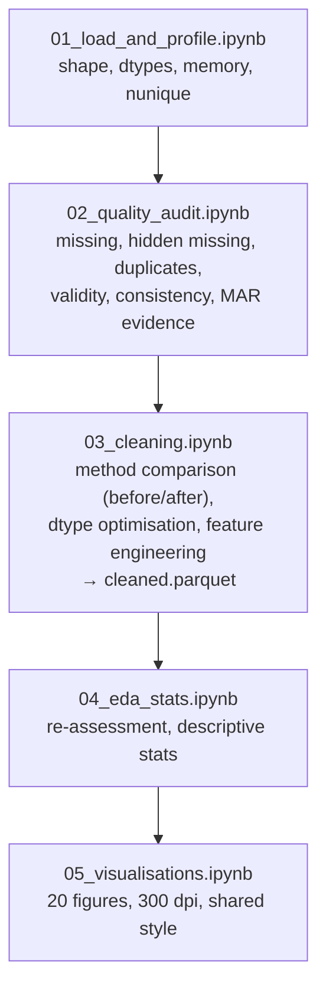

# Dataset Profile: `dataset_coursework1.csv`
## Data එකේ ඇත්ත තත්ත්වය සහ ඔයාලට පාවිච්චි කරන්න වෙන techniques (සිංහලෙන්)

> [!NOTE]
> මේ document එකේ තියෙන්නේ dataset එකේ **technical profile** එකක් විතරයි. ඒ කියන්නේ data එකේ තියෙන ගැටලු සහ ඒවා හොයන්න, හදන්න පාවිච්චි කරන්න වෙන Python techniques. **Research questions, graphs 20 සහ ඒවායේ interpretation මෙතන නැහැ.** Brief එකට අනුව ඒවා group එකේම වැඩ වෙන්න ඕන.
> මෙතන තියෙන අංක ඔයාලගේම notebook එකේ **ආයේ run කරලා confirm කරගන්න.** Report එකට දාන්න ඕන ඔයාලගේම code එකෙන් ආපු output එක.

---

## 1. Dataset එක කෙටියෙන්

| දේ | අගය |
|---|---|
| Rows | **508,106** |
| Columns | **30** |
| Disk size | ~185 MB |
| Memory (හැම column එකක්ම string විදියට) | **~782 MB** → Dtype optimisation අනිවාර්යයි |
| සම්පූර්ණ duplicate rows | **0** |
| Unique `Incident ID` | **467,601** |
| Unique `CR Number` | **467,534** (incidents වලට වඩා **67ක් අඩුයි**. සමහර CR numbers incidents කීපයකට පාවිච්චි වෙලා) |
| `(Incident ID, Offence Code)` duplicates | **0** → **එක row එකක් = එක incident එකක තියෙන එක offence එකක්** |

### Incident එකකට rows කීයද?
| Rows per incident | Incidents ගණන |
|---|---|
| 1 | 433,852 |
| 2 | 28,603 |
| 3 | 3,935 |
| 4 | 918 |
| 5 | 219 |
| 6–8 | 72 |

> [!IMPORTANT]
> Rows **40,505**ක් (8%) අයිති offences කීපයක් තියෙන incidents වලට. ඒ නිසා **rows ගණන (508k) ≠ incidents ගණන (467k)**. "Crime count" එකක් කියද්දී counting unit එක මොකක්ද කියලා report එකේ පැහැදිලිවම කියන්න.
> **Technique:** `df['Incident ID'].nunique()`, `df.groupby('Incident ID').size().value_counts()`, `df.duplicated(['Incident ID','Offence Code']).sum()`

---

## 2. Missing values: ඇත්ත තත්ත්වය

| Column | Missing | % | ස්වභාවය / සටහන |
|---|---|---|---|
| `Street Suffix` | 501,176 | **98.64%** | Structural. බොහෝ පාරවල් වලට suffix එකක් නැහැ. මේක "missing" නෙවෙයි "not applicable" |
| `Street Prefix` | 485,545 | **95.56%** | ඒකමයි (N/E/W/S තියෙන්නේ පාරවල් ටිකකට විතරයි) |
| `End_Date_Time` | 282,444 | **55.59%** | **MAR** වෙන්න පුළුවන්. Crime type එක අනුව missing rate එක වෙනස් වෙනවා (පහළ බලන්න) |
| `Dispatch Date / Time` | 73,405 | **14.45%** | **MAR**. අවුරුද්ද අනුව missing rate එක ගොඩක් වෙනස් වෙනවා (පහළ බලන්න) |
| `Block Address` | 39,804 | 7.83% | Location privacy හරි geocoding failure හරි වෙන්න පුළුවන් |
| `Address Number` | 39,661 | 7.81% | `Block Address` එකත් එක්ක ගැලපෙනවා |
| `State` | 9,509 | 1.87% | |
| `Zip Code` | 3,474 | 0.68% | |
| `Street Type` | 1,856 | 0.37% | |
| `Police District Name` | 1,542 | 0.30% | `Police District Number` = "Unknown" (1,557) එකත් එක්ක ගැලපෙනවා |
| `Street Name` | 1,467 | 0.29% | |
| `City` | 37 | 0.01% | |
| `PRA` | 9 | ~0% | |
| අනිත් columns 17 | 0 | 0% | Crime type, Victims, Place, Lat/Long, Start date වල NaN නැහැ |

> [!WARNING]
> **"Hidden missing" values:** `Latitude`/`Longitude` වල NaN **0** යි. හැබැයි **24,648 rows (4.85%) වල 0.0** තියෙනවා. ඒ කියන්නේ location එක නැහැ, ඒත් ඒක හැංගිලා තියෙන්නේ 0 කියන අගය පිටිපස්සේ. `isna()` එකෙන් විතරක් ඒක අල්ලගන්න බෑ.
> - `Police District Number` = `"Unknown"`, `Place` = `"Other/Unknown"` (40,895), `Police District Name` = `"OTHER"` වගේ **placeholder values** වෙනම හොයන්න ඕන.
>
> **Technique:** `(df['Latitude']==0).sum()`, `df.replace({'Unknown': np.nan})`, `value_counts(dropna=False)`

### Missing වෙන්නේ random ද? (MCAR vs MAR evidence)

**`Dispatch Date / Time` missing rate එක (start year එක අනුව):**

| අවුරුද්ද | 2016 | 2017 | 2018 | 2019 | 2020 | 2021 | 2022 | 2023 | 2024 | 2025 | 2026 |
|---|---|---|---|---|---|---|---|---|---|---|---|
| Missing % | **99.1** | 28.6 | 5.1 | 5.4 | 1.2 | 1.4 | 1.2 | 6.5 | 15.5 | 14.0 | 13.8 |

→ Dispatch dates තියෙන්නේ **2017-04-02** ඉඳන් විතරයි. 2016 එකට dispatch data නැහැ, ඒක **system/recording වෙනසක්**. ඒ කියන්නේ **MAR** (අවුරුද්දට සම්බන්ධයි), **MCAR නෙවෙයි**. Dispatch data පාවිච්චි කරන analysis එකක් කරනවා නම් ඒකට ගැලපෙන කාල සීමාවක් ගැන හිතන්න.

**`End_Date_Time` missing rate එක (`Crime Name1` එක අනුව):**

| Crime Name1 | Missing % |
|---|---|
| Crime Against Property | 41.4% |
| Crime Against Society | 68.6% |
| Crime Against Person | 69.6% |
| Crime Against Not a Crime | 73.7% |

→ Crime type එක අනුවත් missing rate එක වෙනස් වෙනවා. ඒ නිසා මේකත් **MAR**. මේ column එක **impute කරන එක සුදුසු නැහැ**.

> **Technique:** `df.groupby(df['Start'].dt.year)['Dispatch'].apply(lambda s: s.isna().mean())`, `pd.crosstab(df['Crime Name1'], df['End_Date_Time'].isna(), normalize='index')`, `missingno.matrix()` / `missingno.heatmap()`
> Report එකේ MCAR/MAR/MNAR සාකච්ඡාවට මේ වගේ **evidence tables** දැම්මොත් Distinction-level audit එකක් වෙනවා.

---

## 3. Data quality ගැටලු (Missing values හැර)

### 3.1 Date/Time ගැටලු
| ගැටලුව | ගණන | සටහන |
|---|---|---|
| Date format එක | `MM/DD/YYYY hh:mm:ss AM/PM` | `format="%m/%d/%Y %I:%M:%S %p"`. **Unparsable values 0** |
| Start date range එක | 2016-07-01 → **2026-09-14** | Brief එකේ කියන්නේ Sept **10** වෙනකම් කියලා. ඊට පස්සේ rows **227**ක් තියෙනවා |
| Partial years | 2016 (28,270, Jul–Dec විතරයි), 2026 (31,907, Jan–Sep විතරයි) | Annual comparisons වලදී මේ ගැන ප්‍රවේසම් වෙන්න |
| **`End < Start`** | **8,418** | තර්කානුකූල නැහැ. Invalid records |
| **`Dispatch < Start`** | **29,165** | සමහර ඒවා පැය කීපයක්, සමහර ඒවා අවුරුදු ගාණක් |
| Dispatch − Start delay | median **0.05 h** (~3 min), 75% = 15.7 h, 99% = 4,560 h, max = 83,898 h (~9.5 years), min = −51,784 h | **ඉතාම right-skewed**, extreme outliers තියෙනවා. Mean (202 h) එක තේරුමක් නැති අගයක් → **median/IQR** පාවිච්චි කරන්න |
| **Midnight spike** | Start time එක හරියටම **00:00:00** වෙන rows **21,760**යි | වෙලාව නොදන්න අවස්ථාවල default value එක වෙන්න පුළුවන්. Hour 0 = 36,843, hour 1 = 13,376 විතරයි |
| **Time heaping** | Start times වලින් **27.8%**ක minute = 0 | වෙලාවල් round කරලා report කරලා තියෙනවා (random නම් ~1.7% විතරයි වෙන්න ඕන) |

> [!TIP]
> **Midnight spike** එකයි **heaping** එකයි data quality report එකට හොඳ, "deep" findings. Hour-of-day analysis එකක් කරනවා නම් මේ artefact එක ගැන කියලා, ඒක handle කළේ කොහොමද කියලා justify කරන්න (උදා: 00:00:00 exclude කරලා sensitivity check එකක් කරන එක).
> **Technique:** `s.dt.hour.value_counts().sort_index()`, `((s.dt.hour==0)&(s.dt.minute==0)&(s.dt.second==0)).sum()`, `(s.dt.minute==0).mean()`

### 3.2 Geographic ගැටලු
| ගැටලුව | ගණන | සටහන |
|---|---|---|
| Lat/Long = 0 | **24,648 (4.85%)** | Hidden missing. Map එකක් ඇන්දොත් අප්‍රිකාව ළඟ (0,0) point එකක් පේනවා, scale එකත් විනාශ වෙනවා |
| ඉතුරු coordinates | Lat 38.93–39.35, Lon −77.52 – −76.91 | Montgomery County bounding box එක ඇතුළේ. 0 values අයින් කළාම **වෙන outliers නැහැ** |
| `Location` column එක | `"    (39.0457, -76.992)"` | Leading spaces තියෙනවා. Lat/Long වලම copy එකක් (**redundant**) |
| Coordinate precision | Unique Lat 18,956, Lon 4,372 විතරයි | Privacy නිසා round/generalise කරලා. ඒ නිසා overplotting වෙනවා → hexbin/alpha |

**Technique:** `df.loc[(df.Latitude==0)|(df.Longitude==0), ['Latitude','Longitude']] = np.nan`, `between()` එකෙන් bounding box check කරන එක

### 3.3 Categorical inconsistencies

**`City` (unique values 315, ඒකෙන් 153ක් එක පාරක් විතරයි එන්නේ):**
- **Spelling වැරදි:** `BETHESDA` → `BEHESDA`, `BEHTESDA`, `BETEHSDA`, `BETESDA`, `BETHEDA`, `BETHESA`, `BETHESDAS`, `BETHSDA`; `CHEVY CHASE` → `CEHVY CHASE`, `CHEVY CAHSE`, `CHEY CHASE`, `CHVEY CHASE`; `CLARKSBURG` → `CALARKSBURG`, `CLAEKSBURG`, `CLARKESBURG`, `CLARKSBUG`…
- **Invalid values:** `'0'`, `'1'`, `'2'`, `'3'`, `'AA'`, `'CC'`, සහ zip codes (`'20850'`)
- **Suffix noise:** `'BOWIE PG'`, `'ALEXANDRIA FX'`, `'CHEVY CHASE #3'` (county codes/සංඛ්‍යා එකතු වෙලා)
- Upper-case කරලා strip කළාම 314 → 313 විතරයි අඩු වෙන්නේ. ඒ කියන්නේ ප්‍රශ්නය **case** එක නෙවෙයි, **typos**

> [!TIP]
> **City cleaning techniques (සංසන්දනය කරන්න පුළුවන්):**
> 1. **Manual mapping dictionary** (`df['City'].replace({...})`): නිවැරදියි, ඒත් ගොඩක් වෙලා යනවා
> 2. **Fuzzy matching** (`difflib.get_close_matches`, `rapidfuzz`): auto. Threshold එකක් තෝරලා false matches check කරන්න ඕන
> 3. **Frequency threshold:** values N ට අඩු ඒවා "OTHER" කරන එක. සරලයි, ඒත් info නැති වෙනවා
> 4. **City එක පාවිච්චි කරන්නේ නැතුව** `Police District Name` (clean, values 8යි) පාවිච්චි කරන එක: spatial grouping වලට ගොඩක් හොඳ විකල්පයක්
>
> Rows කීයකට බලපෑවද කියලා අංක වලින් කියන්න.

**`State`:** `MD` 498,230; NaN 9,509; **`'16'` 224**, `'17'`, `'15'`, `'7'`, `'0'` (සංඛ්‍යා වැරදියට ඇතුළු වෙලා); `DC` 121, `VA` 12, `ME`, `MS`, `ND`, `MC` (typo). County එකේ dataset එකකට `MD` නොවන ඒවා ගොඩක් සැක සහිතයි.

**`Zip Code`:** Values 504,613ක් 5-digit. **4/3/1-digit values 19ක්** (`'2902'`, `'874'`, `'6'`) තියෙනවා. ඒ leading zero නැති වෙලා හරි වැරදියට type කරලා හරි. → Zip එක **string** එකක් විදියට load කරන්න (`dtype={'Zip Code': str}`).

**`Agency` (8):** `MCPD` 434,446 (85.5%), `RCPD` 28,878 (Rockville City PD), `GPD` 28,541 (Gaithersburg PD), `TPPD` 14,841 (Takoma Park PD), `MCFM` 1,237 (Fire Marshal), `MCSO` 156 (Sheriff), `OTHR` 4, **`P` 3** (සැක සහිතයි). Agency එක අනුව recording practices වෙනස් වෙන්න පුළුවන්. Scope එකේදී මේ ගැන තීරණයක් ගන්න.

**`Police District`:** Name ↔ Number mapping එක **1-to-1, සම්පූර්ණයෙන්ම consistent** (crosstab එකෙන් confirm වෙනවා). `OTHER` 15 + NaN 1,542 = "Unknown" 1,557. → Columns දෙකෙන් එකක් redundant. Number එකෙන් Name එකේ missing values fill කරන්න පුළුවන්ද කියලා check කරන්න (**derivation/lookup imputation**).

### 3.4 Crime classification
| Column | Unique | Hierarchy check |
|---|---|---|
| `Crime Name1` | **4** | Property 246,236 (48.5%), Society 202,327 (39.8%), Person 53,385 (10.5%), **"Crime Against Not a Crime" 6,158 (1.2%)** |
| `Crime Name2` / `NIBRS Code` | **54** / **54** | NIBRS → Name2 1-to-1 ✔, Name2 → Name1 1-to-1 ✔ (hierarchy එක **consistent**) |
| `Crime Name3` / `Offence Code` | **360** / **360** | Detailed local descriptions. Values 34ක් එක පාරක් විතරයි එන්නේ |

> [!WARNING]
> **Scope එකට වැදගත් දේවල්:**
> - **`All Other Offenses` (NIBRS 90Z) = rows 121,221 (23.9%)**. මේක එකම විශාලතම category එක, ඒත් generic "catch-all" එකක්.
> - `Crime Name3` එකේ **ඇත්තටම අපරාධ නොවන** records තියෙනවා: `POLICE INFORMATION` 33,174, `MENTAL ILLNESS - EMERGENCY PETITION` 19,739, `LOST PROPERTY` 17,917, `RECOVERED PROPERTY`…
> - "Crime Against Not a Crime" කියන category එකක්ම තියෙනවා.
>
> මේවා analysis එකට ඇතුළත් කරනවද නැද්ද කියන එක **scope decision** එකක්. ඒක justify කරලා rows කීයක් / % කීයක් බලපෑවද කියලා කියන්න.
> **Technique:** `value_counts()`, `groupby('Crime Name2')['Crime Name1'].nunique()` (hierarchy check එක), `isin([...])` filter එක

### 3.5 Numeric
**`Victims`:** 1 → 499,046 (98.2%), 2 → 7,704, 3 → 928, 4 → 288, 5–9 → 139, **22 → 1** (outlier, valid ද කියලා බලන්න). Zero/negative values නැහැ. Distribution එක ඉතාම skewed නිසා **mean එකට වඩා frequency table එක** වඩා අර්ථවත්.

### 3.6 Address
- `Street Prefix`/`Suffix` 95–99% හිස් → drop කරන්න හරි, `Street Name` එකට එකතු කරන්න හරි පුළුවන්
- `Block Address` = Address Number + Street කොටස්, **redundant**
- `Street Type` values 35යි (RD, AVE, DR…). `BLV`, `PIK`, `PKW` වගේ abbreviations තියෙනවා

---

## 4. Redundant / Low-value columns (Dimensionality reduction)

| Column | ඇයි | යෝජිත ක්‍රියාව |
|---|---|---|
| `Location` | Lat/Long වලම copy එකක් | Drop කරන්න (Lat/Long 0 නම් මේකෙනුත් values ලැබෙයිද කියලා check කරලා) |
| `Police District Number` | Name එකත් එක්ක 1-to-1 | Name එක fill කරන්න පාවිච්චි කරලා drop කරන්න |
| `NIBRS Code` ↔ `Crime Name2`, `Offence Code` ↔ `Crime Name3` | 1-to-1 mappings | Labels තියාගෙන codes drop කරන්න (නැත්නම් ඒ අනිත් පැත්ත) |
| `Street Prefix`, `Street Suffix` | 95%+ හිස් | Drop කරන්න |
| `Block Address`, `Address Number`, `Street *` | Lat/Long සහ District තියෙද්දී ගොඩක් granular | RQs වලට අවශ්‍ය නැත්නම් drop කරන්න |
| `State` | ~100% MD | Validation එකකට විතරක් පාවිච්චි කරන්න |
| `CR Number` | Identifier එකක් | Incident ID එකත් එක්ක consistency check එකකට විතරක් |

Columns 30 → ~15–18 දක්වා අඩු කරන්න පුළුවන්. Learning outcome එකේ තියෙන "dimensionality reduction" එකට මේක හොඳ උදාහරණයක්.

---

## 5. Dtype optimisation (Memory 782 MB → ගොඩක් අඩු කරන්න පුළුවන්)

| Column type | යෝජිත dtype | ඇයි |
|---|---|---|
| IDs, Zip, CR Number | `string` | Leading zeros, arithmetic එකක් අවශ්‍ය නැහැ |
| Low-cardinality text (Crime Name1/2, District, Agency, Place, Sector, Beat, Street Type) | `category` | Memory 90%+ අඩු වෙනවා, groupby වේගවත් වෙනවා |
| Datetimes (3) | `datetime64[ns]` | `.dt` accessor එක පාවිච්චි කරන්න පුළුවන් |
| `Victims` | `int8` | Max අගය 22යි |
| Lat/Long | `float32` | Precision එක ප්‍රමාණවත් |

```python
# technique pattern (ඔයාලගේ notebook එකට ගැලපෙන්න හදාගන්න)
df = pd.read_csv(path, dtype={'Incident ID': str, 'CR Number': str, 'Zip Code': str},
                 low_memory=False)
for c in ['Dispatch Date / Time', 'Start_Date_Time', 'End_Date_Time']:
    df[c] = pd.to_datetime(df[c], format='%m/%d/%Y %I:%M:%S %p', errors='coerce')
df[cat_cols] = df[cat_cols].astype('category')
print(df.memory_usage(deep=True).sum() / 1e6, 'MB')   # before/after පෙන්වන්න
df.to_parquet('cleaned.parquet')                       # group එකට share කරන්න
```

---

## 6. මේ dataset එකට අවශ්‍ය Python Toolkit එක

### 6.1 Libraries
| Library | පාවිච්චි කරන්නේ මොකටද |
|---|---|
| `pandas` | Load, clean, groupby, crosstab, datetime |
| `numpy` | `np.nan`, `np.where`, vectorised logic |
| `missingno` | Missing data matrix/heatmap (quality කොටසට) |
| `matplotlib` + `seaborn` | Visualisations (heatmap, box, FacetGrid) |
| `rapidfuzz` / `difflib` | City typos fuzzy matching |
| `pyarrow` | Parquet save/load |
| `folium` / `plotly` (optional) | Interactive maps. Report එකට screenshot එකක් |
| `scipy.stats` (optional) | Chi-square, Kruskal–Wallis, skewness |

### 6.2 Cleaning techniques (මේ data එකේ issues වලට අනුව)
| Issue | Technique (pandas) | සංසන්දනය කරන්න පුළුවන් විකල්ප |
|---|---|---|
| Lat/Long = 0 | `replace(0, np.nan)` → spatial analysis වලින් exclude කරන්න | Zip/District centroid එකකින් impute කරන එක (accuracy අඩුයි) |
| Dispatch missing (MAR, අවුරුද්ද අනුව) | Analysis-specific exclusion + කාල සීමාව සඳහන් කරන එක | Drop all / impute (සුදුසු නැහැ) |
| End missing 55% | Duration analysis වලට විතරක් non-null rows | Column drop කරන එක / Start එකෙන් fill කරන එක (bias එනවා) |
| End < Start, Dispatch < Start | Boolean mask එකකින් flag/exclude කරන එක | Swap කරන එක (සාක්ෂි නැහැ) |
| Extreme delays | IQR rule, percentile capping (`clip`), log scale | Drop කරන එක |
| Midnight spike | Flag column එකක් (`is_default_time`) + sensitivity check එකක් | Ignore කරන එක (hour analysis එක විකෘති වෙනවා) |
| City typos | Mapping dict / fuzzy match / District එක පාවිච්චි කරන එක | (Section 3.3 බලන්න) |
| State/Zip invalid | Validation rules (`str.len()==5`, `isin(['MD'])`) | |
| District name missing | Number එකෙන් lookup කරලා fill කරන එක | "Unknown" category එකක් |
| Non-crime records | `Crime Name1`/`Name3` එකෙන් filter කරන එක, scope එකේ justify කරලා | සියල්ල තියාගෙන label කරන එක |
| 2026-09-10 ට පස්සේ rows 227 | Date filter එකක් | තියාගන්න එක (brief එකේ period එකට ගැලපෙන්නේ නැහැ) |
| Partial years | Complete years විතරක් / monthly normalise කරන එක | Raw annual counts (misleading) |
| Multi-offence incidents | Incident-level table එකක් (`drop_duplicates('Incident ID')`) සහ offence-level table එකක් | Rows විතරක් ගණන් කරන එක |

### 6.3 Feature engineering (EDA transformations)
| අලුත් feature | Technique |
|---|---|
| Year, Month, Day of week, Hour | `s.dt.year`, `.dt.month`, `.dt.day_name()`, `.dt.hour` |
| Year-Month period | `s.dt.to_period('M')` |
| Weekend flag | `s.dt.dayofweek >= 5` |
| Time-of-day band | `pd.cut(hour, bins=[0,6,12,18,24], right=False, labels=[...])` |
| Season | Month → mapping dict |
| Dispatch delay | `(Dispatch - Start).dt.total_seconds()/3600` |
| Duration | `(End - Start)` |
| Place group | `Place.str.split(' - ').str[0]` (Residence / Street / Parking Lot / Retail…). Categories 100 → ~15 |
| Offences per incident | `groupby('Incident ID').transform('size')` |
| Valid location flag | Lat/Long ≠ 0 |

### 6.4 Descriptive / aggregation techniques
- `value_counts(normalize=True)`: categorical frequency + %
- `groupby([...]).size().unstack()`: pivot tables (heatmaps වලට)
- `pd.crosstab(a, b, normalize='index')`: row % (සාධාරණ සංසන්දනයක්)
- `resample('M')` / `rolling(12)`: time series smoothing
- `describe(percentiles=[...])`, `median`, `quantile`, `skew()`: skewed delays
- `nlargest(10)`: Top-N

### 6.5 Visualisation techniques (මේ data එකේ ස්වභාවයට ගැලපෙන)
| Data ලක්ෂණය | ගැලපෙන technique |
|---|---|
| Categories 54–360 (Crime Name2/3, Place) | **Top-N + "Other"**, sorted horizontal bar |
| Cyclical time (hour × weekday) | **Heatmap** (`sns.heatmap`) |
| දිගු time series (අවුරුදු 10, මාස 120+) | Line + rolling mean. Partial years highlight කරන්න |
| Points 480k+ (Lat/Long, rounded) | **Hexbin** / KDE / `alpha=0.02, s=1`. Lat/Long 0 අයින් කරන්න |
| Skewed delays | **Box plot (log scale)**, histogram (log), median markers |
| Groups කීපයක් (District 7, Crime type 4) | **Small multiples** (`sns.FacetGrid` / `catplot(col=...)`) |
| Categories දෙකක සම්බන්ධය | Crosstab **heatmap (row %)**, 100% stacked bar |
| Dominant category එකක් (Victims=1 98%) | Log-scale bar හරි table එකක් හරි. Plain pie එකක් එපා |

---

## 7. ඔයාලගේ notebook එකේ පිළිවෙළ (යෝජනාවක්)



**Quality audit table එකට ඔයාලගේ output එකේ තියෙන්න ඕන columns:**
`Issue | Column(s) | Detection code | Records | % of 508,106 | MCAR/MAR/MNAR | Decision | Justification | Alternative considered`

---

## 8. Report එකට ගන්න පුළුවන් Key Data Facts (ඔයාලගේ code එකෙන් ආයේ verify කරගන්න)

- Rows 508,106 / incidents 467,601 / multi-offence rows 40,505 (8%)
- Hidden missing: Lat/Long 0 → 24,648 (4.85%)
- End_Date_Time 55.6%, Dispatch 14.45% missing. Dispatch missing වීම අවුරුද්දට සම්බන්ධයි (2016 → 99%)
- End < Start → 8,418; Dispatch < Start → 29,165
- Midnight artefact 21,760; minute=0 heaping 27.8%
- City: unique values 315 (typos, සංඛ්‍යා, zip codes); State: invalid සංඛ්‍යා
- Crime hierarchy (NIBRS → Name2 → Name1) 100% consistent
- 90Z "All Other Offenses" 23.9%; non-crime categories තියෙනවා
- Brief එකේ period එකෙන් එළියේ (Sept 10 ට පස්සේ) rows 227
- Memory ~782 MB (raw strings), dtype optimisation අවශ්‍යයි

---

> [!CAUTION]
> **Generative AI declaration:** මේ profile එක AI එකකින් හදපු නිසා, report එකේ GAI Acknowledgement එකේ මේ වගේ දෙයක් සඳහන් කරන්න: *"used to aid understanding of the dataset's structure and quality issues; all analysis, code, figures and interpretations in the report were produced and verified by the group."* (ඒක **ඇත්ත වෙන විදියට** ලියන්න). මෙතන තියෙන අංක copy කරන්න එපා. ඔයාලගේම code එකෙන් ඒවා නැවත ගණනය කරන්න.
